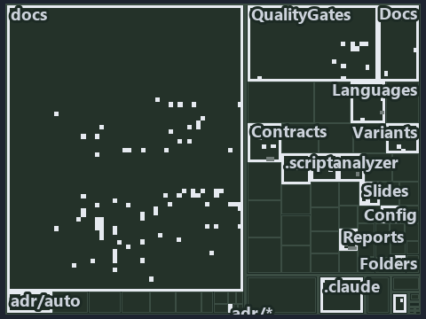

---
catzc:
  immutable:
    with_body_sha: "57ac2489ca56"
    repo_status: locked
    path: docs/explanation/automation/.assets/three-tests-prove-the-hook/tree.md
    source: docs/explanation/automation/.assets/three-tests-prove-the-hook/diagram.drawio.png
    role: asset-description
    language: markdown
    filetype: md
    track: docs
    tracktype: documentation
---

# One rule bounds every call, three tests prove the hook, and the exemption route is ADR-only: the tree minimap

```text
Which files cite ADR-AUTO-DEFAULT and ADR-AUTO-FAILFAST: every file of the world map is a tile, grouped by top-level folder.
135 files lit in 17 groups.
```



This is the tree minimap in the sidebar of the governance diagram of [One rule bounds every call, three tests prove the hook, and the
exemption route is ADR-only][136], which explains [ADR-AUTO-DEFAULT][1] and [ADR-AUTO-FAILFAST][2]. It lights every file that cites those
codes, grouped by folder, so it shows which files carry the decision. Each lit group has its reason below, naming the code that selects it.

## What the minimap shows

The tree draws every file of the world map as a tile, grouped by top-level folder (under `pwsh/` by module, under `docs/adr/` by ADR
domain), and lights 135 files in 17 groups, filled in ink. A lit ADR file has a white rim; a file lit only by passing mentions is a lighter
ink. Every other tile is idle, a grey box: a file the slide's ADR codes do not select.

- docs (docs/ outside docs/adr/): 77 lit files
- QualityGates (pwsh/Catzc.Base.QualityGates): 12 lit files
- Reports (pwsh/Catzc.Base.Reports): 7 lit files
- Contracts (pwsh/Catzc.Base.Contracts): 5 lit files
- Docs (pwsh/Catzc.Base.Docs): 5 lit files
- .claude: 4 lit files
- Languages (pwsh/Catzc.Base.Languages): 4 lit files
- Slides (pwsh/Catzc.Base.Slides): 4 lit files
- adr/auto (docs/adr/automation): 3 lit files
- Config (pwsh/Catzc.Base.Config): 3 lit files
- Folders (pwsh/Catzc.Base.Folders): 3 lit files
- adr/* (the files directly in docs/adr/): 2 lit files
- Variants (pwsh/Catzc.Base.Variants): 2 lit files
- pipelines: 1 lit file
- .scriptanalyzer (pwsh/.scriptanalyzer): 1 lit file
- Timeouts (pwsh/Catzc.Base.Timeouts): 1 lit file
- VSCode (pwsh/Catzc.Base.VSCode): 1 lit file

## Why each group is lit

### docs (docs/ outside docs/adr/, 77 lit files)

The group holds the files of docs/ outside docs/adr/; each sits in its world-map cell and is lit by:

- [docs/how-to/pwsh/manual-test-plan/repository-conventions.md][3], in the cell docs × markdown: selected by [ADR-AUTO-DEFAULT][1]: the file
  cites it at line 34 (text).
- [docs/references/pwsh/.assets/az-cli-test-assert-share-one-state/diagram.drawio.md][4], in the cell docs × markdown: selected by
  [ADR-AUTO-FAILFAST][2]: the file cites it at line 102 (text).
- [docs/references/pwsh/.assets/az-cli-test-assert-share-one-state/diagram.drawio.verify.md][5], in the cell docs × markdown: selected by
  [ADR-AUTO-FAILFAST][2]: the file cites it at line 63 (text).
- [docs/references/pwsh/.assets/azure-identity-resolves-from-config/diagram.drawio.verify.md][6], in the cell docs × markdown: selected by
  [ADR-AUTO-DEFAULT][1]: the file cites it at line 54 (text).
- [docs/references/pwsh/.assets/invoke-executable-two-paths-one-bounded/diagram.drawio.md][7], in the cell docs × markdown: selected by
  [ADR-AUTO-FAILFAST][2]: the file cites it at line 32 (text) and line 100 (text).
- [docs/references/pwsh/.assets/invoke-executable-two-paths-one-bounded/diagram.drawio.verify.md][8], in the cell docs × markdown: selected
  by [ADR-AUTO-FAILFAST][2]: the file cites it at line 45 (text), line 58 (text), line 61 (text), line 62 (text) and line 62 (text).
- [docs/references/pwsh/catzc-azure-cli/Assert-AzCliSubscriptionAccessible.ps1.md][9], in the cell docs × markdown: selected by
  [ADR-AUTO-FAILFAST][2]: the file cites it at line 22 (text).
- [docs/references/pwsh/catzc-azure/types/AzureConfig.cs.md][10], in the cell docs × markdown: selected by [ADR-AUTO-DEFAULT][1]: the file
  cites it at line 24 (text).
- [docs/references/pwsh/catzc-base-contracts/configs/contracts.yml.md][11], in the cell docs × markdown: selected by [ADR-AUTO-DEFAULT][1]:
  the file cites it at line 15 (text).
- [docs/references/pwsh/catzc-base-contracts/tests/types/ContractsConfig.Tests.ps1.md][12], in the cell docs × markdown: selected by
  [ADR-AUTO-DEFAULT][1]: the file cites it at line 12 (text).
- [docs/references/pwsh/catzc-base-contracts/types/ContractsConfig.cs.md][13], in the cell docs × markdown: selected by
  [ADR-AUTO-DEFAULT][1]: the file cites it at line 13 (text).
- [docs/references/pwsh/catzc-base-docs/Test-Glossary.ps1.md][14], in the cell docs × markdown: selected by [ADR-AUTO-FAILFAST][2]: the file
  cites it at line 27 (text).
- [docs/references/pwsh/catzc-base-docs/configs/adr-checks.yml.md][15], in the cell docs × markdown: selected by [ADR-AUTO-DEFAULT][1]: the
  file cites it at line 13 (text).
- [docs/references/pwsh/catzc-base-docs/private/Import-AdrCitationMapFile.ps1.md][16], in the cell docs × markdown: selected by
  [ADR-AUTO-FAILFAST][2]: the file cites it at line 15 (text).
- [docs/references/pwsh/catzc-base-docs/tests/Test-Glossary.Tests.ps1.md][17], in the cell docs × markdown: selected by
  [ADR-AUTO-FAILFAST][2]: the file cites it at line 13 (text).
- [docs/references/pwsh/catzc-base-docs/types/AdrChecksConfig.cs.md][18], in the cell docs × markdown: selected by [ADR-AUTO-DEFAULT][1]:
  the file cites it at line 12 (text).
- [docs/references/pwsh/catzc-base-docs/types/AdrsConfig.cs.md][19], in the cell docs × markdown: selected by [ADR-AUTO-DEFAULT][1]: the
  file cites it at line 37 (text).
- [docs/references/pwsh/catzc-base-docs/types/CheckMode.cs.md][20], in the cell docs × markdown: selected by [ADR-AUTO-DEFAULT][1]: the file
  cites it at line 19 (text).
- [docs/references/pwsh/catzc-base-docs/types/CheckModes.cs.md][21], in the cell docs × markdown: selected by [ADR-AUTO-DEFAULT][1]: the
  file cites it at line 15 (text).
- [docs/references/pwsh/catzc-base-engines/types/ExecutionEngine.cs.md][22], in the cell docs × markdown: selected by
  [ADR-AUTO-FAILFAST][2]: the file cites it at line 37 (text).
- [docs/references/pwsh/catzc-base-folders/tests/types/FolderWalkConfig.Tests.ps1.md][23], in the cell docs × markdown: selected by
  [ADR-AUTO-DEFAULT][1]: the file cites it at line 12 (text).
- [docs/references/pwsh/catzc-base-git/Import-RepositoryWithHistory.ps1.md][24], in the cell docs × markdown: selected by
  [ADR-AUTO-DEFAULT][1]: the file cites it at line 20 (text); selected by [ADR-AUTO-FAILFAST][2]: the file cites it at line 23 (text).
- [docs/references/pwsh/catzc-base-globs/Test-GlobSetAffected.ps1.md][25], in the cell docs × markdown: selected by [ADR-AUTO-FAILFAST][2]:
  the file cites it at line 26 (text).
- [docs/references/pwsh/catzc-base-languages.md][26], in the cell docs × markdown: selected by [ADR-AUTO-DEFAULT][1]: the file cites it at
  line 49 (text).
- [docs/references/pwsh/catzc-base-languages/configs/file-carriers.yml.md][27], in the cell docs × markdown: selected by
  [ADR-AUTO-DEFAULT][1]: the file cites it at line 14 (text).
- [docs/references/pwsh/catzc-base-languages/configs/go.yml.md][28], in the cell docs × markdown: selected by [ADR-AUTO-DEFAULT][1]: the
  file cites it at line 16 (text).
- [docs/references/pwsh/catzc-base-languages/configs/languages.yml.md][29], in the cell docs × markdown: selected by [ADR-AUTO-DEFAULT][1]:
  the file cites it at line 41 (text).
- [docs/references/pwsh/catzc-base-languages/configs/python.yml.md][30], in the cell docs × markdown: selected by [ADR-AUTO-DEFAULT][1]: the
  file cites it at line 18 (text).
- [docs/references/pwsh/catzc-base-languages/types/FileCarrier.cs.md][31], in the cell docs × markdown: selected by [ADR-AUTO-DEFAULT][1]:
  the file cites it at line 13 (text).
- [docs/references/pwsh/catzc-base-languages/types/FileCarriersConfig.cs.md][32], in the cell docs × markdown: selected by
  [ADR-AUTO-DEFAULT][1]: the file cites it at line 14 (text).
- [docs/references/pwsh/catzc-base-languages/types/GoConfig.cs.md][33], in the cell docs × markdown: selected by [ADR-AUTO-DEFAULT][1]: the
  file cites it at line 13 (text).
- [docs/references/pwsh/catzc-base-languages/types/LanguagesConfig.cs.md][34], in the cell docs × markdown: selected by
  [ADR-AUTO-DEFAULT][1]: the file cites it at line 26 (text).
- [docs/references/pwsh/catzc-base-maps/configs/maps.yml.md][35], in the cell docs × markdown: selected by [ADR-AUTO-DEFAULT][1]: the file
  cites it at line 15 (text).
- [docs/references/pwsh/catzc-base-maps/types/MapsConfig.cs.md][36], in the cell docs × markdown: selected by [ADR-AUTO-DEFAULT][1]: the
  file cites it at line 19 (text).
- [docs/references/pwsh/catzc-base-maps/types/MapsHighlight.cs.md][37], in the cell docs × markdown: selected by [ADR-AUTO-DEFAULT][1]: the
  file cites it at line 17 (text).
- [docs/references/pwsh/catzc-base-maps/types/MapsLabels.cs.md][38], in the cell docs × markdown: selected by [ADR-AUTO-DEFAULT][1]: the
  file cites it at line 25 (text).
- [docs/references/pwsh/catzc-base-maps/types/MapsLimits.cs.md][39], in the cell docs × markdown: selected by [ADR-AUTO-DEFAULT][1]: the
  file cites it at line 15 (text).
- [docs/references/pwsh/catzc-base-maps/types/MapsPalette.cs.md][40], in the cell docs × markdown: selected by [ADR-AUTO-DEFAULT][1]: the
  file cites it at line 15 (text).
- [docs/references/pwsh/catzc-base-qualitygates/Test-ShippedConfigs.ps1.md][41], in the cell docs × markdown: selected by
  [ADR-AUTO-DEFAULT][1]: the file cites it at line 49 (text).
- [docs/references/pwsh/catzc-base-qualitygates/configs/comments.yml.md][42], in the cell docs × markdown: selected by
  [ADR-AUTO-DEFAULT][1]: the file cites it at line 17 (text).
- [docs/references/pwsh/catzc-base-qualitygates/configs/file-meta.yml.md][43], in the cell docs × markdown: selected by
  [ADR-AUTO-DEFAULT][1]: the file cites it at line 13 (text).
- [docs/references/pwsh/catzc-base-qualitygates/configs/links.yml.md][44], in the cell docs × markdown: selected by [ADR-AUTO-DEFAULT][1]:
  the file cites it at line 15 (text).
- [docs/references/pwsh/catzc-base-qualitygates/configs/parameter-consistency.yml.md][45], in the cell docs × markdown: selected by
  [ADR-AUTO-DEFAULT][1]: the file cites it at line 18 (text).
- [docs/references/pwsh/catzc-base-qualitygates/configs/source-conventions.yml.md][46], in the cell docs × markdown: selected by
  [ADR-AUTO-DEFAULT][1]: the file cites it at line 17 (text).
- [docs/references/pwsh/catzc-base-qualitygates/configs/test-policy.yml.md][47], in the cell docs × markdown: selected by
  [ADR-AUTO-DEFAULT][1]: the file cites it at line 15 (text).
- [docs/references/pwsh/catzc-base-qualitygates/private/Get-LinkLineLimit.ps1.md][48], in the cell docs × markdown: selected by
  [ADR-AUTO-DEFAULT][1]: the file cites it at line 16 (text).
- [docs/references/pwsh/catzc-base-qualitygates/private/Test-TestRunOverBudget.ps1.md][49], in the cell docs × markdown: selected by
  [ADR-AUTO-FAILFAST][2]: the file cites it at line 17 (text).
- [docs/references/pwsh/catzc-base-qualitygates/private/Write-TestAutomationVerdict.ps1.md][50], in the cell docs × markdown: selected by
  [ADR-AUTO-FAILFAST][2]: the file cites it at line 26 (text).
- [docs/references/pwsh/catzc-base-qualitygates/tests/types/CommentsConfig.Tests.ps1.md][51], in the cell docs × markdown: selected by
  [ADR-AUTO-DEFAULT][1]: the file cites it at line 12 (text).
- [docs/references/pwsh/catzc-base-qualitygates/tests/types/FileMetaConfig.Tests.ps1.md][52], in the cell docs × markdown: selected by
  [ADR-AUTO-DEFAULT][1]: the file cites it at line 12 (text).
- [docs/references/pwsh/catzc-base-qualitygates/tests/types/LinksConfig.Tests.ps1.md][53], in the cell docs × markdown: selected by
  [ADR-AUTO-DEFAULT][1]: the file cites it at line 12 (text).
- [docs/references/pwsh/catzc-base-qualitygates/tests/types/SourceCheck.Tests.ps1.md][54], in the cell docs × markdown: selected by
  [ADR-AUTO-DEFAULT][1]: the file cites it at line 12 (text).
- [docs/references/pwsh/catzc-base-qualitygates/tests/types/SourceConventionsConfig.Tests.ps1.md][55], in the cell docs × markdown: selected
  by [ADR-AUTO-DEFAULT][1]: the file cites it at line 12 (text).
- [docs/references/pwsh/catzc-base-qualitygates/types/CommentsConfig.cs.md][56], in the cell docs × markdown: selected by
  [ADR-AUTO-DEFAULT][1]: the file cites it at line 13 (text).
- [docs/references/pwsh/catzc-base-qualitygates/types/EngineSetCheck.cs.md][57], in the cell docs × markdown: selected by
  [ADR-AUTO-DEFAULT][1]: the file cites it at line 22 (text).
- [docs/references/pwsh/catzc-base-qualitygates/types/FileMetaKind.cs.md][58], in the cell docs × markdown: selected by
  [ADR-AUTO-DEFAULT][1]: the file cites it at line 13 (text).
- [docs/references/pwsh/catzc-base-qualitygates/types/GeneratedWriter.cs.md][59], in the cell docs × markdown: selected by
  [ADR-AUTO-DEFAULT][1]: the file cites it at line 11 (text).
- [docs/references/pwsh/catzc-base-qualitygates/types/LinksConfig.cs.md][60], in the cell docs × markdown: selected by
  [ADR-AUTO-DEFAULT][1]: the file cites it at line 15 (text).
- [docs/references/pwsh/catzc-base-qualitygates/types/ParameterConsistencyConfig.cs.md][61], in the cell docs × markdown: selected by
  [ADR-AUTO-DEFAULT][1]: the file cites it at line 13 (text).
- [docs/references/pwsh/catzc-base-qualitygates/types/SourceCheck.cs.md][62], in the cell docs × markdown: selected by
  [ADR-AUTO-DEFAULT][1]: the file cites it at line 13 (text).
- [docs/references/pwsh/catzc-base-qualitygates/types/SourceConventionsConfig.cs.md][63], in the cell docs × markdown: selected by
  [ADR-AUTO-DEFAULT][1]: the file cites it at line 13 (text).
- [docs/references/pwsh/catzc-base-qualitygates/types/TestPolicyConfig.cs.md][64], in the cell docs × markdown: selected by
  [ADR-AUTO-DEFAULT][1]: the file cites it at line 13 (text).
- [docs/references/pwsh/catzc-base-timeouts/Get-TestTimeLimits.ps1.md][65], in the cell docs × markdown: selected by [ADR-AUTO-FAILFAST][2]:
  the file cites it at line 16 (text).
- [docs/references/pwsh/catzc-base-timeouts/Watch-Blocking.ps1.md][66], in the cell docs × markdown: selected by [ADR-AUTO-FAILFAST][2]: the
  file cites it at line 24 (text), line 25 (text) and line 27 (text).
- [docs/references/pwsh/catzc-base-timeouts/types/BashSafeguard.cs.md][67], in the cell docs × markdown: selected by [ADR-AUTO-FAILFAST][2]:
  the file cites it at line 12 (text).
- [docs/references/pwsh/catzc-base-timeouts/types/TimeoutExemptionsConfig.cs.md][68], in the cell docs × markdown: selected by
  [ADR-AUTO-DEFAULT][1]: the file cites it at line 19 (text).
- [docs/references/pwsh/catzc-base-timeouts/types/TimeoutsConfig.cs.md][69], in the cell docs × markdown: selected by [ADR-AUTO-DEFAULT][1]:
  the file cites it at line 22 (text).
- [docs/references/pwsh/catzc-base-typessystem.md][70], in the cell docs × markdown: selected by [ADR-AUTO-FAILFAST][2]: the file cites it
  at line 64 (text).
- [docs/references/pwsh/catzc-base-typessystem/Assert-LoadedTypesCurrent.ps1.md][71], in the cell docs × markdown: selected by
  [ADR-AUTO-FAILFAST][2]: the file cites it at line 15 (text).
- [docs/references/pwsh/catzc-base-typessystem/Build-BashTimeoutHook.ps1.md][72], in the cell docs × markdown: selected by
  [ADR-AUTO-FAILFAST][2]: the file cites it at line 15 (text).
- [docs/references/pwsh/catzc-base-variants/private/Get-Variant.ps1.md][73], in the cell docs × markdown: selected by [ADR-AUTO-DEFAULT][1]:
  the file cites it at line 18 (text).
- [docs/references/pwsh/catzc-base-variants/types/VariantsConfig.cs.md][74], in the cell docs × markdown: selected by [ADR-AUTO-DEFAULT][1]:
  the file cites it at line 57 (text).
- [docs/references/pwsh/catzc-tooling-inspiration/Get-Inspiration.ps1.md][75], in the cell docs × markdown: selected by
  [ADR-AUTO-DEFAULT][1]: the file cites it at line 15 (text).
- [docs/references/pwsh/catzc-tooling-inspiration/configs/inspiration.yml.md][76], in the cell docs × markdown: selected by
  [ADR-AUTO-DEFAULT][1]: the file cites it at line 15 (text).
- [docs/references/pwsh/catzc-tooling-inspiration/tests/types/InspirationConfig.Tests.ps1.md][77], in the cell docs × markdown: selected by
  [ADR-AUTO-DEFAULT][1]: the file cites it at line 13 (text).
- [docs/references/pwsh/catzc-tooling-inspiration/types/InspirationConfig.cs.md][78], in the cell docs × markdown: selected by
  [ADR-AUTO-DEFAULT][1]: the file cites it at line 18 (text).
- [docs/references/pwsh/claude-hooks/Assert-BashTimeout/Program.cs.md][79], in the cell docs × markdown: selected by [ADR-AUTO-FAILFAST][2]:
  the file cites it at line 12 (text) and line 39 (text).

### QualityGates (pwsh/Catzc.Base.QualityGates, 12 lit files)

The group holds the files of pwsh/Catzc.Base.QualityGates; each sits in its world-map cell and is lit by:

- [pwsh/Catzc.Base.QualityGates/configs/analyzer-adr-map.yml][80], in the cell pwsh × yaml: selected by [ADR-AUTO-DEFAULT][1]: the file
  cites it at line 33 (text).
- [pwsh/Catzc.Base.QualityGates/tests/Get-AdrCodesFileMetaFact.Tests.ps1][81], in the cell pwsh × powershell: selected by
  [ADR-AUTO-DEFAULT][1]: the file cites it at line 159 (text).
- [pwsh/Catzc.Base.QualityGates/tests/Test-ShippedConfigs.Tests.ps1][82], in the cell pwsh × powershell: selected by [ADR-AUTO-DEFAULT][1]:
  the file cites it at line 57 (text).
- [pwsh/Catzc.Base.QualityGates/tests/types/CommentsConfig.Tests.ps1][83], in the cell pwsh × powershell: selected by [ADR-AUTO-DEFAULT][1]:
  the file cites it at line 2 (text), line 98 (text) and line 102 (text).
- [pwsh/Catzc.Base.QualityGates/tests/types/EngineSetCheck.Tests.ps1][84], in the cell pwsh × powershell: selected by [ADR-AUTO-DEFAULT][1]:
  the file cites it at line 6 (text).
- [pwsh/Catzc.Base.QualityGates/tests/types/FileHeadPolicy.Tests.ps1][85], in the cell pwsh × powershell: selected by [ADR-AUTO-DEFAULT][1]:
  the file cites it at line 2 (text).
- [pwsh/Catzc.Base.QualityGates/tests/types/FileMetaConfig.Tests.ps1][86], in the cell pwsh × powershell: selected by [ADR-AUTO-DEFAULT][1]:
  the file cites it at line 16 (text) and line 66 (text).
- [pwsh/Catzc.Base.QualityGates/tests/types/LinksConfig.Tests.ps1][87], in the cell pwsh × powershell: selected by [ADR-AUTO-DEFAULT][1]:
  the file cites it at line 2 (text).
- [pwsh/Catzc.Base.QualityGates/tests/types/PlansConfig.Tests.ps1][88], in the cell pwsh × powershell: selected by [ADR-AUTO-DEFAULT][1]:
  the file cites it at line 1 (text).
- [pwsh/Catzc.Base.QualityGates/tests/types/SourceCheck.Tests.ps1][89], in the cell pwsh × powershell: selected by [ADR-AUTO-DEFAULT][1]:
  the file cites it at line 2 (text).
- [pwsh/Catzc.Base.QualityGates/tests/types/SourceConventionsConfig.Tests.ps1][90], in the cell pwsh × powershell: selected by
  [ADR-AUTO-DEFAULT][1]: the file cites it at line 3 (text) and line 27 (text).
- [pwsh/Catzc.Base.QualityGates/types/PlansConfig.cs][91], in the cell pwsh × csharp: selected by [ADR-AUTO-DEFAULT][1]: the file cites it
  at line 1 (header).

### Reports (pwsh/Catzc.Base.Reports, 7 lit files)

The group holds the files of pwsh/Catzc.Base.Reports; each sits in its world-map cell and is lit by:

- [pwsh/Catzc.Base.Reports/tests/types/IsolationRunResult.Tests.ps1][92], in the cell pwsh × powershell: selected by [ADR-AUTO-DEFAULT][1]:
  the file cites it at line 16 (text).
- [pwsh/Catzc.Base.Reports/tests/types/OutputFormatsConfig.Tests.ps1][93], in the cell pwsh × powershell: selected by [ADR-AUTO-DEFAULT][1]:
  the file cites it at line 43 (text) and line 65 (text).
- [pwsh/Catzc.Base.Reports/tests/types/QualityGateResult.Tests.ps1][94], in the cell pwsh × powershell: selected by [ADR-AUTO-DEFAULT][1]:
  the file cites it at line 14 (text).
- [pwsh/Catzc.Base.Reports/tests/types/TestRunResult.Tests.ps1][95], in the cell pwsh × powershell: selected by [ADR-AUTO-DEFAULT][1]: the
  file cites it at line 21 (text).
- [pwsh/Catzc.Base.Reports/types/IsolationRunResult.cs][96], in the cell pwsh × csharp: selected by [ADR-AUTO-DEFAULT][1]: the file cites it
  at line 6 (body comment) (a passing mention only).
- [pwsh/Catzc.Base.Reports/types/QualityGateResult.cs][97], in the cell pwsh × csharp: selected by [ADR-AUTO-DEFAULT][1]: the file cites it
  at line 8 (body comment) (a passing mention only).
- [pwsh/Catzc.Base.Reports/types/TestRunResult.cs][98], in the cell pwsh × csharp: selected by [ADR-AUTO-DEFAULT][1]: the file cites it at
  line 6 (body comment) (a passing mention only).

### Contracts (pwsh/Catzc.Base.Contracts, 5 lit files)

The group holds the files of pwsh/Catzc.Base.Contracts; each sits in its world-map cell and is lit by:

- [pwsh/Catzc.Base.Contracts/tests/Get-Contract.Tests.ps1][99], in the cell pwsh × powershell: selected by [ADR-AUTO-DEFAULT][1]: the file
  cites it at line 93 (text), line 261 (text) and line 277 (text).
- [pwsh/Catzc.Base.Contracts/tests/types/ContractCommand.Tests.ps1][100], in the cell pwsh × powershell: selected by [ADR-AUTO-DEFAULT][1]:
  the file cites it at line 28 (text) and line 92 (text).
- [pwsh/Catzc.Base.Contracts/tests/types/ContractsConfig.Tests.ps1][101], in the cell pwsh × powershell: selected by [ADR-AUTO-DEFAULT][1]:
  the file cites it at line 2 (text) and line 26 (text).
- [pwsh/Catzc.Base.Contracts/types/ContractCommand.cs][102], in the cell pwsh × csharp: selected by [ADR-AUTO-DEFAULT][1]: the file cites it
  at line 8 (body comment) (a passing mention only).
- [pwsh/Catzc.Base.Contracts/types/ContractParameter.cs][103], in the cell pwsh × csharp: selected by [ADR-AUTO-DEFAULT][1]: the file cites
  it at line 9 (body comment) (a passing mention only).

### Docs (pwsh/Catzc.Base.Docs, 5 lit files)

The group holds the files of pwsh/Catzc.Base.Docs; each sits in its world-map cell and is lit by:

- [pwsh/Catzc.Base.Docs/configs/adrs.yml][104], in the cell pwsh × yaml: selected by [ADR-AUTO-DEFAULT][1]: the file cites it at line 131
  (text); selected by [ADR-AUTO-FAILFAST][2]: the file cites it at line 132 (text).
- [pwsh/Catzc.Base.Docs/configs/agents.yml][105], in the cell pwsh × yaml: selected by [ADR-AUTO-FAILFAST][2]: the file cites it at line 55
  (text) and line 76 (text).
- [pwsh/Catzc.Base.Docs/configs/capabilities.yml][106], in the cell pwsh × yaml: selected by [ADR-AUTO-DEFAULT][1]: the file cites it at
  line 17 (text); selected by [ADR-AUTO-FAILFAST][2]: the file cites it at line 4 (text).
- [pwsh/Catzc.Base.Docs/tests/types/AdrChecksConfig.Tests.ps1][107], in the cell pwsh × powershell: selected by [ADR-AUTO-DEFAULT][1]: the
  file cites it at line 2 (text).
- [pwsh/Catzc.Base.Docs/tests/types/CheckModes.Tests.ps1][108], in the cell pwsh × powershell: selected by [ADR-AUTO-DEFAULT][1]: the file
  cites it at line 2 (text).

### .claude (4 lit files)

The group holds the files of .claude; each sits in its world-map cell and is lit by:

- [.claude/CLAUDE.md][109], in the cell .claude × markdown: selected by [ADR-AUTO-DEFAULT][1]: the file cites it at line 51 (text); selected
  by [ADR-AUTO-FAILFAST][2]: the file cites it at line 121 (text).
- [.claude/plans/plan-layers-vocabulary-rename-contracts.md][110], in the cell .claude × markdown: selected by [ADR-AUTO-DEFAULT][1]: the
  file cites it at line 82 (text) and line 84 (text).
- [.claude/plans/plan-test-run-budget.md][111], in the cell .claude × markdown: selected by [ADR-AUTO-FAILFAST][2]: the file cites it at
  line 84 (text).
- [.claude/skills/catzc-module/SKILL.md][112], in the cell .claude × markdown: selected by [ADR-AUTO-DEFAULT][1]: the file cites it at line
  26 (text) and line 41 (text).

### Languages (pwsh/Catzc.Base.Languages, 4 lit files)

The group holds the files of pwsh/Catzc.Base.Languages; each sits in its world-map cell and is lit by:

- [pwsh/Catzc.Base.Languages/tests/Get-EngineContract.Tests.ps1][113], in the cell pwsh × powershell: selected by [ADR-AUTO-FAILFAST][2]:
  the file cites it at line 30 (text).
- [pwsh/Catzc.Base.Languages/tests/types/FileCarriersConfig.Tests.ps1][114], in the cell pwsh × powershell: selected by
  [ADR-AUTO-DEFAULT][1]: the file cites it at line 31 (text).
- [pwsh/Catzc.Base.Languages/tests/types/LanguagesConfig.Tests.ps1][115], in the cell pwsh × powershell: selected by [ADR-AUTO-DEFAULT][1]:
  the file cites it at line 169 (text).
- [pwsh/Catzc.Base.Languages/types/LayoutRow.cs][116], in the cell pwsh × csharp: selected by [ADR-AUTO-DEFAULT][1]: the file cites it at
  line 6 (body comment) (a passing mention only).

### Slides (pwsh/Catzc.Base.Slides, 4 lit files)

The group holds the files of pwsh/Catzc.Base.Slides; each sits in its world-map cell and is lit by:

- [pwsh/Catzc.Base.Slides/tests/Build-SlideDeck.Tests.ps1][117], in the cell pwsh × powershell: selected by [ADR-AUTO-FAILFAST][2]: the file
  cites it at line 152 (text) and line 160 (text).
- [pwsh/Catzc.Base.Slides/tests/Test-Slides.Tests.ps1][118], in the cell pwsh × powershell: selected by [ADR-AUTO-FAILFAST][2]: the file
  cites it at line 46 (text).
- [pwsh/Catzc.Base.Slides/tests/types/SlidesConfig.Tests.ps1][119], in the cell pwsh × powershell: selected by [ADR-AUTO-DEFAULT][1]: the
  file cites it at line 2 (text), line 7 (text) and line 46 (text).
- [pwsh/Catzc.Base.Slides/tests/types/SlidesKit.Tests.ps1][120], in the cell pwsh × powershell: selected by [ADR-AUTO-DEFAULT][1]: the file
  cites it at line 19 (text).

### adr/auto (docs/adr/automation, 3 lit files)

The group holds the files of docs/adr/automation; each sits in its world-map cell and is lit by:

- [docs/adr/automation/dora-explains.md][121], in the cell docs × markdown: selected by [ADR-AUTO-DEFAULT][1]: the file cites it at line 243
  (text); selected by [ADR-AUTO-FAILFAST][2]: the file cites it at line 260 (text).
- [docs/adr/automation/fail-fast-with-asserts.md][2], in the cell docs × markdown: selected by [ADR-AUTO-FAILFAST][2]: the ADR's own file.
- [docs/adr/automation/sensible-defaults.md][1], in the cell docs × markdown: selected by [ADR-AUTO-DEFAULT][1]: the ADR's own file.

### Config (pwsh/Catzc.Base.Config, 3 lit files)

The group holds the files of pwsh/Catzc.Base.Config; each sits in its world-map cell and is lit by:

- [pwsh/Catzc.Base.Config/configs/glossary.yml][122], in the cell pwsh × yaml: selected by [ADR-AUTO-DEFAULT][1]: the file cites it at line
  5 (text).
- [pwsh/Catzc.Base.Config/tests/Get-Config.Tests.ps1][123], in the cell pwsh × powershell: selected by [ADR-AUTO-DEFAULT][1]: the file cites
  it at line 174 (text), line 248 (text) and line 262 (text).
- [pwsh/Catzc.Base.Config/types/ConfigDefaultDifference.cs][124], in the cell pwsh × csharp: selected by [ADR-AUTO-DEFAULT][1]: the file
  cites it at line 10 (body comment) (a passing mention only).

### Folders (pwsh/Catzc.Base.Folders, 3 lit files)

The group holds the files of pwsh/Catzc.Base.Folders; each sits in its world-map cell and is lit by:

- [pwsh/Catzc.Base.Folders/tests/Get-ChildPath.Tests.ps1][125], in the cell pwsh × powershell: selected by [ADR-AUTO-DEFAULT][1]: the file
  cites it at line 63 (text) and line 69 (text); selected by [ADR-AUTO-FAILFAST][2]: the file cites it at line 47 (text).
- [pwsh/Catzc.Base.Folders/tests/types/FolderWalkConfig.Tests.ps1][126], in the cell pwsh × powershell: selected by [ADR-AUTO-DEFAULT][1]:
  the file cites it at line 2 (text), line 9 (text) and line 50 (text).
- [pwsh/Catzc.Base.Folders/tests/types/FolderWalker.Tests.ps1][127], in the cell pwsh × powershell: selected by [ADR-AUTO-DEFAULT][1]: the
  file cites it at line 23 (text); selected by [ADR-AUTO-FAILFAST][2]: the file cites it at line 64 (text).

### adr/* (the files directly in docs/adr/, 2 lit files)

The group holds the files of the files directly in docs/adr/; each sits in its world-map cell and is lit by:

- [docs/adr/glossary.md][128], in the cell docs × markdown: selected by [ADR-AUTO-DEFAULT][1]: the file cites it at line 783 (text).
- [docs/adr/index.md][129], in the cell docs × markdown: selected by [ADR-AUTO-DEFAULT][1]: the file cites it at line 162 (text); selected
  by [ADR-AUTO-FAILFAST][2]: the file cites it at line 163 (text).

### Variants (pwsh/Catzc.Base.Variants, 2 lit files)

The group holds the files of pwsh/Catzc.Base.Variants; each sits in its world-map cell and is lit by:

- [pwsh/Catzc.Base.Variants/tests/Get-Track.Tests.ps1][130], in the cell pwsh × powershell: selected by [ADR-AUTO-DEFAULT][1]: the file
  cites it at line 65 (text).
- [pwsh/Catzc.Base.Variants/tests/types/VariantsConfig.Tests.ps1][131], in the cell pwsh × powershell: selected by [ADR-AUTO-DEFAULT][1]:
  the file cites it at line 31 (text), line 41 (text) and line 50 (text).

### pipelines (1 lit file)

The group holds the files of pipelines; each sits in its world-map cell and is lit by:

- [pipelines/ci-automation.yaml][132], in the cell pipelines × pipeline-yaml: selected by [ADR-AUTO-DEFAULT][1]: a pipeline that cites
  nothing itself carries its globset's citations, which cite it at `pwsh/.scriptanalyzer/tests/NoLiteralDefault.Tests.ps1` line 1 (text),
  `pwsh/Catzc.Base.Config/configs/glossary.yml` line 5 (text), `pwsh/Catzc.Base.Config/tests/Get-Config.Tests.ps1` line 174 (text),
  `pwsh/Catzc.Base.Config/tests/Get-Config.Tests.ps1` line 248 (text), `pwsh/Catzc.Base.Config/tests/Get-Config.Tests.ps1` line 262 (text),
  `pwsh/Catzc.Base.Config/types/ConfigDefaultDifference.cs` line 10 (body comment), `pwsh/Catzc.Base.Contracts/tests/Get-Contract.Tests.ps1`
  line 93 (text), `pwsh/Catzc.Base.Contracts/tests/Get-Contract.Tests.ps1` line 261 (text),
  `pwsh/Catzc.Base.Contracts/tests/Get-Contract.Tests.ps1` line 277 (text),
  `pwsh/Catzc.Base.Contracts/tests/types/ContractCommand.Tests.ps1` line 28 (text),
  `pwsh/Catzc.Base.Contracts/tests/types/ContractCommand.Tests.ps1` line 92 (text),
  `pwsh/Catzc.Base.Contracts/tests/types/ContractsConfig.Tests.ps1` line 2 (text),
  `pwsh/Catzc.Base.Contracts/tests/types/ContractsConfig.Tests.ps1` line 26 (text), `pwsh/Catzc.Base.Contracts/types/ContractCommand.cs`
  line 8 (body comment), `pwsh/Catzc.Base.Contracts/types/ContractParameter.cs` line 9 (body comment),
  `pwsh/Catzc.Base.Docs/configs/adrs.yml` line 131 (text), `pwsh/Catzc.Base.Docs/configs/capabilities.yml` line 17 (text),
  `pwsh/Catzc.Base.Docs/tests/types/AdrChecksConfig.Tests.ps1` line 2 (text), `pwsh/Catzc.Base.Docs/tests/types/CheckModes.Tests.ps1` line 2
  (text), `pwsh/Catzc.Base.Folders/tests/Get-ChildPath.Tests.ps1` line 63 (text), `pwsh/Catzc.Base.Folders/tests/Get-ChildPath.Tests.ps1`
  line 69 (text), `pwsh/Catzc.Base.Folders/tests/types/FolderWalkConfig.Tests.ps1` line 2 (text),
  `pwsh/Catzc.Base.Folders/tests/types/FolderWalkConfig.Tests.ps1` line 9 (text),
  `pwsh/Catzc.Base.Folders/tests/types/FolderWalkConfig.Tests.ps1` line 50 (text),
  `pwsh/Catzc.Base.Folders/tests/types/FolderWalker.Tests.ps1` line 23 (text),
  `pwsh/Catzc.Base.Languages/tests/types/FileCarriersConfig.Tests.ps1` line 31 (text),
  `pwsh/Catzc.Base.Languages/tests/types/LanguagesConfig.Tests.ps1` line 169 (text), `pwsh/Catzc.Base.Languages/types/LayoutRow.cs` line 6
  (body comment), `pwsh/Catzc.Base.QualityGates/configs/analyzer-adr-map.yml` line 33 (text),
  `pwsh/Catzc.Base.QualityGates/tests/Get-AdrCodesFileMetaFact.Tests.ps1` line 159 (text),
  `pwsh/Catzc.Base.QualityGates/tests/Test-ShippedConfigs.Tests.ps1` line 57 (text),
  `pwsh/Catzc.Base.QualityGates/tests/types/CommentsConfig.Tests.ps1` line 2 (text),
  `pwsh/Catzc.Base.QualityGates/tests/types/CommentsConfig.Tests.ps1` line 98 (text),
  `pwsh/Catzc.Base.QualityGates/tests/types/CommentsConfig.Tests.ps1` line 102 (text),
  `pwsh/Catzc.Base.QualityGates/tests/types/EngineSetCheck.Tests.ps1` line 6 (text),
  `pwsh/Catzc.Base.QualityGates/tests/types/FileHeadPolicy.Tests.ps1` line 2 (text),
  `pwsh/Catzc.Base.QualityGates/tests/types/FileMetaConfig.Tests.ps1` line 16 (text),
  `pwsh/Catzc.Base.QualityGates/tests/types/FileMetaConfig.Tests.ps1` line 66 (text),
  `pwsh/Catzc.Base.QualityGates/tests/types/LinksConfig.Tests.ps1` line 2 (text),
  `pwsh/Catzc.Base.QualityGates/tests/types/PlansConfig.Tests.ps1` line 1 (text),
  `pwsh/Catzc.Base.QualityGates/tests/types/SourceCheck.Tests.ps1` line 2 (text),
  `pwsh/Catzc.Base.QualityGates/tests/types/SourceConventionsConfig.Tests.ps1` line 3 (text),
  `pwsh/Catzc.Base.QualityGates/tests/types/SourceConventionsConfig.Tests.ps1` line 27 (text),
  `pwsh/Catzc.Base.QualityGates/types/PlansConfig.cs` line 1 (header), `pwsh/Catzc.Base.Reports/tests/types/IsolationRunResult.Tests.ps1`
  line 16 (text), `pwsh/Catzc.Base.Reports/tests/types/OutputFormatsConfig.Tests.ps1` line 43 (text),
  `pwsh/Catzc.Base.Reports/tests/types/OutputFormatsConfig.Tests.ps1` line 65 (text),
  `pwsh/Catzc.Base.Reports/tests/types/QualityGateResult.Tests.ps1` line 14 (text),
  `pwsh/Catzc.Base.Reports/tests/types/TestRunResult.Tests.ps1` line 21 (text), `pwsh/Catzc.Base.Reports/types/IsolationRunResult.cs` line 6
  (body comment), `pwsh/Catzc.Base.Reports/types/QualityGateResult.cs` line 8 (body comment),
  `pwsh/Catzc.Base.Reports/types/TestRunResult.cs` line 6 (body comment), `pwsh/Catzc.Base.Slides/tests/types/SlidesConfig.Tests.ps1` line 2
  (text), `pwsh/Catzc.Base.Slides/tests/types/SlidesConfig.Tests.ps1` line 7 (text),
  `pwsh/Catzc.Base.Slides/tests/types/SlidesConfig.Tests.ps1` line 46 (text), `pwsh/Catzc.Base.Slides/tests/types/SlidesKit.Tests.ps1` line
  19 (text), `pwsh/Catzc.Base.Timeouts/tests/types/TimeoutsConfig.Tests.ps1` line 163 (text),
  `pwsh/Catzc.Base.VSCode/types/VscodeOwnExtension.cs` line 9 (body comment), `pwsh/Catzc.Base.Variants/tests/Get-Track.Tests.ps1` line 65
  (text), `pwsh/Catzc.Base.Variants/tests/types/VariantsConfig.Tests.ps1` line 31 (text),
  `pwsh/Catzc.Base.Variants/tests/types/VariantsConfig.Tests.ps1` line 41 (text) and
  `pwsh/Catzc.Base.Variants/tests/types/VariantsConfig.Tests.ps1` line 50 (text); selected by [ADR-AUTO-FAILFAST][2]: a pipeline that cites
  nothing itself carries its globset's citations, which cite it at `pwsh/Catzc.Base.Docs/configs/adrs.yml` line 132 (text),
  `pwsh/Catzc.Base.Docs/configs/agents.yml` line 55 (text), `pwsh/Catzc.Base.Docs/configs/agents.yml` line 76 (text),
  `pwsh/Catzc.Base.Docs/configs/capabilities.yml` line 4 (text), `pwsh/Catzc.Base.Folders/tests/Get-ChildPath.Tests.ps1` line 47 (text),
  `pwsh/Catzc.Base.Folders/tests/types/FolderWalker.Tests.ps1` line 64 (text),
  `pwsh/Catzc.Base.Languages/tests/Get-EngineContract.Tests.ps1` line 30 (text), `pwsh/Catzc.Base.Slides/tests/Build-SlideDeck.Tests.ps1`
  line 152 (text), `pwsh/Catzc.Base.Slides/tests/Build-SlideDeck.Tests.ps1` line 160 (text),
  `pwsh/Catzc.Base.Slides/tests/Test-Slides.Tests.ps1` line 46 (text) and `pwsh/Catzc.Base.Timeouts/tests/types/TimeoutsConfig.Tests.ps1`
  line 133 (text).

### .scriptanalyzer (pwsh/.scriptanalyzer, 1 lit file)

The group holds the files of pwsh/.scriptanalyzer; each sits in its world-map cell and is lit by:

- [pwsh/.scriptanalyzer/tests/NoLiteralDefault.Tests.ps1][133], in the cell pwsh × powershell: selected by [ADR-AUTO-DEFAULT][1]: the file
  cites it at line 1 (text).

### Timeouts (pwsh/Catzc.Base.Timeouts, 1 lit file)

The group holds the files of pwsh/Catzc.Base.Timeouts; each sits in its world-map cell and is lit by:

- [pwsh/Catzc.Base.Timeouts/tests/types/TimeoutsConfig.Tests.ps1][134], in the cell pwsh × powershell: selected by [ADR-AUTO-DEFAULT][1]:
  the file cites it at line 163 (text); selected by [ADR-AUTO-FAILFAST][2]: the file cites it at line 133 (text).

### VSCode (pwsh/Catzc.Base.VSCode, 1 lit file)

The group holds the files of pwsh/Catzc.Base.VSCode; each sits in its world-map cell and is lit by:

- [pwsh/Catzc.Base.VSCode/types/VscodeOwnExtension.cs][135], in the cell pwsh × csharp: selected by [ADR-AUTO-DEFAULT][1]: the file cites it
  at line 9 (body comment) (a passing mention only).

## Keywords

- [world map][137]
- [track][138]
- [file language][139]
- [cell][140]
- [lit cell][141]
- [.claude][142]: a track
- [docs][142]: a track
- [pipelines][142]: a track
- [pwsh][142]: a track
- [csharp][143]: a file language
- [markdown][143]: a file language
- [pipeline-yaml][143]: a file language
- [powershell][143]: a file language
- [yaml][143]: a file language

[1]: ../../../../adr/automation/sensible-defaults.md
[2]: ../../../../adr/automation/fail-fast-with-asserts.md
[3]: ../../../../how-to/pwsh/manual-test-plan/repository-conventions.md
[4]: ../../../../references/pwsh/.assets/az-cli-test-assert-share-one-state/diagram.drawio.md
[5]: ../../../../references/pwsh/.assets/az-cli-test-assert-share-one-state/diagram.drawio.verify.md
[6]: ../../../../references/pwsh/.assets/azure-identity-resolves-from-config/diagram.drawio.verify.md
[7]: ../../../../references/pwsh/.assets/invoke-executable-two-paths-one-bounded/diagram.drawio.md
[8]: ../../../../references/pwsh/.assets/invoke-executable-two-paths-one-bounded/diagram.drawio.verify.md
[9]: ../../../../references/pwsh/catzc-azure-cli/Assert-AzCliSubscriptionAccessible.ps1.md
[10]: ../../../../references/pwsh/catzc-azure/types/AzureConfig.cs.md
[11]: ../../../../references/pwsh/catzc-base-contracts/configs/contracts.yml.md
[12]: ../../../../references/pwsh/catzc-base-contracts/tests/types/ContractsConfig.Tests.ps1.md
[13]: ../../../../references/pwsh/catzc-base-contracts/types/ContractsConfig.cs.md
[14]: ../../../../references/pwsh/catzc-base-docs/Test-Glossary.ps1.md
[15]: ../../../../references/pwsh/catzc-base-docs/configs/adr-checks.yml.md
[16]: ../../../../references/pwsh/catzc-base-docs/private/Import-AdrCitationMapFile.ps1.md
[17]: ../../../../references/pwsh/catzc-base-docs/tests/Test-Glossary.Tests.ps1.md
[18]: ../../../../references/pwsh/catzc-base-docs/types/AdrChecksConfig.cs.md
[19]: ../../../../references/pwsh/catzc-base-docs/types/AdrsConfig.cs.md
[20]: ../../../../references/pwsh/catzc-base-docs/types/CheckMode.cs.md
[21]: ../../../../references/pwsh/catzc-base-docs/types/CheckModes.cs.md
[22]: ../../../../references/pwsh/catzc-base-engines/types/ExecutionEngine.cs.md
[23]: ../../../../references/pwsh/catzc-base-folders/tests/types/FolderWalkConfig.Tests.ps1.md
[24]: ../../../../references/pwsh/catzc-base-git/Import-RepositoryWithHistory.ps1.md
[25]: ../../../../references/pwsh/catzc-base-globs/Test-GlobSetAffected.ps1.md
[26]: ../../../../references/pwsh/catzc-base-languages.md
[27]: ../../../../references/pwsh/catzc-base-languages/configs/file-carriers.yml.md
[28]: ../../../../references/pwsh/catzc-base-languages/configs/go.yml.md
[29]: ../../../../references/pwsh/catzc-base-languages/configs/languages.yml.md
[30]: ../../../../references/pwsh/catzc-base-languages/configs/python.yml.md
[31]: ../../../../references/pwsh/catzc-base-languages/types/FileCarrier.cs.md
[32]: ../../../../references/pwsh/catzc-base-languages/types/FileCarriersConfig.cs.md
[33]: ../../../../references/pwsh/catzc-base-languages/types/GoConfig.cs.md
[34]: ../../../../references/pwsh/catzc-base-languages/types/LanguagesConfig.cs.md
[35]: ../../../../references/pwsh/catzc-base-maps/configs/maps.yml.md
[36]: ../../../../references/pwsh/catzc-base-maps/types/MapsConfig.cs.md
[37]: ../../../../references/pwsh/catzc-base-maps/types/MapsHighlight.cs.md
[38]: ../../../../references/pwsh/catzc-base-maps/types/MapsLabels.cs.md
[39]: ../../../../references/pwsh/catzc-base-maps/types/MapsLimits.cs.md
[40]: ../../../../references/pwsh/catzc-base-maps/types/MapsPalette.cs.md
[41]: ../../../../references/pwsh/catzc-base-qualitygates/Test-ShippedConfigs.ps1.md
[42]: ../../../../references/pwsh/catzc-base-qualitygates/configs/comments.yml.md
[43]: ../../../../references/pwsh/catzc-base-qualitygates/configs/file-meta.yml.md
[44]: ../../../../references/pwsh/catzc-base-qualitygates/configs/links.yml.md
[45]: ../../../../references/pwsh/catzc-base-qualitygates/configs/parameter-consistency.yml.md
[46]: ../../../../references/pwsh/catzc-base-qualitygates/configs/source-conventions.yml.md
[47]: ../../../../references/pwsh/catzc-base-qualitygates/configs/test-policy.yml.md
[48]: ../../../../references/pwsh/catzc-base-qualitygates/private/Get-LinkLineLimit.ps1.md
[49]: ../../../../references/pwsh/catzc-base-qualitygates/private/Test-TestRunOverBudget.ps1.md
[50]: ../../../../references/pwsh/catzc-base-qualitygates/private/Write-TestAutomationVerdict.ps1.md
[51]: ../../../../references/pwsh/catzc-base-qualitygates/tests/types/CommentsConfig.Tests.ps1.md
[52]: ../../../../references/pwsh/catzc-base-qualitygates/tests/types/FileMetaConfig.Tests.ps1.md
[53]: ../../../../references/pwsh/catzc-base-qualitygates/tests/types/LinksConfig.Tests.ps1.md
[54]: ../../../../references/pwsh/catzc-base-qualitygates/tests/types/SourceCheck.Tests.ps1.md
[55]: ../../../../references/pwsh/catzc-base-qualitygates/tests/types/SourceConventionsConfig.Tests.ps1.md
[56]: ../../../../references/pwsh/catzc-base-qualitygates/types/CommentsConfig.cs.md
[57]: ../../../../references/pwsh/catzc-base-qualitygates/types/EngineSetCheck.cs.md
[58]: ../../../../references/pwsh/catzc-base-qualitygates/types/FileMetaKind.cs.md
[59]: ../../../../references/pwsh/catzc-base-qualitygates/types/GeneratedWriter.cs.md
[60]: ../../../../references/pwsh/catzc-base-qualitygates/types/LinksConfig.cs.md
[61]: ../../../../references/pwsh/catzc-base-qualitygates/types/ParameterConsistencyConfig.cs.md
[62]: ../../../../references/pwsh/catzc-base-qualitygates/types/SourceCheck.cs.md
[63]: ../../../../references/pwsh/catzc-base-qualitygates/types/SourceConventionsConfig.cs.md
[64]: ../../../../references/pwsh/catzc-base-qualitygates/types/TestPolicyConfig.cs.md
[65]: ../../../../references/pwsh/catzc-base-timeouts/Get-TestTimeLimits.ps1.md
[66]: ../../../../references/pwsh/catzc-base-timeouts/Watch-Blocking.ps1.md
[67]: ../../../../references/pwsh/catzc-base-timeouts/types/BashSafeguard.cs.md
[68]: ../../../../references/pwsh/catzc-base-timeouts/types/TimeoutExemptionsConfig.cs.md
[69]: ../../../../references/pwsh/catzc-base-timeouts/types/TimeoutsConfig.cs.md
[70]: ../../../../references/pwsh/catzc-base-typessystem.md
[71]: ../../../../references/pwsh/catzc-base-typessystem/Assert-LoadedTypesCurrent.ps1.md
[72]: ../../../../references/pwsh/catzc-base-typessystem/Build-BashTimeoutHook.ps1.md
[73]: ../../../../references/pwsh/catzc-base-variants/private/Get-Variant.ps1.md
[74]: ../../../../references/pwsh/catzc-base-variants/types/VariantsConfig.cs.md
[75]: ../../../../references/pwsh/catzc-tooling-inspiration/Get-Inspiration.ps1.md
[76]: ../../../../references/pwsh/catzc-tooling-inspiration/configs/inspiration.yml.md
[77]: ../../../../references/pwsh/catzc-tooling-inspiration/tests/types/InspirationConfig.Tests.ps1.md
[78]: ../../../../references/pwsh/catzc-tooling-inspiration/types/InspirationConfig.cs.md
[79]: ../../../../references/pwsh/claude-hooks/Assert-BashTimeout/Program.cs.md
[80]: ../../../../../pwsh/Catzc.Base.QualityGates/configs/analyzer-adr-map.yml
[81]: ../../../../../pwsh/Catzc.Base.QualityGates/tests/Get-AdrCodesFileMetaFact.Tests.ps1
[82]: ../../../../../pwsh/Catzc.Base.QualityGates/tests/Test-ShippedConfigs.Tests.ps1
[83]: ../../../../../pwsh/Catzc.Base.QualityGates/tests/types/CommentsConfig.Tests.ps1
[84]: ../../../../../pwsh/Catzc.Base.QualityGates/tests/types/EngineSetCheck.Tests.ps1
[85]: ../../../../../pwsh/Catzc.Base.QualityGates/tests/types/FileHeadPolicy.Tests.ps1
[86]: ../../../../../pwsh/Catzc.Base.QualityGates/tests/types/FileMetaConfig.Tests.ps1
[87]: ../../../../../pwsh/Catzc.Base.QualityGates/tests/types/LinksConfig.Tests.ps1
[88]: ../../../../../pwsh/Catzc.Base.QualityGates/tests/types/PlansConfig.Tests.ps1
[89]: ../../../../../pwsh/Catzc.Base.QualityGates/tests/types/SourceCheck.Tests.ps1
[90]: ../../../../../pwsh/Catzc.Base.QualityGates/tests/types/SourceConventionsConfig.Tests.ps1
[91]: ../../../../../pwsh/Catzc.Base.QualityGates/types/PlansConfig.cs
[92]: ../../../../../pwsh/Catzc.Base.Reports/tests/types/IsolationRunResult.Tests.ps1
[93]: ../../../../../pwsh/Catzc.Base.Reports/tests/types/OutputFormatsConfig.Tests.ps1
[94]: ../../../../../pwsh/Catzc.Base.Reports/tests/types/QualityGateResult.Tests.ps1
[95]: ../../../../../pwsh/Catzc.Base.Reports/tests/types/TestRunResult.Tests.ps1
[96]: ../../../../../pwsh/Catzc.Base.Reports/types/IsolationRunResult.cs
[97]: ../../../../../pwsh/Catzc.Base.Reports/types/QualityGateResult.cs
[98]: ../../../../../pwsh/Catzc.Base.Reports/types/TestRunResult.cs
[99]: ../../../../../pwsh/Catzc.Base.Contracts/tests/Get-Contract.Tests.ps1
[100]: ../../../../../pwsh/Catzc.Base.Contracts/tests/types/ContractCommand.Tests.ps1
[101]: ../../../../../pwsh/Catzc.Base.Contracts/tests/types/ContractsConfig.Tests.ps1
[102]: ../../../../../pwsh/Catzc.Base.Contracts/types/ContractCommand.cs
[103]: ../../../../../pwsh/Catzc.Base.Contracts/types/ContractParameter.cs
[104]: ../../../../../pwsh/Catzc.Base.Docs/configs/adrs.yml
[105]: ../../../../../pwsh/Catzc.Base.Docs/configs/agents.yml
[106]: ../../../../../pwsh/Catzc.Base.Docs/configs/capabilities.yml
[107]: ../../../../../pwsh/Catzc.Base.Docs/tests/types/AdrChecksConfig.Tests.ps1
[108]: ../../../../../pwsh/Catzc.Base.Docs/tests/types/CheckModes.Tests.ps1
[109]: ../../../../../.claude/CLAUDE.md
[110]: ../../../../../.claude/plans/plan-layers-vocabulary-rename-contracts.md
[111]: ../../../../../.claude/plans/plan-test-run-budget.md
[112]: ../../../../../.claude/skills/catzc-module/SKILL.md
[113]: ../../../../../pwsh/Catzc.Base.Languages/tests/Get-EngineContract.Tests.ps1
[114]: ../../../../../pwsh/Catzc.Base.Languages/tests/types/FileCarriersConfig.Tests.ps1
[115]: ../../../../../pwsh/Catzc.Base.Languages/tests/types/LanguagesConfig.Tests.ps1
[116]: ../../../../../pwsh/Catzc.Base.Languages/types/LayoutRow.cs
[117]: ../../../../../pwsh/Catzc.Base.Slides/tests/Build-SlideDeck.Tests.ps1
[118]: ../../../../../pwsh/Catzc.Base.Slides/tests/Test-Slides.Tests.ps1
[119]: ../../../../../pwsh/Catzc.Base.Slides/tests/types/SlidesConfig.Tests.ps1
[120]: ../../../../../pwsh/Catzc.Base.Slides/tests/types/SlidesKit.Tests.ps1
[121]: ../../../../adr/automation/dora-explains.md
[122]: ../../../../../pwsh/Catzc.Base.Config/configs/glossary.yml
[123]: ../../../../../pwsh/Catzc.Base.Config/tests/Get-Config.Tests.ps1
[124]: ../../../../../pwsh/Catzc.Base.Config/types/ConfigDefaultDifference.cs
[125]: ../../../../../pwsh/Catzc.Base.Folders/tests/Get-ChildPath.Tests.ps1
[126]: ../../../../../pwsh/Catzc.Base.Folders/tests/types/FolderWalkConfig.Tests.ps1
[127]: ../../../../../pwsh/Catzc.Base.Folders/tests/types/FolderWalker.Tests.ps1
[128]: ../../../../adr/glossary.md
[129]: ../../../../adr/index.md
[130]: ../../../../../pwsh/Catzc.Base.Variants/tests/Get-Track.Tests.ps1
[131]: ../../../../../pwsh/Catzc.Base.Variants/tests/types/VariantsConfig.Tests.ps1
[132]: ../../../../../pipelines/ci-automation.yaml
[133]: ../../../../../pwsh/.scriptanalyzer/tests/NoLiteralDefault.Tests.ps1
[134]: ../../../../../pwsh/Catzc.Base.Timeouts/tests/types/TimeoutsConfig.Tests.ps1
[135]: ../../../../../pwsh/Catzc.Base.VSCode/types/VscodeOwnExtension.cs
[136]: ../../three-tests-prove-the-hook.md
[137]: ../../../../adr/glossary.md#world-map
[138]: ../../../../adr/glossary.md#track
[139]: ../../../../adr/glossary.md#file-language
[140]: ../../../../adr/glossary.md#cell
[141]: ../../../../adr/glossary.md#lit-cell
[142]: ../../../../../pwsh/Catzc.Base.Variants/configs/variants.yml
[143]: ../../../../../pwsh/Catzc.Base.Languages/configs/languages.yml
