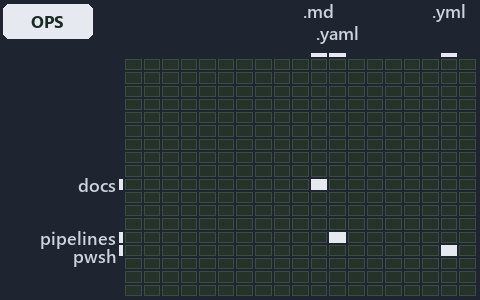

---
catzc:
  immutable:
    with_body_sha: "2cb4445e18b4"
    repo_status: locked
    path: docs/explanation/automation/.assets/undeclared-edge-fails-with-one-line/grid.md
    source: docs/explanation/automation/.assets/undeclared-edge-fails-with-one-line/diagram.drawio.png
    role: asset-description
    language: markdown
    filetype: md
    track: docs
    tracktype: documentation
---

# An undeclared module edge fails the gate with one line per issue: the world-map minimap

```text
Where the files that cite ADR-AUTO-DEPM sit in the repository: tracks down, file languages across.
3 of 342 cells lit, holding 10 files.
```



This is the world-map minimap in the sidebar of the operations diagram of [An undeclared module edge fails the gate with one line per
issue][12], which explains [ADR-AUTO-DEPM][1]. It lights every cell of the world map that holds a file citing those codes, so it shows where
the decision lives in the repository. Each lit cell has its reason below, naming the code that selects it.

## What the minimap shows

The grid crosses the 18 tracks (rows) with the 19 file languages (columns) of the world map and lights 3 cells, filled in ink. A cell lit
only by passing mentions (citations in body comments, not in a file's header or text) is touched: a lighter ink. Every other cell is idle, a
grey box: it holds files the slide's ADR codes do not select, or no file at all (288 of the 342 cells hold none). The minimap shows where
the slide sits, not how many files a cell holds; the world-map PDFs show the counts.

- docs × markdown: 8 lit of 2778 files
- pipelines × pipeline-yaml: 1 lit of 14 files
- pwsh × yaml: 1 lit of 115 files

## Key

A lit row prints its track's name; a lit column prints a short code, the first extension of its file language:

- `.md`: markdown
- `.yaml`: pipeline-yaml
- `.yml`: yaml

## Why each cell is lit

### docs × markdown (8 lit files)

Placed: the root folder `docs/` names the track docs ([ADR-DSGN-TRACK-TRACKISPLACEDCLUSTER][2]); the extension `.md` names the file language
markdown ([ADR-DSGN-TRACK-FILELANGUAGE][2]). Lit ([ADR-DSGN-TRACK-LITCELL][2]) by:

- [docs/adr/automation/controlling-module-dependencies.md][1]: selected by [ADR-AUTO-DEPM][1]: the ADR's own file.
- [docs/adr/automation/dora-explains.md][3]: selected by [ADR-AUTO-DEPM][1]: the file cites it at line 365 (text).
- [docs/adr/index.md][4]: selected by [ADR-AUTO-DEPM][1]: the file cites it at line 169 (text).
- [docs/references/pwsh/.assets/module-graph-declared-vs-observed/diagram.drawio.md][5]: selected by [ADR-AUTO-DEPM][1]: the file cites it
  at line 110 (text) and line 114 (text).
- [docs/references/pwsh/.assets/module-graph-declared-vs-observed/diagram.drawio.verify.md][6]: selected by [ADR-AUTO-DEPM][1]: the file
  cites it at line 47 (text), line 54 (text), line 54 (text), line 71 (text) and line 73 (text).
- [docs/references/pwsh/catzc-base-modulesystem/types/DependenciesConfig.cs.md][7]: selected by [ADR-AUTO-DEPM][1]: the file cites it at
  line 12 (text).
- [docs/references/pwsh/catzc-base-modulesystem/types/DependencyGraph.cs.md][8]: selected by [ADR-AUTO-DEPM][1]: the file cites it at line
  15 (text).
- [docs/references/pwsh/catzc-base-modulesystem/types/ModuleGroup.cs.md][9]: selected by [ADR-AUTO-DEPM][1]: the file cites it at line 13
  (text).

### pipelines × pipeline-yaml (1 lit file)

Placed: the root folder `pipelines/` names the track pipelines ([ADR-DSGN-TRACK-TRACKISPLACEDCLUSTER][2]); the extension `.yaml` names the
file language pipeline-yaml ([ADR-DSGN-TRACK-FILELANGUAGE][2]). Lit ([ADR-DSGN-TRACK-LITCELL][2]) by:

- [pipelines/ci-automation.yaml][10]: selected by [ADR-AUTO-DEPM][1]: a pipeline that cites nothing itself carries its globset's citations,
  which cite it at `pwsh/Catzc.Base.Docs/configs/adrs.yml` line 138 (text).

### pwsh × yaml (1 lit file)

Placed: the root folder `pwsh/` names the track pwsh ([ADR-DSGN-TRACK-TRACKISPLACEDCLUSTER][2]); the extension `.yml` names the file
language yaml ([ADR-DSGN-TRACK-FILELANGUAGE][2]). Lit ([ADR-DSGN-TRACK-LITCELL][2]) by:

- [pwsh/Catzc.Base.Docs/configs/adrs.yml][11]: selected by [ADR-AUTO-DEPM][1]: the file cites it at line 138 (text).

## Keywords

- [world map][13]
- [track][14]
- [file language][15]
- [cell][16]
- [lit cell][17]
- [docs][18]: a track
- [pipelines][18]: a track
- [pwsh][18]: a track
- [markdown][19]: a file language
- [pipeline-yaml][19]: a file language
- [yaml][19]: a file language

[1]: ../../../../adr/automation/controlling-module-dependencies.md
[2]: ../../../../adr/design/tracks.md
[3]: ../../../../adr/automation/dora-explains.md
[4]: ../../../../adr/index.md
[5]: ../../../../references/pwsh/.assets/module-graph-declared-vs-observed/diagram.drawio.md
[6]: ../../../../references/pwsh/.assets/module-graph-declared-vs-observed/diagram.drawio.verify.md
[7]: ../../../../references/pwsh/catzc-base-modulesystem/types/DependenciesConfig.cs.md
[8]: ../../../../references/pwsh/catzc-base-modulesystem/types/DependencyGraph.cs.md
[9]: ../../../../references/pwsh/catzc-base-modulesystem/types/ModuleGroup.cs.md
[10]: ../../../../../pipelines/ci-automation.yaml
[11]: ../../../../../pwsh/Catzc.Base.Docs/configs/adrs.yml
[12]: ../../undeclared-edge-fails-with-one-line.md
[13]: ../../../../adr/glossary.md#world-map
[14]: ../../../../adr/glossary.md#track
[15]: ../../../../adr/glossary.md#file-language
[16]: ../../../../adr/glossary.md#cell
[17]: ../../../../adr/glossary.md#lit-cell
[18]: ../../../../../pwsh/Catzc.Base.Variants/configs/variants.yml
[19]: ../../../../../pwsh/Catzc.Base.Languages/configs/languages.yml
