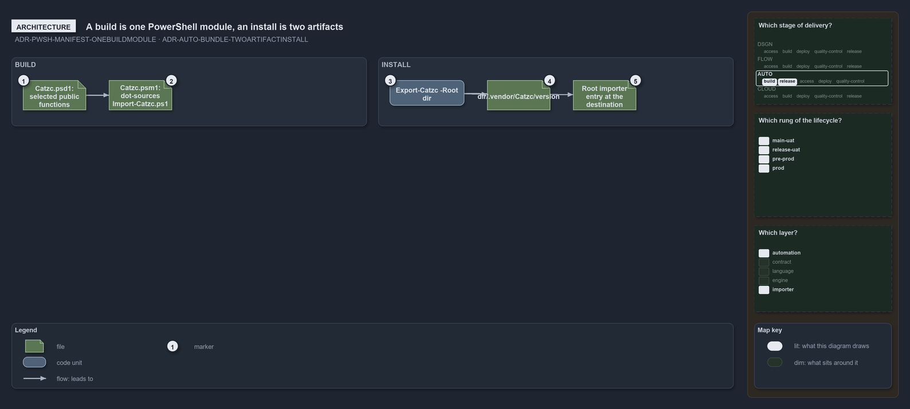

---
catzc:
  warning: "Experimental: this article merges two rules into one and holds nothing beyond what they say"
  edges:
    cites:
      - ADR-PWSH-MANIFEST-ONEBUILDMODULE
      - ADR-AUTO-BUNDLE-TWOARTIFACTINSTALL
---

# A build is one powershell module and an install is two artifacts in two places

This article is one rule:
[ADR-PWSH-MANIFEST-ONEBUILDMODULE](../../drs/automation/pwsh/dynamic-module-manifests.md#rule-adr-pwsh-manifest-onebuildmodule) and
[ADR-AUTO-BUNDLE-TWOARTIFACTINSTALL](../../drs/automation/platform-bundle.md#rule-adr-auto-bundle-twoartifactinstall) merged into one. It
holds nothing beyond what those two rules say.

A build is one PowerShell module, `Catzc`: a generated top-level `Catzc.psd1` exporting the selected modules' public functions, whose
`RootModule` is a generated one-line `Catzc.psm1` that dot-sources `Import-Catzc.ps1`. An install is two artifacts in two places:
`Export-Catzc -Root <dir>` copies the build to `<dir>/.vendor/Catzc/<version>/` and writes a root importer entry at the destination root.

