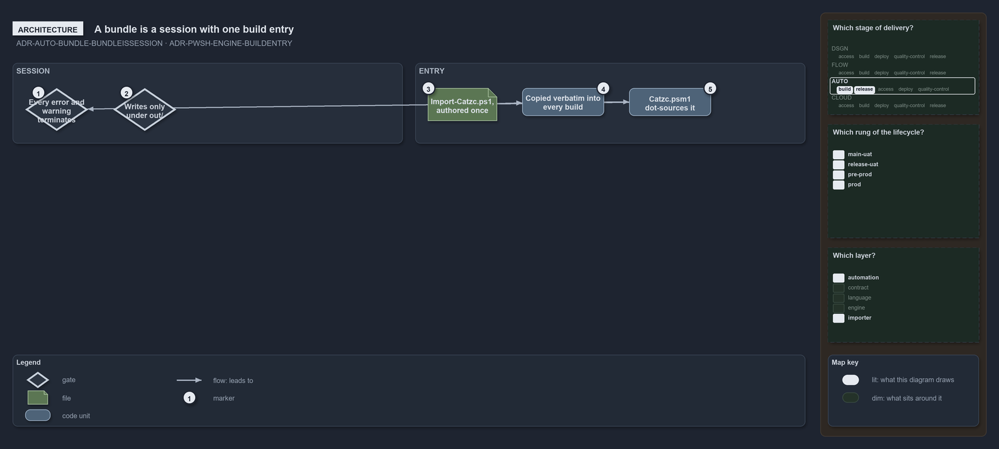

---
catzc:
  warning: "Experimental: this article merges two rules into one and holds nothing beyond what they say"
  edges:
    cites:
      - ADR-AUTO-BUNDLE-BUNDLEISSESSION
      - ADR-PWSH-ENGINE-BUILDENTRY
---

# A bundle is a session and its build entry is authored once

This article is one rule: [ADR-AUTO-BUNDLE-BUNDLEISSESSION](../../drs/automation/platform-bundle.md#rule-adr-auto-bundle-bundleissession)
and [ADR-PWSH-ENGINE-BUILDENTRY](../../drs/automation/pwsh/pwsh-engine.md#rule-adr-pwsh-engine-buildentry) merged into one. It holds nothing
beyond what those two rules say.

A bundle is a session, not a passive library: loading it establishes the catzc session, the same session settings the mono importer sets,
under which every error and every warning terminates, and it writes only under the working root's `out/`. The build's entry is
`Import-Catzc.ps1`, authored once at `pwsh/.internal/assets/Import-Catzc.ps1` and copied verbatim into every build, the build's generated
`Catzc.psm1` dot-sourcing it.

