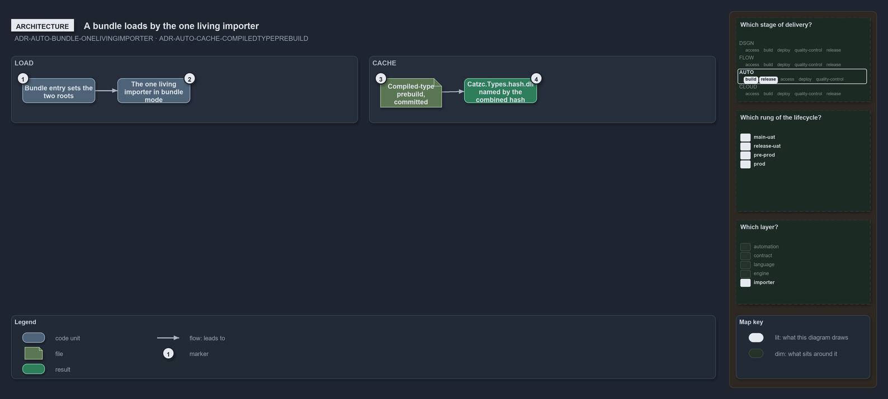

---
catzc:
  warning: "Experimental: this article merges two rules into one and holds nothing beyond what they say"
  edges:
    cites:
      - ADR-AUTO-BUNDLE-ONELIVINGIMPORTER
      - ADR-AUTO-CACHE-COMPILEDTYPEPREBUILD
---

# A bundle loads by the one living importer and compiled types are one committed cache

This article is one rule:
[ADR-AUTO-BUNDLE-ONELIVINGIMPORTER](../../drs/automation/platform-bundle.md#rule-adr-auto-bundle-onelivingimporter) and
[ADR-AUTO-CACHE-COMPILEDTYPEPREBUILD](../../drs/automation/caching.md#rule-adr-auto-cache-compiledtypeprebuild) merged into one. It holds
nothing beyond what those two rules say.

A bundle loads by running the one living importer in its bundle mode, never a forked bootstrap: the bundle's entry sets the two roots and
runs the same importer the mono repo's entry runs. The compiled-type prebuild is the one committed, cross-session cache: one assembly for
the whole repository, committed as `pwsh/.compiled/Catzc.Types.<hash>.dll` and named for the combined hash of every module's type sources,
so a fresh checkout and CI load it without compiling.

