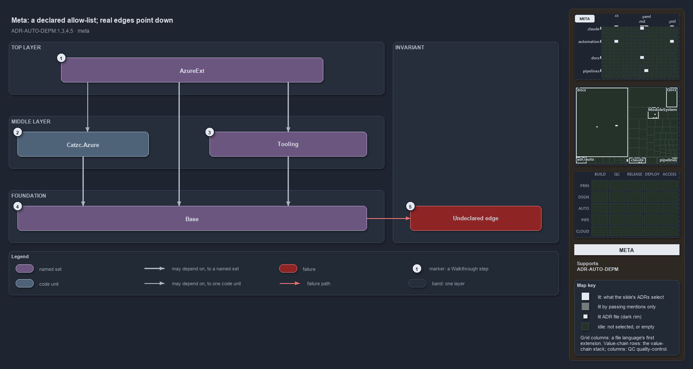

---
catzc:
  derived:
    path: docs/explanation/automation/a-declared-allow-list-of-layers.md
    folder: docs/explanation/automation
    name: a-declared-allow-list-of-layers
    filetype: md
    kind: explanation
    language: markdown
    track: docs
    body_sha: "30924884b291"
    adrs:
      - ADR-AUTO-DEPM#{1,3-5}
    links:
      - docs/.assets/explanation/adr-auto-depm--a-declared-allow-list-of-layers--meta.drawio.md
      - docs/.assets/explanation/adr-auto-depm--a-declared-allow-list-of-layers--meta.drawio.png
      - docs/adr/automation/controlling-module-dependencies.md
      - docs/explanation/automation/index.md
      - docs/explanation/automation/three-layers-edges-point-down.md
      - docs/explanation/automation/two-gates-check-the-layer-pins.md
      - docs/explanation/automation/two-sections-unioned-into-one-allow-set.md
      - docs/explanation/automation/undeclared-edge-fails-with-one-line.md
      - docs/explanation/index.md#how-to-read-the-diagrams
---

# One declared allow-list says what may depend on what, and every edge points down

```text
One declared allow-list says what may depend on what, and every allowed edge points down.

1  AzureExt         top layer: the Azure modules below the Azure root, one group
2  Catzc.Azure      middle layer: the Azure root, one module
3  Tooling          middle layer: the managers of the non-vendored external tools, one group
4  Base             foundation: one group that depends on nothing outside itself
5  Undeclared edge  any real edge the declaration does not list; it fails the build

Supports ADR-AUTO-DEPM#1, #3, #4 and #5 (meta lens).
```

The module dependency declaration is one file that says which module may depend on which, and cats checks the code against that file, never
the other way round. The declaration is the allow-list: it lets each layer depend only on the layers below it, and a real edge it does not
list fails the build. Stripped of every module and function name, the whole idea is three layers and one failure.



The diagram is described element by element in
[its asset description](../../.assets/explanation/adr-auto-depm--a-declared-allow-list-of-layers--meta.drawio.md).

## Walkthrough

1. **AzureExt.** The top of the graph is a group: the Azure modules that sit below the Azure root. Its members may use the Azure root, the
   Tooling group and the Base group, and nothing outside the group may depend on it.
2. **Catzc.Azure.** The Azure root is a single module in the middle of the graph. It may use Base.
3. **Tooling.** The managers of the non-vendored external tools form a group in the middle of the graph. It may use Base.
4. **Base.** The foundation is a group that depends on nothing outside itself; its members are layered only among themselves.
5. **Undeclared edge.** An edge the declaration does not list, such as a Base library reaching up into Tooling, fails the build. The check
   is mechanical, not a matter of review vigilance.

## Why it holds

- The declaration is the only place a module dependency can exist, and an actual edge with no declaration fails the build (ADR-AUTO-DEPM#1).
- A group is a concept, not a module on disk. Allowing a group allows an edge to any of its members, while allowing one module allows
  exactly that edge (ADR-AUTO-DEPM#3).
- The declaration is checked when it loads, and the quality gate then checks every real edge in the code against it (ADR-AUTO-DEPM#4).
- A new dependency is a new declared edge, landed in the same change as the code that introduces it (ADR-AUTO-DEPM#5).

The two Tooling modules that belong to no group, Github and KeyHandler, also depend on Base alone; they are left out here for brevity.

## See also

- [Controlling module dependencies](../../adr/automation/controlling-module-dependencies.md) — the decision this article explains.
- The other lenses on the same graph: [architecture](three-layers-edges-point-down.md),
  [implementation](two-sections-unioned-into-one-allow-set.md), [operations](undeclared-edge-fails-with-one-line.md) and
  [governance](two-gates-check-the-layer-pins.md).
- [The automation explanations](index.md) · [How to read the diagrams](../index.md#how-to-read-the-diagrams)
