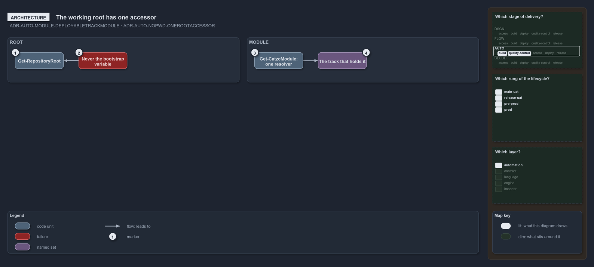

---
catzc:
  warning: "Experimental: this article merges two rules into one and holds nothing beyond what they say"
  edges:
    cites:
      - ADR-AUTO-MODULE-DEPLOYABLETRACKMODULE
      - ADR-AUTO-NOPWD-ONEROOTACCESSOR
---

# A deployable modules resolver is one command and the working root has one accessor

This article is one rule:
[ADR-AUTO-MODULE-DEPLOYABLETRACKMODULE](../../drs/automation/module-model.md#rule-adr-auto-module-deployabletrackmodule) and
[ADR-AUTO-NOPWD-ONEROOTACCESSOR](../../drs/automation/never-depend-on-pwd.md#rule-adr-auto-nopwd-onerootaccessor) merged into one. It holds
nothing beyond what those two rules say.

A module of a deployable track is resolved through the track that holds it, by one resolver, `Get-CatzcModule`. Module code reads the
working-tree anchor only through its one accessor, `Get-RepositoryRoot`, never the bootstrap variable directly: the variable is the
importer's hand-off and the accessor is the one reader, so a change to where the root comes from lands in one place.

