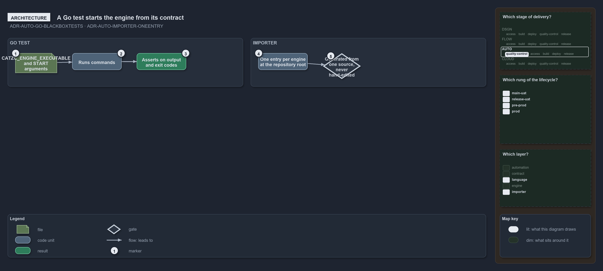

---
catzc:
  warning: "Experimental: this article merges two rules into one and holds nothing beyond what they say"
  edges:
    cites:
      - ADR-AUTO-GO-BLACKBOXTESTS
      - ADR-AUTO-IMPORTER-ONEENTRY
---

# A go test starts the engine from its contract and the importer is one entry

This article is one rule: [ADR-AUTO-GO-BLACKBOXTESTS](../../drs/automation/go/go-test-artifacts.md#rule-adr-auto-go-blackboxtests) and
[ADR-AUTO-IMPORTER-ONEENTRY](../../drs/automation/importer.md#rule-adr-auto-importer-oneentry) merged into one. It holds nothing beyond what
those two rules say.

A Go test is a black-box test: it starts the engine from the contract its runner sets, `CATZC_ENGINE_EXECUTABLE` with the
`CATZC_ENGINE_START` arguments, runs commands and asserts on their output and exit codes. The importer is the one way catzc enters a
session: per execution engine one entry at the repository root, every entry generated from one source and never hand-edited.

