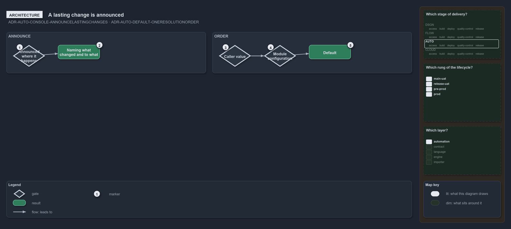

---
catzc:
  warning: "Experimental: this article merges two rules into one and holds nothing beyond what they say"
  edges:
    cites:
      - ADR-AUTO-CONSOLE-ANNOUNCELASTINGCHANGES
      - ADR-AUTO-DEFAULT-ONERESOLUTIONORDER
---

# A lasting change is announced and a setting resolves in one fixed order

This article is one rule:
[ADR-AUTO-CONSOLE-ANNOUNCELASTINGCHANGES](../../drs/automation/console-output-matters.md#rule-adr-auto-console-announcelastingchanges) and
[ADR-AUTO-DEFAULT-ONERESOLUTIONORDER](../../drs/automation/sensible-defaults.md#rule-adr-auto-default-oneresolutionorder) merged into one.
It holds nothing beyond what those two rules say.

Every lasting change a function makes to the state of the session is announced on the always-shown status output, where it happens, naming
what changed and to what. A configurable setting resolves in one fixed order: the caller's explicit value, else the value in the owning
module's configuration (`Get-Config`), which includes the config contributions gathered from Markdown files and, in build mode, a consumer
overlay's fragment.

