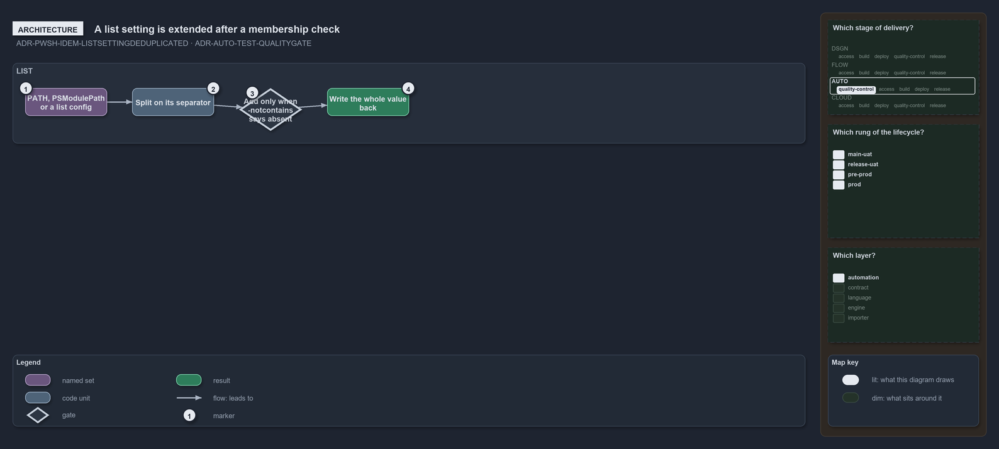

---
catzc:
  warning: "Experimental: this article merges two rules into one and holds nothing beyond what they say"
  edges:
    cites:
      - ADR-PWSH-IDEM-LISTSETTINGDEDUPLICATED
      - ADR-AUTO-TEST-QUALITYGATE
---

# A list valued setting is extended only after membership check and gates collect all issues

This article is one rule:
[ADR-PWSH-IDEM-LISTSETTINGDEDUPLICATED](../../drs/automation/pwsh/idempotent-state-mechanics.md#rule-adr-pwsh-idem-listsettingdeduplicated)
and [ADR-AUTO-TEST-QUALITYGATE](../../drs/automation/test-automation.md#rule-adr-auto-test-qualitygate) merged into one. It holds nothing
beyond what those two rules say.

A list-valued setting, `$env:PATH`, `$env:PSModulePath` or a list in a config the function writes, is extended only after a membership
check: split it on its separator, add the entry only when `-notcontains` says it is absent, and write the whole value back. Quality gates
collect in the same spirit, one public `Test-<subject>` function that collects every issue and throws once listing them all.

