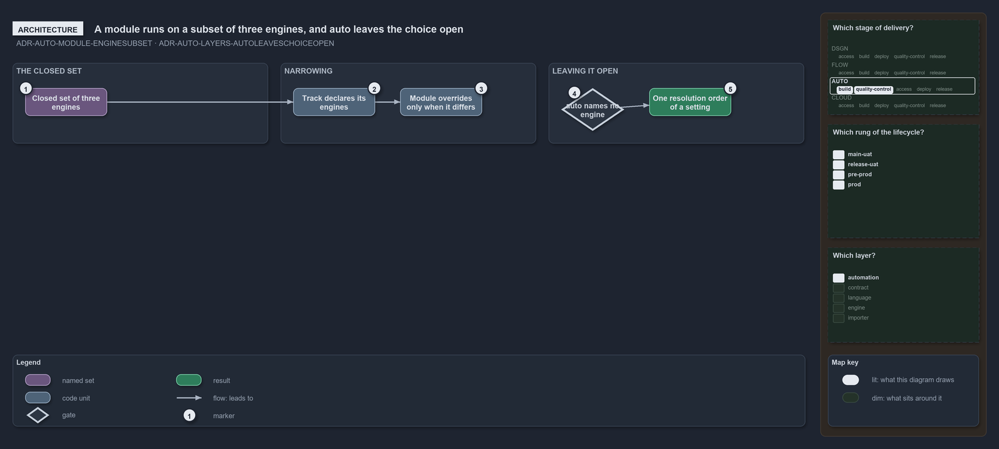

---
catzc:
  warning: "Experimental: this article merges two rules into one and holds nothing beyond what they say"
  edges:
    cites:
      - ADR-AUTO-MODULE-ENGINESUBSET
      - ADR-AUTO-LAYERS-AUTOLEAVESCHOICEOPEN
---

# A modules engines are a subset of three and auto leaves the choice open

This article is one rule: [ADR-AUTO-MODULE-ENGINESUBSET](../../drs/automation/module-model.md#rule-adr-auto-module-enginesubset) and
[ADR-AUTO-LAYERS-AUTOLEAVESCHOICEOPEN](../../drs/automation/layers.md#rule-adr-auto-layers-autoleaveschoiceopen) merged into one. It holds
nothing beyond what those two rules say.

A module's execution engines are a subset of the closed set of three engines. A track declares the engines its modules run under and a
module overrides the track's list only when it differs. `auto` leaves a layer's choice open: for the engine it is the value that names none,
and in every case it resolves in the one resolution order of a setting.

