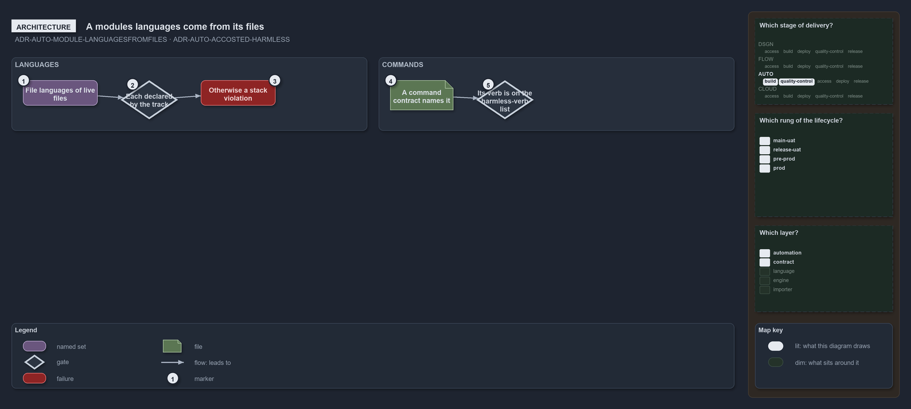

---
catzc:
  warning: "Experimental: this article merges two rules into one and holds nothing beyond what they say"
  edges:
    cites:
      - ADR-AUTO-MODULE-LANGUAGESFROMFILES
      - ADR-AUTO-ACCOSTED-HARMLESS
---

# A modules languages are file languages of its live files and command harmless by verb

This article is one rule: [ADR-AUTO-MODULE-LANGUAGESFROMFILES](../../drs/automation/module-model.md#rule-adr-auto-module-languagesfromfiles)
and [ADR-AUTO-ACCOSTED-HARMLESS](../../drs/automation/accosted-language.md#rule-adr-auto-accosted-harmless) merged into one. It holds
nothing beyond what those two rules say.

A module's languages are the file languages of its live files, and each must be one the track declares; a file in another language is a
stack violation. A command is harmless when a command contract names it and its verb is on the harmless-verb list, declared once in the
language's config with its default on the config type.

