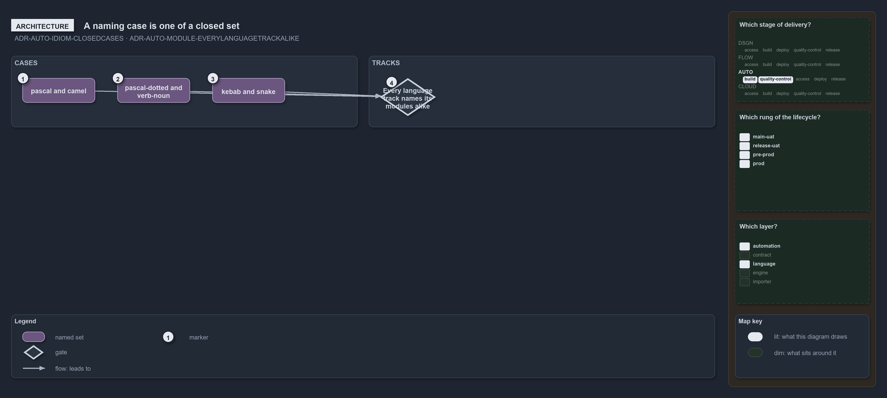

---
catzc:
  warning: "Experimental: this article merges two rules into one and holds nothing beyond what they say"
  edges:
    cites:
      - ADR-AUTO-IDIOM-CLOSEDCASES
      - ADR-AUTO-MODULE-EVERYLANGUAGETRACKALIKE
---

# A naming case is one of closed set and every language track names modules alike

This article is one rule: [ADR-AUTO-IDIOM-CLOSEDCASES](../../drs/automation/idiomatic-names.md#rule-adr-auto-idiom-closedcases) and
[ADR-AUTO-MODULE-EVERYLANGUAGETRACKALIKE](../../drs/automation/module-model.md#rule-adr-auto-module-everylanguagetrackalike) merged into
one. It holds nothing beyond what those two rules say.

A naming case is one of a closed set, each stating how a name splits into words and how words join into a name: `pascal`, `camel`,
`pascal-dotted`, `verb-noun`, `kebab` and `snake`. Every language track holds its modules the same way, a module being a non-dot folder
directly under the track's root, named by the folder, with pwsh one language among the others.

