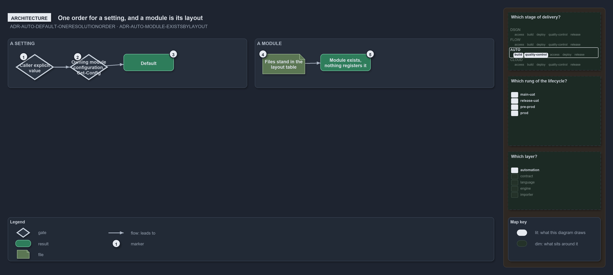

---
catzc:
  warning: "Experimental: this article merges two rules into one and holds nothing beyond what they say"
  edges:
    cites:
      - ADR-AUTO-DEFAULT-ONERESOLUTIONORDER
      - ADR-AUTO-MODULE-EXISTSBYLAYOUT
---

# A setting resolves in one fixed order and a module exists by its layout

This article is one rule:
[ADR-AUTO-DEFAULT-ONERESOLUTIONORDER](../../drs/automation/sensible-defaults.md#rule-adr-auto-default-oneresolutionorder) and
[ADR-AUTO-MODULE-EXISTSBYLAYOUT](../../drs/automation/module-model.md#rule-adr-auto-module-existsbylayout) merged into one. It holds nothing
beyond what those two rules say.

A configurable setting resolves in one fixed order: the caller's explicit value, else the value in the owning module's configuration
(`Get-Config`), which includes the config contributions gathered from Markdown files and, in build mode, a consumer overlay's fragment. A
module exists when its files stand in its layout; nothing registers it, and no descriptor file declares it.

