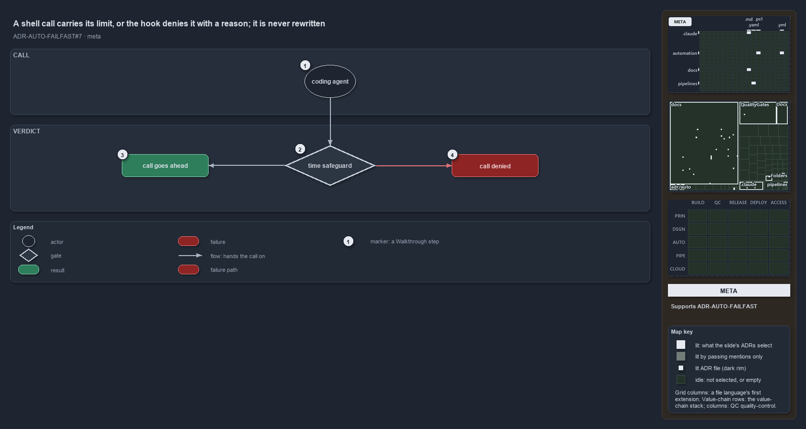

# A shell call carries its limit, or the hook denies it with a reason; it is never rewritten

```text
An agent's shell call carries its limit, or the hook denies it with a reason; it is never rewritten.

1  coding agent     who makes the call: the main session, a subagent, or an agent in a pipeline
2  time safeguard   the check run before every call: does the call carry a limit inside the bounds?
3  call goes ahead  the call carries its limit; the hook says nothing and the normal permission flow runs
4  call denied      the call does not; the hook denies it and says how to re-issue it

Supports ADR-AUTO-FAILFAST#7 (meta lens).
```

A coding agent working in cats runs shell commands all day, and each one is a wait like any other: a command that hangs holds the agent
until a person notices. The domain rules bound every wait, so an agent's shell call is bounded too. The idea is the smallest possible one: a
call either carries its own limit, within the limits cats configures, or it does not run. There is no third verdict. The hook never rewrites
a call into a bounded one, because a hook that rewrites must also approve, and an approval skips the permission prompt that every other
safeguard relies on.



The diagram is described element by element in [its asset description](a-shell-call-carries-its-limit-or-is-denied.drawio.md).

## Walkthrough

1. **Coding agent.** The caller is an AI coding agent: the main session at a devbox, a subagent it launched, or an agent running inside a
   pipeline. Every shell call it makes goes through the same check, whoever asks.
2. **Time safeguard.** Before the call runs, the safeguard asks one question: does this call carry a limit inside the configured bounds? A
   foreground call carries it as its own timeout; a background call carries it as a `timeout` prefix around one command, because the tool
   that runs background work does not apply its timeout there.
3. **Call goes ahead.** When the answer is yes, the safeguard says nothing. The call then meets the ordinary permission flow exactly as if
   the safeguard did not exist; an allowed call is never pre-approved.
4. **Call denied.** When the answer is no, the call is denied with a reason that names the limit it broke and the form to re-issue it in,
   and the denial is recorded as a blocker to tune. Who asked changes only what the reason says: the main session raises the blocker with
   the user, a subagent reports it to its coordinator, and a pipeline fixes the call or its limit.

## Why it holds

- Every wait is bounded, and an agent's shell call is a wait: the bash limits bound every shell call an agent makes, in the foreground and
  the background, and a hook denies a call outside them (ADR-AUTO-FAILFAST#7).
- The limits live in one config with no "no limit" value, so a call that needs longer is a blocker to tune, never a limit raised quietly in
  a call (ADR-AUTO-FAILFAST#7).
- The hook denies and never rewrites, so a denial leaves every other safeguard in force (ADR-AUTO-FAILFAST#7).

## Where the code and the ADR differ

The ADR states that an agent cannot start a shell call that has no limit. The hook fails open: when it cannot run at all, because it is not
built yet or its own program throws, it reports a non-blocking error and the call goes ahead.

## See also

- [Fail fast with inline assertions](../../adr/automation/fail-fast-with-asserts.md) — the decision this article explains.
- The other lenses on the same verdict: [architecture](hook-compiles-module-verdict-and-limits.md),
  [implementation](decide-returns-null-or-a-reason.md), [operations](pass-the-limit-or-the-call-is-denied.md) and
  [governance](three-tests-prove-the-hook.md).
- [The automation explanations](index.md) · [How to read the diagrams](../index.md#how-to-read-the-diagrams)
