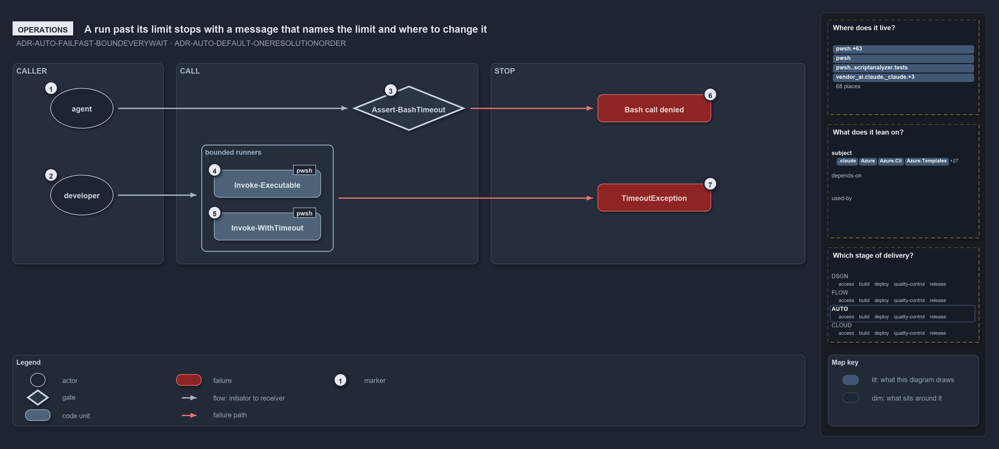

# A run past its limit stops with a message that names the limit and where to change it

```text
A run past its limit stops with a message that names the limit and where to change it; no call runs without one.

1  agent               a coding agent whose every Bash call passes the hook
2  developer           a person running pwsh work on a devbox, or a pipeline running it unattended
3  Assert-BashTimeout  the hook: a call without a limit within the bash limits is denied
4  Invoke-Executable   a native tool, killed with its process tree past its executable's limit
5  Invoke-WithTimeout  a script block, stopped past the pwsh limit or a budget's ceiling
6  Bash call denied    the denial: the limit, how to re-issue the call, who to tell
7  TimeoutException    the throw: how long it ran, the limit, which file or parameter to tune

Supports ADR-AUTO-FAILFAST-BOUNDEVERYWAIT and ADR-AUTO-DEFAULT-ONERESOLUTIONORDER (operations lens).
```

Nobody in cats waits forever. A person's pwsh work runs through `Invoke-Executable` or `Invoke-WithTimeout`, and a coding agent's shell call
runs through the Bash hook; each is the same wait with a different caller, and each stops at a known limit with an ordinary failure that
says how long it ran, what the limit was, and where to change it. The limits are tight on purpose on a devbox, 3 seconds for pwsh work and
for a foreground bash call, so that a call which legitimately needs longer shows up as a blocker to tune rather than a limit raised quietly
in code.

```yml drawio
description:
  "Every call runs inside a limit: an agent's Bash call meets the hook, a developer's or pipeline's pwsh work runs through the two bounded
  runners, and a run past its limit stops with a message naming the limit and where to change it."
about:
  rules: [ADR-AUTO-FAILFAST-BOUNDEVERYWAIT, ADR-AUTO-DEFAULT-ONERESOLUTIONORDER]
  lens: operations
content:
  title: A run past its limit stops with a message that names the limit and where to change it
  kind: explanation
  flow: left-to-right
  theme: dark
  bands:
    - { id: band-caller, label: CALLER }
    - { id: band-call, label: CALL }
    - { id: band-stop, label: STOP }
  groups:
    - { id: grp-runners, label: bounded runners, in: band-call }
  glyphs:
    - { id: g-agent, kind: actor, label: agent, in: band-caller }
    - { id: g-developer, kind: actor, label: developer, in: band-caller }
    - { id: g-hook, kind: gate, label: Assert-BashTimeout, in: band-call }
    - { id: g-executable, kind: code, label: Invoke-Executable, in: grp-runners }
    - { id: g-with-timeout, kind: code, label: Invoke-WithTimeout, in: grp-runners }
    - { id: f-denied, kind: failure, label: Bash call denied, in: band-stop }
    - { id: f-timeout, kind: failure, label: TimeoutException, in: band-stop }
  edges:
    - { from: g-agent, to: g-hook, kind: flow, label: "" }
    - { from: g-developer, to: grp-runners, kind: flow, label: "" }
    - { from: g-hook, to: f-denied, kind: fail, label: "" }
    - { from: grp-runners, to: f-timeout, kind: fail, label: "" }
  markers:
    - { at: g-agent, number: 1 }
    - { at: g-developer, number: 2 }
    - { at: g-hook, number: 3 }
    - { at: g-executable, number: 4 }
    - { at: g-with-timeout, number: 5 }
    - { at: f-denied, number: 6 }
    - { at: f-timeout, number: 7 }
  legend: auto
  minimaps: [code-locations, module-neighbourhood, axis]
layout:
  band-caller: { x: 20, y: 84, w: 240, h: 320 }
  band-call: { x: 280, y: 84, w: 480, h: 320 }
  band-stop: { x: 780, y: 84, w: 500, h: 320 }
  g-agent: { x: 80, y: 124, w: 100, h: 64 }
  g-developer: { x: 80, y: 262, w: 100, h: 64 }
  g-hook: { x: 560, y: 120, w: 180, h: 72 }
  grp-runners: { x: 320, y: 214, w: 210, h: 170 }
  g-executable: { x: 340, y: 254, w: 170, h: 44 }
  g-with-timeout: { x: 340, y: 322, w: 170, h: 44 }
  f-denied: { x: 950, y: 134, w: 180, h: 44 }
  f-timeout: { x: 950, y: 276, w: 180, h: 44 }
```



## Walkthrough

1. **Agent.** Every Bash call a coding agent makes is judged by the hook before it runs. A foreground call passes a `timeout` of at most the
   foreground limit, 3000 milliseconds on a devbox. A background call, whose `timeout` the Bash tool ignores, starts with a GNU
   `timeout <duration>` of at most the background limit, 360 seconds on a devbox, around one command; exit 124 means the safeguard stopped
   it.
2. **Developer.** A person on a devbox, or a pipeline with nobody watching, runs the pwsh wrappers. A pipeline gets looser limits, 600
   seconds for pwsh work and for a foreground bash call and 3600 for a background one, but never none.
3. **Assert-BashTimeout.** The hook denies and never rewrites a call, because an approval would skip the permission prompt and a wrapped
   command no longer matches the deny rules written for it. Denial leaves every other safeguard in place.
4. **Invoke-Executable.** The default mode runs the tool under its executable's entry in `timeouts.yml`, or the environment's pwsh limit
   when it has none, and kills the whole process tree past it.
5. **Invoke-WithTimeout.** A script block runs under the environment's pwsh limit, or the exemption ceiling while its budget is exempt, and
   is stopped past it. `Assert-CompletesWithin` and `Test-CompletesWithin` are its assertion and boolean forms.
6. **Bash call denied.** The reason names the environment, foreground or background, what the call carried and the limit, then the fix:
   `Re-issue it with timeout: <ms>`, or run longer work in the background behind `timeout <s> <one command>`. Who asked changes only the
   last line: the main session raises the blocker with the user, a subagent reports it to its coordinator, and a pipeline fixes the call or
   its limit. Each denial is appended to `out/time-safeguard.log`, the list of blockers to tune.
7. **TimeoutException.** A killed tool reports `Killed '<command>' after <n>s: it did not finish within its time limit`, then says to make
   it faster or pass `-TimeoutSeconds` or tune the executable's entry in `timeouts.yml`. A stopped script block reports
   `Stopped after <n>s: '<activity>' did not finish within its <n>-second limit`, then names `-Seconds`, the environment's pwsh limit in
   `timeouts.yml`, and a `-Budget` to exempt in `timeout-exemptions.yml` while the work is tuned.

## Why it holds

- A hang fails fast with a message naming the limit instead of waiting forever; the bash limits bound every shell call an agent makes,
  foreground and background, and a hook denies a call outside them; work that legitimately runs longer while it is tuned carries a budget
  GUID and is exempted, which raises its limit to a ceiling but never lifts it (ADR-AUTO-FAILFAST-BOUNDEVERYWAIT).
- The limit a wrapper applies is the caller's explicit value, else the config, else the declared default, so a person tunes one entry in one
  file and never a number in code (ADR-AUTO-DEFAULT-ONERESOLUTIONORDER).

## See also

- [Fail fast with inline assertions](../../drs/automation/fail-fast-with-asserts.md) and
  [Sensible defaults for all parameters](../../drs/automation/sensible-defaults.md) — the decisions this article explains.
- The other lenses on the same resolution: [meta](callers-value-else-config-else-default.md),
  [architecture](one-resolver-every-consumer-but-the-hook.md), [implementation](resolve-one-limit-in-code-order.md) and
  [governance](one-rule-per-stage-and-two-gaps.md).
- [The automation explanations](index.md) · [How to read the diagrams](../index.md#how-to-read-the-diagrams)
