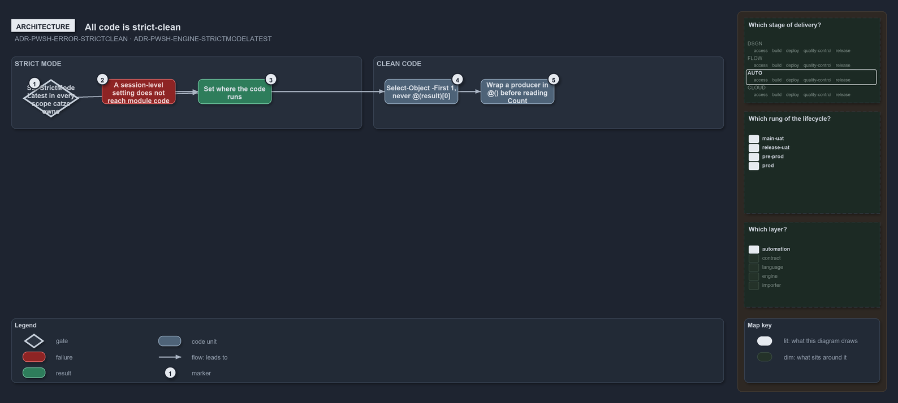

---
catzc:
  warning: "Experimental: this article merges two rules into one and holds nothing beyond what they say"
  edges:
    cites:
      - ADR-PWSH-ERROR-STRICTCLEAN
      - ADR-PWSH-ENGINE-STRICTMODELATEST
---

# All code is strict clean because every scope runs in latest strict mode

This article is one rule: [ADR-PWSH-ERROR-STRICTCLEAN](../../drs/automation/pwsh/error-handling.md#rule-adr-pwsh-error-strictclean) and
[ADR-PWSH-ENGINE-STRICTMODELATEST](../../drs/automation/pwsh/pwsh-engine.md#rule-adr-pwsh-engine-strictmodelatest) merged into one. It holds
nothing beyond what those two rules say.

All code is written strict-clean, because it runs under `Set-StrictMode -Version Latest`: take the first element of a result that may be
empty with `<result> | Select-Object -First 1`, never `@(<result>)[0]`, and wrap a producer in `@()` before reading `.Count`. Strict mode
belongs to a PowerShell scope and a session-level setting does not reach module code, so it is set where the code runs.

