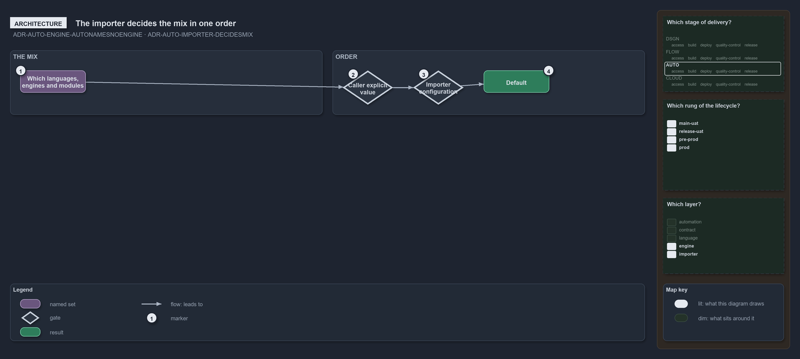

---
catzc:
  warning: "Experimental: this article merges two rules into one and holds nothing beyond what they say"
  edges:
    cites:
      - ADR-AUTO-ENGINE-AUTONAMESNOENGINE
      - ADR-AUTO-IMPORTER-DECIDESMIX
---

# Auto names no engine and the importer decides the mix

This article is one rule:
[ADR-AUTO-ENGINE-AUTONAMESNOENGINE](../../drs/automation/execution-engines.md#rule-adr-auto-engine-autonamesnoengine) and
[ADR-AUTO-IMPORTER-DECIDESMIX](../../drs/automation/importer.md#rule-adr-auto-importer-decidesmix) merged into one. It holds nothing beyond
what those two rules say.

`auto` is the engine value that names no particular engine: a setting that says `auto` takes whatever engine its sensible default resolves
to, and names pwsh, bash or zsh only when it needs that one. The importer decides the mix a session loads, which languages, which engines
and which modules, each input resolving in the one order of a setting: the caller's explicit value, else the importer's configuration, else
the default.

