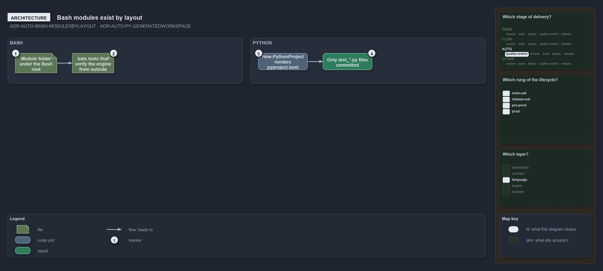

---
catzc:
  warning: "Experimental: this article merges two rules into one and holds nothing beyond what they say"
  edges:
    cites:
      - ADR-AUTO-BASH-MODULESBYLAYOUT
      - ADR-AUTO-PY-GENERATEDWORKSPACE
---

# Bash modules exist by layout and the python tests form one generated workspace

This article is one rule:
[ADR-AUTO-BASH-MODULESBYLAYOUT](../../drs/automation/bash/bash-test-artifacts.md#rule-adr-auto-bash-modulesbylayout) and
[ADR-AUTO-PY-GENERATEDWORKSPACE](../../drs/automation/python/python-test-artifacts.md#rule-adr-auto-py-generatedworkspace) merged into one.
It holds nothing beyond what those two rules say.

Bash code in the `bash` track is either a module of the track, a folder that exists by the layout, or a black-box test under the track's
test holder, `.bats` files that verify the engine from outside. The Python tests form one generated, gitignored uv workspace, the Python
form of `go.work`: nothing Python-specific is committed but the `test_*.py` files, and `New-PythonProject` renders the workspace root
`<root>/pyproject.toml`.

