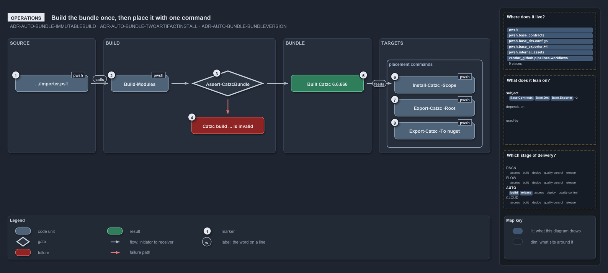

---
catzc:
  warning: "Header is generated by Format-FileMeta via Format-Code; do not change it"
  edges:
    cites:
      - ADR-AUTO-BUNDLE-IMMUTABLEBUILD
      - ADR-AUTO-BUNDLE-TWOARTIFACTINSTALL
      - ADR-AUTO-BUNDLE-AUTOVERSION
    drs_total: 3
---

# Build the bundle once, then place it with one command

```text
Build the bundle once, then place it with one command.

1  . ./importer.ps1             source mode, which building needs
2  Build-Modules                builds; prints the local-version notice on a devbox
3  Assert-CatzcBundle           the integrity check the build runs on its own output
4  Catzc build ... is invalid   the throw that lists every violation
5  Built Catzc 6.6.666          the success line, with the build's path
6  Install-Catzc -Scope         copies the build into the user's module path
7  Export-Catzc -Root           builds, then installs beside a working root
8  Export-Catzc -To nuget       builds, then packs into out/automation/packages/

Supports ADR-AUTO-BUNDLE-IMMUTABLEBUILD, ADR-AUTO-BUNDLE-TWOARTIFACTINSTALL and ADR-AUTO-BUNDLE-AUTOVERSION (operations lens).
```

Building and placing the bundle takes two commands at the prompt. In a source-mode session a person runs `Build-Modules`, which verifies its
own output and prints where the build went, and then one command places it: `Install-Catzc -Scope CurrentUser`, `Export-Catzc -Root <dir>`,
or `Export-Catzc -To nuget`. A build that fails its integrity check throws with the whole list of what is wrong.

```yml drawio
description:
  A source-mode session builds the bundle, the build checks its own output, and one placement command then copies the build into a module
  path, beside a working root, or into a package.
about:
  adrs: [ADR-AUTO-BUNDLE-IMMUTABLEBUILD, ADR-AUTO-BUNDLE-TWOARTIFACTINSTALL, ADR-AUTO-BUNDLE-AUTOVERSION]
  lens: operations
content:
  title: Build the bundle once, then place it with one command
  kind: explanation
  flow: left-to-right
  relation: feeds or runs the next step
  theme: dark
  bands:
    - { id: band-source, label: SOURCE }
    - { id: band-build, label: BUILD }
    - { id: band-bundle, label: BUNDLE }
    - { id: band-targets, label: TARGETS }
  groups:
    - { id: grp-places, label: placement commands, in: band-targets }
  glyphs:
    - { id: g-importer, kind: code, label: . ./importer.ps1, in: band-source }
    - { id: g-build, kind: code, label: Build-Modules, in: band-build }
    - { id: g-assert, kind: gate, label: Assert-CatzcBundle, in: band-build }
    - { id: f-invalid, kind: failure, label: Catzc build ... is invalid, in: band-build }
    - { id: r-built, kind: result, label: Built Catzc 6.6.666, in: band-bundle }
    - { id: g-install, kind: code, label: Install-Catzc -Scope, in: grp-places }
    - { id: g-root, kind: code, label: Export-Catzc -Root, in: grp-places }
    - { id: g-nuget, kind: code, label: Export-Catzc -To nuget, in: grp-places }
  edges:
    - { from: g-importer, to: g-build, kind: flow, label: "" }
    - { from: g-build, to: g-assert, kind: flow, label: "" }
    - { from: g-assert, to: r-built, kind: flow, label: "" }
    - { from: g-assert, to: f-invalid, kind: fail, label: "" }
    - { from: r-built, to: grp-places, kind: flow, label: "" }
  markers:
    - { at: g-importer, number: 1 }
    - { at: g-build, number: 2 }
    - { at: g-assert, number: 3 }
    - { at: f-invalid, number: 4 }
    - { at: r-built, number: 5 }
    - { at: g-install, number: 6 }
    - { at: g-root, number: 7 }
    - { at: g-nuget, number: 8 }
  legend: auto
  minimaps:
    code-locations:
      - cell: docs/-/.
        by:
          - docs/drs/automation/dora-explains.md
          - docs/drs/automation/platform-bundle.md
          - docs/drs/index.md
          - docs/references/github/workflows/ci-pwsh.yml.md
          - docs/references/pwsh/catzc-base-contracts/Publish-ContractRelease.ps1.md
          - docs/references/pwsh/catzc-base-exporter/Assert-CatzcBundle.ps1.md
          - docs/references/pwsh/catzc-base-exporter/Export-Catzc.ps1.md
          - docs/references/pwsh/catzc-base-exporter/Install-Catzc.ps1.md
          - docs/references/pwsh/catzc-base-exporter/Resolve-CatzcBuildVersion.ps1.md
          - docs/references/pwsh/catzc-base-exporter/configs/exporter.yml.md
          - docs/references/pwsh/catzc-base-exporter/private/Assert-BundleFootprint.ps1.md
          - docs/references/pwsh/catzc-base-exporter/private/New-CatzcNuGetPackage.ps1.md
          - docs/references/pwsh/catzc-base-exporter/types/ExporterBundle.cs.md
          - docs/references/pwsh/catzc-base-exporter/types/ExporterConfig.cs.md
          - docs/references/pwsh/internal/Catzc.Internal.Builder.psm1.md
          - docs/references/pwsh/internal/assets/Import-Catzc.ps1.md
          - ADR-AUTO-BUNDLE-AUTOVERSION
          - ADR-AUTO-BUNDLE-IMMUTABLEBUILD
          - ADR-AUTO-BUNDLE-TWOARTIFACTINSTALL
      - cell: github-workflows/workflows/.
        by: [.github/workflows/ci-pwsh.yml, ADR-AUTO-BUNDLE-IMMUTABLEBUILD]
      - cell: pwsh/Catzc.Base.Contracts/.
        by: [pwsh/Catzc.Base.Contracts/Publish-ContractRelease.ps1, ADR-AUTO-BUNDLE-AUTOVERSION]
      - cell: pwsh/Catzc.Base.Drs/configs
        by:
          - pwsh/Catzc.Base.Drs/configs/drs.yml
          - ADR-AUTO-BUNDLE-AUTOVERSION
          - ADR-AUTO-BUNDLE-IMMUTABLEBUILD
          - ADR-AUTO-BUNDLE-TWOARTIFACTINSTALL
      - cell: pwsh/Catzc.Base.Exporter/.
        by:
          - pwsh/Catzc.Base.Exporter/Assert-CatzcBundle.ps1
          - pwsh/Catzc.Base.Exporter/Export-Catzc.ps1
          - pwsh/Catzc.Base.Exporter/Install-Catzc.ps1
          - pwsh/Catzc.Base.Exporter/Resolve-CatzcBuildVersion.ps1
          - ADR-AUTO-BUNDLE-AUTOVERSION
          - ADR-AUTO-BUNDLE-IMMUTABLEBUILD
          - ADR-AUTO-BUNDLE-TWOARTIFACTINSTALL
      - cell: pwsh/Catzc.Base.Exporter/configs
        by:
          - pwsh/Catzc.Base.Exporter/configs/exporter.yml
          - ADR-AUTO-BUNDLE-AUTOVERSION
          - ADR-AUTO-BUNDLE-IMMUTABLEBUILD
          - ADR-AUTO-BUNDLE-TWOARTIFACTINSTALL
      - cell: pwsh/Catzc.Base.Exporter/private
        by:
          - pwsh/Catzc.Base.Exporter/private/Assert-BundleFootprint.ps1
          - pwsh/Catzc.Base.Exporter/private/New-CatzcNuGetPackage.ps1
          - ADR-AUTO-BUNDLE-AUTOVERSION
          - ADR-AUTO-BUNDLE-IMMUTABLEBUILD
          - ADR-AUTO-BUNDLE-TWOARTIFACTINSTALL
      - cell: pwsh/Catzc.Base.Exporter/types
        by:
          - pwsh/Catzc.Base.Exporter/types/ExporterBundle.cs
          - pwsh/Catzc.Base.Exporter/types/ExporterConfig.cs
          - ADR-AUTO-BUNDLE-AUTOVERSION
          - ADR-AUTO-BUNDLE-IMMUTABLEBUILD
          - ADR-AUTO-BUNDLE-TWOARTIFACTINSTALL
      - cell: pwsh/Catzc.Internal.Assets/.
        by:
          - pwsh/.internal/assets/Import-Catzc.ps1
          - ADR-AUTO-BUNDLE-AUTOVERSION
          - ADR-AUTO-BUNDLE-IMMUTABLEBUILD
          - ADR-AUTO-BUNDLE-TWOARTIFACTINSTALL
    module-neighbourhood:
      - cell: subject/Catzc.Base.Contracts
        by: [pwsh/Catzc.Base.Contracts/Publish-ContractRelease.ps1, ADR-AUTO-BUNDLE-AUTOVERSION]
      - cell: subject/Catzc.Base.Drs
        by:
          - pwsh/Catzc.Base.Drs/configs/drs.yml
          - ADR-AUTO-BUNDLE-AUTOVERSION
          - ADR-AUTO-BUNDLE-IMMUTABLEBUILD
          - ADR-AUTO-BUNDLE-TWOARTIFACTINSTALL
      - cell: subject/Catzc.Base.Exporter
        by:
          - pwsh/Catzc.Base.Exporter/Assert-CatzcBundle.ps1
          - pwsh/Catzc.Base.Exporter/Export-Catzc.ps1
          - pwsh/Catzc.Base.Exporter/Install-Catzc.ps1
          - pwsh/Catzc.Base.Exporter/Resolve-CatzcBuildVersion.ps1
          - pwsh/Catzc.Base.Exporter/configs/exporter.yml
          - pwsh/Catzc.Base.Exporter/private/Assert-BundleFootprint.ps1
          - pwsh/Catzc.Base.Exporter/private/New-CatzcNuGetPackage.ps1
          - pwsh/Catzc.Base.Exporter/types/ExporterBundle.cs
          - pwsh/Catzc.Base.Exporter/types/ExporterConfig.cs
          - ADR-AUTO-BUNDLE-AUTOVERSION
          - ADR-AUTO-BUNDLE-IMMUTABLEBUILD
          - ADR-AUTO-BUNDLE-TWOARTIFACTINSTALL
      - cell: subject/Catzc.Internal.Assets
        by:
          - pwsh/.internal/assets/Import-Catzc.ps1
          - ADR-AUTO-BUNDLE-AUTOVERSION
          - ADR-AUTO-BUNDLE-IMMUTABLEBUILD
          - ADR-AUTO-BUNDLE-TWOARTIFACTINSTALL
      - cell: subject/workflows
        by: [.github/workflows/ci-pwsh.yml, ADR-AUTO-BUNDLE-IMMUTABLEBUILD]
    axis:
      - cell: AUTO/build
        by: [ADR-AUTO-BUNDLE-AUTOVERSION, ADR-AUTO-BUNDLE-IMMUTABLEBUILD, ADR-AUTO-BUNDLE-TWOARTIFACTINSTALL]
      - cell: AUTO/release
        by: [ADR-AUTO-BUNDLE-AUTOVERSION, ADR-AUTO-BUNDLE-IMMUTABLEBUILD, ADR-AUTO-BUNDLE-TWOARTIFACTINSTALL]
layout:
  band-source: { x: 20, y: 84, w: 230, h: 300 }
  band-build: { x: 270, y: 84, w: 450, h: 300 }
  band-bundle: { x: 740, y: 84, w: 230, h: 300 }
  band-targets: { x: 990, y: 84, w: 290, h: 300 }
  g-importer: { x: 40, y: 180, w: 190, h: 44 }
  g-build: { x: 290, y: 180, w: 150, h: 44 }
  g-assert: { x: 500, y: 168, w: 190, h: 68 }
  f-invalid: { x: 500, y: 290, w: 190, h: 44 }
  r-built: { x: 760, y: 180, w: 190, h: 44 }
  grp-places: { x: 1010, y: 140, w: 250, h: 230 }
  g-install: { x: 1030, y: 184, w: 210, h: 44 }
  g-root: { x: 1030, y: 244, w: 210, h: 44 }
  g-nuget: { x: 1030, y: 304, w: 210, h: 44 }
```



## Walkthrough

1. **. ./importer.ps1.** Building needs the source mode, so the session starts by dot-sourcing the importer at the repository root. The
   build engine asserts the source tree and fails fast anywhere else.
2. **Build-Modules.** On a devbox it prints the yellow notice "local build — version 6.6.666; real versions are assigned only by the
   pipeline". In a pipeline the version is calculated instead, and a shallow clone throws "Cannot calculate the build version: the
   repository is a shallow clone, …".
3. **Assert-CatzcBundle.** The build runs the integrity check on its own output, so nobody needs to call it by hand.
4. **Catzc build … is invalid.** A failed check throws `Catzc build at '<path>' is invalid:` followed by every violation, one per line.
5. **Built Catzc 6.6.666.** A passing build prints "Built Catzc 6.6.666 (… modules, … files, types …) ->
   out/automation/build/Catzc/6.6.666".
6. **Install-Catzc -Scope.** `Install-Catzc -Scope CurrentUser` copies the build in `out/` into the user's module path, after which
   `Import-Module Catzc` loads it from any shell. It prints `Installed Catzc <version> -> module …`, or "Already current:" when the content
   hash already matches.
7. **Export-Catzc -Root.** `Export-Catzc -Root <dir>` builds first and then installs beside that working root, so it needs no earlier
   `Build-Modules`. Dot-sourcing `<dir>/importer.ps1` then loads cats from the installed build.
8. **Export-Catzc -To nuget.** It builds first and packs the build into `out/automation/packages/`. The manual Release workflow runs it.

Every placement that installs, from `Install-Catzc` or from `Export-Catzc -Root`, verifies the build again before it touches the
destination; a failure there throws the same message.

## Why it holds

- `Assert-CatzcBundle` is the integrity guard, and `Build-Modules` runs it as a self-check on its own output
  (ADR-AUTO-BUNDLE-IMMUTABLEBUILD).
- `Export-Catzc -Root` installs beside a working root, `Install-Catzc -Scope CurrentUser` into the module path, and `Export-Catzc -To nuget`
  packs into `out/automation/packages/`; every install is idempotent (ADR-AUTO-BUNDLE-TWOARTIFACTINSTALL).
- A devbox build carries the `6.6.666` placeholder with a yellow notice, and a pipeline build gets a calculated version that needs the full
  history (ADR-AUTO-BUNDLE-AUTOVERSION).

## See also

- [Platform bundle](../../drs/automation/platform-bundle.md) — the decision this article explains.
- The other lenses on the same bundle: [meta](one-commit-one-immutable-package.md), [architecture](every-code-root-is-a-copy.md),
  [implementation](build-verify-then-copy-the-folder.md) and [governance](what-gates-each-bundle-stage.md).
- [The automation explanations](index.md) · [How to read the diagrams](../index.md#how-to-read-the-diagrams)
