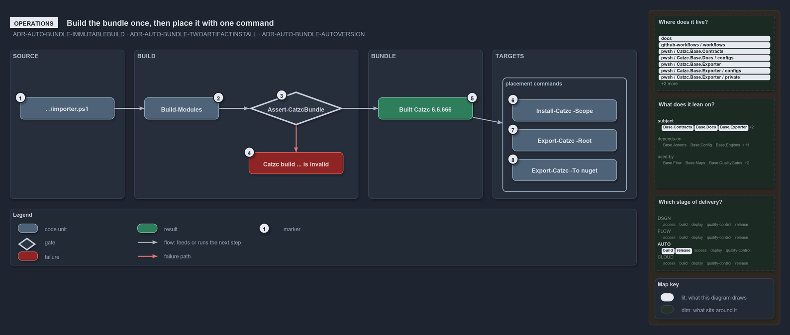

# Build the bundle once, then place it with one command

```text
Build the bundle once, then place it with one command.

1  . ./importer.ps1             source mode, which building needs
2  Build-Modules                builds; prints the local-version notice on a devbox
3  Assert-CatzcBundle           the integrity check the build runs on its own output
4  Catzc build ... is invalid   the throw that lists every violation
5  Built Catzc 6.6.666          the success line, with the build's path
6  Install-Catzc -Scope         copies the build into the user's module path
7  Export-Catzc -Root           builds, then installs beside a working root
8  Export-Catzc -To nuget       builds, then packs into out/automation/packages/

Supports ADR-AUTO-BUNDLE-IMMUTABLEBUILD, ADR-AUTO-BUNDLE-TWOARTIFACTINSTALL and ADR-AUTO-BUNDLE-AUTOVERSION (operations lens).
```

Building and placing the bundle takes two commands at the prompt. In a source-mode session a person runs `Build-Modules`, which verifies its
own output and prints where the build went, and then one command places it: `Install-Catzc -Scope CurrentUser`, `Export-Catzc -Root <dir>`,
or `Export-Catzc -To nuget`. A build that fails its integrity check throws with the whole list of what is wrong.



## Walkthrough

1. **. ./importer.ps1.** Building needs the source mode, so the session starts by dot-sourcing the importer at the repository root. The
   build engine asserts the source tree and fails fast anywhere else.
2. **Build-Modules.** On a devbox it prints the yellow notice "local build — version 6.6.666; real versions are assigned only by the
   pipeline". In a pipeline the version is calculated instead, and a shallow clone throws "Cannot calculate the build version: the
   repository is a shallow clone, …".
3. **Assert-CatzcBundle.** The build runs the integrity check on its own output, so nobody needs to call it by hand.
4. **Catzc build … is invalid.** A failed check throws `Catzc build at '<path>' is invalid:` followed by every violation, one per line.
5. **Built Catzc 6.6.666.** A passing build prints "Built Catzc 6.6.666 (… modules, … files, types …) ->
   out/automation/build/Catzc/6.6.666".
6. **Install-Catzc -Scope.** `Install-Catzc -Scope CurrentUser` copies the build in `out/` into the user's module path, after which
   `Import-Module Catzc` loads it from any shell. It prints `Installed Catzc <version> -> module …`, or "Already current:" when the content
   hash already matches.
7. **Export-Catzc -Root.** `Export-Catzc -Root <dir>` builds first and then installs beside that working root, so it needs no earlier
   `Build-Modules`. Dot-sourcing `<dir>/importer.ps1` then loads cats from the installed build.
8. **Export-Catzc -To nuget.** It builds first and packs the build into `out/automation/packages/`. The manual Release workflow runs it.

Every placement that installs, from `Install-Catzc` or from `Export-Catzc -Root`, verifies the build again before it touches the
destination; a failure there throws the same message.

## Why it holds

- `Assert-CatzcBundle` is the integrity guard, and `Build-Modules` runs it as a self-check on its own output
  (ADR-AUTO-BUNDLE-IMMUTABLEBUILD).
- `Export-Catzc -Root` installs beside a working root, `Install-Catzc -Scope CurrentUser` into the module path, and `Export-Catzc -To nuget`
  packs into `out/automation/packages/`; every install is idempotent (ADR-AUTO-BUNDLE-TWOARTIFACTINSTALL).
- A devbox build carries the `6.6.666` placeholder with a yellow notice, and a pipeline build gets a calculated version that needs the full
  history (ADR-AUTO-BUNDLE-AUTOVERSION).

## See also

- [Platform bundle](../../drs/automation/platform-bundle.md) — the decision this article explains.
- The other lenses on the same bundle: [meta](one-commit-one-immutable-package.md), [architecture](every-code-root-is-a-copy.md),
  [implementation](build-verify-then-copy-the-folder.md) and [governance](what-gates-each-bundle-stage.md).
- [The automation explanations](index.md) · [How to read the diagrams](../index.md#how-to-read-the-diagrams)
