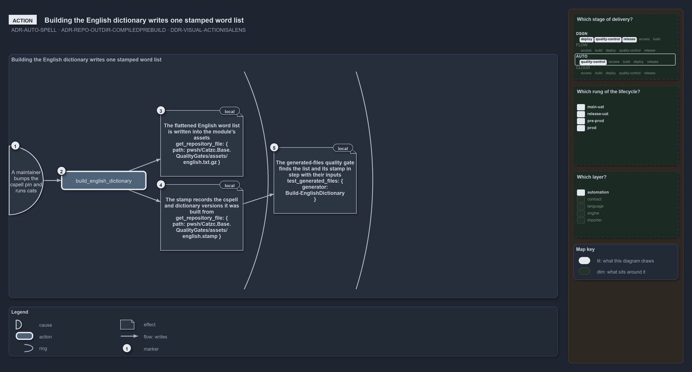

---
catzc:
  warning: "Header is generated by Format-FileMeta via Format-Code; do not change it"
  edges:
    cites:
      - ADR-AUTO-ACCOSTED-ARTICLERENDERING
      - ADR-AUTO-SPELL
      - ADR-REPO-OUTDIR-COMPILEDPREBUILD
      - DDR-VISUAL-ACTIONISALENS
      - DDR-VISUAL-PROOFISTHEACCOSTEDFILE
    drs_total: 5
---

# Building the English dictionary writes one stamped word list

```text
A maintainer bumps the cspell pin and runs cats; one command rebuilds the English half of the spelling oracle.

1  A maintainer bumps the cspell pin and runs cats   the cause: the pinned cspell changed, so its dictionaries may have
2  build_english_dictionary                          the action: one command, in the contract form
3  The flattened English word list                   zone 1, local: get_repository_file shows assets/english.txt.gz
4  The stamp                                         zone 1, local: get_repository_file shows assets/english.stamp
5  The generated-files quality gate                          zone 2, local, after 4: test_generated_files sees no drift for the builder

Supports ADR-AUTO-SPELL, ADR-REPO-OUTDIR-COMPILEDPREBUILD and DDR-VISUAL-ACTIONISALENS (action lens).
```

The spelling quality gate judges every identifier fragment against two halves of one oracle: the curated terminology registry, and the
English word list of the pinned cspell. The English half is not read live from a package at check time; it is a committed, stamped artifact
that one command builds. This diagram is that command and what it leaves in the tree. The two files land together in the first zone; the
drift check in the second zone is what keeps them honest afterwards.



## Walkthrough

1. **A maintainer bumps the cspell pin and runs cats.** The cause is a change to the pinned tool: a new cspell may ship new dictionaries, so
   the committed word list must be rebuilt from it.
2. **build_english_dictionary.** The action is one command in the contract form, with no arguments. It is an authoring step: it writes into
   the source module, never into an installed build
   ([ADR-REPO-OUTDIR-COMPILEDPREBUILD](../../drs/repository/dedicated-output-directory.md#rule-adr-repo-outdir-compiledprebuild)).
3. **The flattened English word list.** The first zone holds what the command writes directly. cspell's bundled English dictionaries are
   flattened into one compressed list, `assets/english.txt.gz`, and the observation that shows it is `get_repository_file` on that path.
4. **The stamp.** Beside the list, in the same zone and the same run of the command, a sidecar stamp records the cspell and dictionary
   versions the list was built from. The two files are one artifact in two parts, which is why they stand in one zone.
5. **The generated-files quality gate.** The second zone holds what the two files cause further out. The generated-files registry names the
   builder with its inputs and its outputs, and `test_generated_files` for that generator finds the outputs in step with the inputs: the
   gate that fails the moment someone bumps the pin without rebuilding ([ADR-AUTO-SPELL](../../drs/automation/spell-out-names.md)).

## The proof

The drawing never says what the proof does not run. The three runs below are copied from the accosted file the diagram names, and each
observation on the drawing occurs in them verbatim
([DDR-VISUAL-PROOFISTHEACCOSTEDFILE](../../drs/design/visual-design.md#rule-ddr-visual-proofistheaccostedfile)).

```yml accosted
runs:
  - - get_repository_file: { path: pwsh/Catzc.Base.QualityGates/assets/english.txt.gz }
  - - get_repository_file: { path: pwsh/Catzc.Base.QualityGates/assets/english.stamp }
  - - test_generated_files: { generator: Build-EnglishDictionary }
```

The same runs in PowerShell, rendered from that file by `Get-AccostedFragment`, never written by hand
([ADR-AUTO-ACCOSTED-ARTICLERENDERING](../../drs/automation/accosted-language.md#rule-adr-auto-accosted-articlerendering)):

```powershell
Get-RepositoryFile -Path 'pwsh/Catzc.Base.QualityGates/assets/english.txt.gz'

Get-RepositoryFile -Path 'pwsh/Catzc.Base.QualityGates/assets/english.stamp'

Test-GeneratedFiles -Generator 'Build-EnglishDictionary'
```

## Why it holds

- The English half of the oracle is a committed, version-stamped artifact, built by one command from the pinned cspell, so a spelling
  verdict never depends on what happens to be installed (ADR-AUTO-SPELL).
- An authoring step writes its committed artifact into the source module, never into an installed build (ADR-REPO-OUTDIR-COMPILEDPREBUILD).
- The two files stand in one zone because one run of the command writes both; the gate stands in the next because it is what the files
  cause, not what the command does (DDR-VISUAL-ACTIONISALENS).

The generated-files quality gate proves that the committed files match their inputs today; it does not prove that the word list is complete,
which is the pinned dictionary's promise, not this command's.

## See also

- [Spell out names](../../drs/automation/spell-out-names.md) — the decision this article explains.
- [Visual design](../../drs/design/visual-design.md) — how an action diagram is drawn.
- [The automation explanations](index.md) · [How to read the diagrams](../index.md#how-to-read-the-diagrams)
