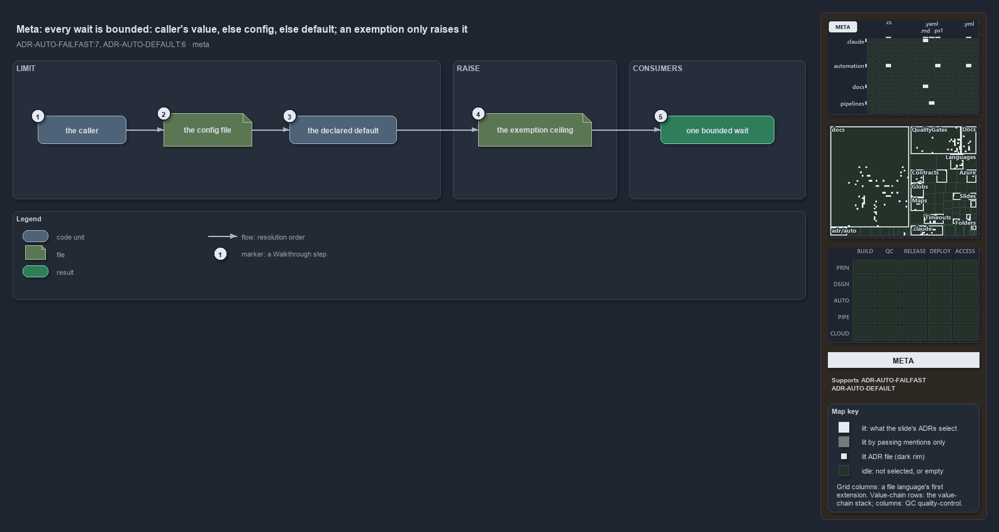

---
catzc:
  immutable:
    repo_status: clean
    path: docs/explanation/automation/callers-value-else-config-else-default.md
    folder: docs/explanation/automation
    name: callers-value-else-config-else-default
    filetype: md
    kind: explanation
    language: markdown
    track: docs
    tracktype: documentation
  edges:
    cites:
      - ADR-AUTO-DEFAULT#6
      - ADR-AUTO-FAILFAST#7
    links:
      - docs/adr/automation/fail-fast-with-asserts.md
      - docs/adr/automation/sensible-defaults.md
      - docs/explanation/.assets/adr-auto-failfast--callers-value-else-config-else-default--meta.drawio.png
      - docs/explanation/automation/a-stopped-run-names-its-limit.md
      - docs/explanation/automation/callers-value-else-config-else-default.drawio.md
      - docs/explanation/automation/index.md
      - docs/explanation/automation/one-resolver-every-consumer-but-the-hook.md
      - docs/explanation/automation/one-rule-per-stage-and-two-gaps.md
      - docs/explanation/automation/resolve-one-limit-in-code-order.md
      - docs/explanation/index.md#how-to-read-the-diagrams
---

# Every wait is bounded: the caller's value, else the config, else the default; an exemption only raises it

```text
Every wait is bounded, and its limit resolves in one order: the caller's value, else the config, else the declared default.

1  the caller             the function that waits; a value it names wins
2  the config file        timeouts.yml, read when the caller names nothing
3  the declared default   the value on the config type, when the file states nothing
4  the exemption ceiling  timeout-exemptions.yml: an exempt budget runs up to it, never past it
5  one bounded wait       the process or script block, stopped at the limit

Supports ADR-AUTO-FAILFAST#7 and ADR-AUTO-DEFAULT#6 (meta lens).
```

A hang is the slowest failure cats can have: a process waiting on a prompt nobody answers holds a terminal, a pipeline agent or a coding
agent until someone notices, with nothing to say where it stopped. So every wait in cats runs inside a time safeguard, and the limit it runs
under is a configurable setting that resolves the same way as every other setting: the caller's explicit value, else the owning module's
configuration, else the sensible default declared once on the config type. An exemption can raise that limit to a ceiling while slow work is
tuned, and nothing removes it, because there is no "no limit" value.



The diagram is described element by element in [its asset description](callers-value-else-config-else-default.drawio.md).

## Walkthrough

1. **The caller.** The function that is about to wait may name its own limit, as `-Seconds` on `Invoke-WithTimeout` or `-TimeoutSeconds` on
   `Invoke-Executable`. A named value wins outright, and it is itself bounded: it must be a whole number of at least one second.
2. **The config file.** When the caller names nothing, the limit comes from `timeouts.yml`, the one config that `Catzc.Base.Timeouts` owns,
   read through `Get-Config`. Today the file states only the per-executable entries that have been tuned, such as 600 seconds for `dotnet`
   and 1800 for `az`; it carries no `limits` block at all.
3. **The declared default.** When the file states nothing for a key, the sensible default applies. It is declared exactly once, on the
   config type `TimeoutsConfig`, so an omitted key and a fresh checkout behave the same: on a devbox 3 seconds for pwsh work and for a
   foreground bash call, 360 for a background bash call; in a pipeline 600, 600 and 3600.
4. **The exemption ceiling.** Work that is known to be slow while it is fixed carries an immutable budget GUID and is listed in
   `timeout-exemptions.yml`. An exempt budget's limit is raised to the ceiling of its run environment and shell, 600 seconds on a devbox and
   3600 in a pipeline by default, and never lowered: the raise is the larger of the limit and the ceiling. No budget is exempt today.
5. **One bounded wait.** Whatever won, the wait runs under a positive number of seconds. `Invoke-Executable` kills the child process tree at
   that limit and `Invoke-WithTimeout` stops the script block, and the error names the limit and where to change it.

## Why it holds

- Every external call and every unbounded piece of work runs inside a time safeguard, with the limits in one config keyed by run environment
  and execution engine, sensible defaults on the config type, per-executable entries, and no "no limit" value; an exemption raises a limit
  to a ceiling but never lifts it (ADR-AUTO-FAILFAST#7).
- A configurable setting resolves in one fixed order, the caller's explicit value, else the owning module's configuration, else the sensible
  default, and that default is declared exactly once, on the setting's config type (ADR-AUTO-DEFAULT#6).

## Where the code and the ADR differ

The ADR bounds every external call, yet `Invoke-Executable -Direct`, the interactive mode, runs with no limit, on the grounds that a person
at the prompt is its safeguard. The ADR also lets an exemption raise the limit of an agent's bash call, and the exemptions file accepts a
bash ceiling and a `shell: bash` scope, but the hook that bounds bash calls reads `TimeoutsConfig` only, so a bash exemption has no effect.

## See also

- [Fail fast with inline assertions](../../adr/automation/fail-fast-with-asserts.md) and
  [Sensible defaults for all parameters](../../adr/automation/sensible-defaults.md) — the decisions this article explains.
- The other lenses on the same resolution: [architecture](one-resolver-every-consumer-but-the-hook.md),
  [implementation](resolve-one-limit-in-code-order.md), [operations](a-stopped-run-names-its-limit.md) and
  [governance](one-rule-per-stage-and-two-gaps.md).
- [The automation explanations](index.md) · [How to read the diagrams](../index.md#how-to-read-the-diagrams)
