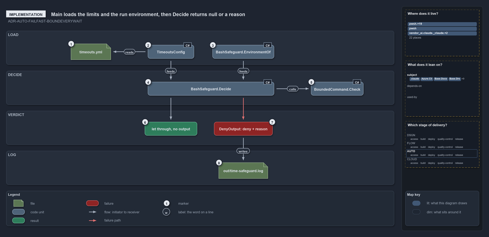

---
catzc:
  edges:
    cites:
      - ADR-AUTO-FAILFAST-BOUNDEVERYWAIT
---

# Main loads the limits and the run environment, then Decide returns null or a reason

```text
Main loads the limits and the run environment, then Decide returns null to let the call through or a reason to deny it.

1  timeouts.yml                 loaded by the hook itself, three folders up from the published program
2  TimeoutsConfig               the typed limits; no limits: section today, so the defaults apply
3  BashSafeguard.EnvironmentOf  devbox or pipeline, from TF_BUILD and GITHUB_ACTIONS
4  BashSafeguard.Decide         the verdict on the payload: the background rule or the foreground rule
5  BoundedCommand.Check         the background rule: prefix, then duration, then one command
6  let through, no output       Decide returns null; Main prints nothing and exits 0
7  DenyOutput: deny + reason    Decide returns a reason; Main prints the PreToolUse denial
8  out/time-safeguard.log       one tab-separated line per denial, the list of blockers to tune

Supports ADR-AUTO-FAILFAST-BOUNDEVERYWAIT (implementation lens).
```

The hook program is short on purpose: `Main` in `Program.cs` does the input and output, and every decision is made by the types it compiles
in from `Catzc.Base.Timeouts`. In code order, `Main` loads `timeouts.yml` into a `TimeoutsConfig`, reads the run environment, hands the
call's payload to `BashSafeguard.Decide`, and acts on what comes back: nothing, or a reason. The verdict for a background call is delegated
once more, to `BoundedCommand.Check`.

```yml drawio
description:
  "The bash hook's program loads the limits and the run environment, hands the call to Decide, and acts on what comes back: nothing to let
  the call through, or a reason that becomes a denial and one line in the blocker log."
about:
  adrs: [ADR-AUTO-FAILFAST-BOUNDEVERYWAIT]
  lens: implementation
content:
  title: Main loads the limits and the run environment, then Decide returns null or a reason
  kind: explanation
  flow: top-to-bottom
  relation: feeds the next step
  theme: dark
  bands:
    - { id: band-load, label: LOAD }
    - { id: band-decide, label: DECIDE }
    - { id: band-verdict, label: VERDICT }
    - { id: band-log, label: LOG }
  glyphs:
    - { id: g-timeouts, kind: file, label: timeouts.yml, in: band-load }
    - { id: g-config, kind: code, label: TimeoutsConfig, in: band-load }
    - { id: g-environment, kind: code, label: BashSafeguard.EnvironmentOf, in: band-load }
    - { id: g-decide, kind: code, label: BashSafeguard.Decide, in: band-decide }
    - { id: g-bounded, kind: code, label: BoundedCommand.Check, in: band-decide }
    - { id: r-through, kind: result, label: "let through, no output", in: band-verdict }
    - { id: f-deny, kind: failure, label: "DenyOutput: deny + reason", in: band-verdict }
    - { id: g-log, kind: file, label: out/time-safeguard.log, in: band-log }
  edges:
    - { from: g-timeouts, to: g-config, kind: flow, label: "" }
    - { from: g-config, to: g-decide, kind: flow, label: "" }
    - { from: g-environment, to: g-decide, kind: flow, label: "" }
    - { from: g-decide, to: g-bounded, kind: flow, label: "" }
    - { from: g-decide, to: r-through, kind: flow, label: "" }
    - { from: g-decide, to: f-deny, kind: fail, label: "" }
    - { from: f-deny, to: g-log, kind: flow, label: "" }
  markers:
    - { at: g-timeouts, number: 1 }
    - { at: g-config, number: 2 }
    - { at: g-environment, number: 3 }
    - { at: g-decide, number: 4 }
    - { at: g-bounded, number: 5 }
    - { at: r-through, number: 6 }
    - { at: f-deny, number: 7 }
    - { at: g-log, number: 8 }
  legend: auto
  minimaps:
    code-locations:
      - cell: .claude/.claude/.
        by: [.claude/CLAUDE.md, ADR-AUTO-FAILFAST-BOUNDEVERYWAIT]
      - cell: .claude/.claude/hooks/Assert-BashTimeout
        by: [.claude/hooks/Assert-BashTimeout/Program.cs, ADR-AUTO-FAILFAST-BOUNDEVERYWAIT]
      - cell: docs/-/.
        by:
          - docs/drs/automation/dora-explains.md
          - docs/drs/automation/fail-fast-with-asserts.md
          - docs/drs/index.md
          - docs/references/pwsh/catzc-azure-cli/Assert-AzCliSubscriptionAccessible.ps1.md
          - docs/references/pwsh/catzc-base-docs/Test-Glossary.ps1.md
          - docs/references/pwsh/catzc-base-docs/tests/Test-Glossary.Tests.ps1.md
          - docs/references/pwsh/catzc-base-drs/private/Import-DrsCitationMapFile.ps1.md
          - docs/references/pwsh/catzc-base-engines/types/ExecutionEngine.cs.md
          - docs/references/pwsh/catzc-base-globs/Test-GlobSetAffected.ps1.md
          - docs/references/pwsh/catzc-base-quality-gates/private/Test-TestRunOverBudget.ps1.md
          - docs/references/pwsh/catzc-base-quality-gates/private/Write-TestAutomationVerdict.ps1.md
          - docs/references/pwsh/catzc-base-timeouts/Get-TestTimeLimits.ps1.md
          - docs/references/pwsh/catzc-base-timeouts/Watch-Blocking.ps1.md
          - docs/references/pwsh/catzc-base-timeouts/types/BashSafeguard.cs.md
          - docs/references/pwsh/catzc-base-types-system.md
          - docs/references/pwsh/catzc-base-types-system/Build-AgentHook.ps1.md
          - docs/references/pwsh/catzc-tooling-listen/Wait-DocChange.ps1.md
          - docs/references/pwsh/catzc-tooling-listen/Wait-DocNote.ps1.md
          - docs/references/pwsh/claude-hooks/Assert-BashTimeout/Program.cs.md
          - ADR-AUTO-FAILFAST-BOUNDEVERYWAIT
      - cell: pwsh/Catzc.Azure.Cli/.
        by: [pwsh/Catzc.Azure.Cli/Assert-AzCliSubscriptionAccessible.ps1, ADR-AUTO-FAILFAST-BOUNDEVERYWAIT]
      - cell: pwsh/Catzc.Base.Docs/.
        by: [pwsh/Catzc.Base.Docs/Test-Glossary.ps1, ADR-AUTO-FAILFAST-BOUNDEVERYWAIT]
      - cell: pwsh/Catzc.Base.Docs/configs
        by: [pwsh/Catzc.Base.Docs/configs/agents.yml, pwsh/Catzc.Base.Docs/configs/capabilities.yml, ADR-AUTO-FAILFAST-BOUNDEVERYWAIT]
      - cell: pwsh/Catzc.Base.Docs/tests
        by: [pwsh/Catzc.Base.Docs/tests/Test-Glossary.Tests.ps1, ADR-AUTO-FAILFAST-BOUNDEVERYWAIT]
      - cell: pwsh/Catzc.Base.Drs/configs
        by: [pwsh/Catzc.Base.Drs/configs/drs.yml, ADR-AUTO-FAILFAST-BOUNDEVERYWAIT]
      - cell: pwsh/Catzc.Base.Drs/private
        by: [pwsh/Catzc.Base.Drs/private/Import-DrsCitationMapFile.ps1, ADR-AUTO-FAILFAST-BOUNDEVERYWAIT]
      - cell: pwsh/Catzc.Base.Engines/types
        by: [pwsh/Catzc.Base.Engines/types/ExecutionEngine.cs, ADR-AUTO-FAILFAST-BOUNDEVERYWAIT]
      - cell: pwsh/Catzc.Base.Globs/.
        by: [pwsh/Catzc.Base.Globs/Test-GlobSetAffected.ps1, ADR-AUTO-FAILFAST-BOUNDEVERYWAIT]
      - cell: pwsh/Catzc.Base.Languages/tests
        by: [pwsh/Catzc.Base.Languages/tests/Get-EngineContract.Tests.ps1, ADR-AUTO-FAILFAST-BOUNDEVERYWAIT]
      - cell: pwsh/Catzc.Base.QualityGates/private
        by:
          - pwsh/Catzc.Base.QualityGates/private/Test-TestRunOverBudget.ps1
          - pwsh/Catzc.Base.QualityGates/private/Write-TestAutomationVerdict.ps1
          - ADR-AUTO-FAILFAST-BOUNDEVERYWAIT
      - cell: pwsh/Catzc.Base.Timeouts/.
        by: [pwsh/Catzc.Base.Timeouts/Get-TestTimeLimits.ps1, pwsh/Catzc.Base.Timeouts/Watch-Blocking.ps1, ADR-AUTO-FAILFAST-BOUNDEVERYWAIT]
      - cell: pwsh/Catzc.Base.Timeouts/tests/types
        by: [pwsh/Catzc.Base.Timeouts/tests/types/TimeoutsConfig.Tests.ps1, ADR-AUTO-FAILFAST-BOUNDEVERYWAIT]
      - cell: pwsh/Catzc.Base.Timeouts/types
        by: [pwsh/Catzc.Base.Timeouts/types/BashSafeguard.cs, ADR-AUTO-FAILFAST-BOUNDEVERYWAIT]
      - cell: pwsh/Catzc.Base.TypesSystem/.
        by: [pwsh/Catzc.Base.TypesSystem/Build-AgentHook.ps1, ADR-AUTO-FAILFAST-BOUNDEVERYWAIT]
      - cell: pwsh/Catzc.Internal.Assets/.
        by: [pwsh/.internal/assets/Enter-CatzcBurst.ps1, pwsh/.internal/assets/Invoke-CatzcCommand.ps1, ADR-AUTO-FAILFAST-BOUNDEVERYWAIT]
      - cell: pwsh/Catzc.Internal.Tests/.
        by:
          - pwsh/.internal/tests/Enter-CatzcBurst.Tests.ps1
          - pwsh/.internal/tests/Invoke-CatzcCommand.Tests.ps1
          - pwsh/.internal/tests/Wait-CatzcRunLock.Tests.ps1
          - ADR-AUTO-FAILFAST-BOUNDEVERYWAIT
      - cell: pwsh/Catzc.Tooling.Listen/.
        by: [pwsh/Catzc.Tooling.Listen/Wait-DocChange.ps1, pwsh/Catzc.Tooling.Listen/Wait-DocNote.ps1, ADR-AUTO-FAILFAST-BOUNDEVERYWAIT]
      - cell: pwsh/Catzc.Tooling.Listen/tests
        by:
          - pwsh/Catzc.Tooling.Listen/tests/Wait-DocChange.Tests.ps1
          - pwsh/Catzc.Tooling.Listen/tests/Wait-DocNote.Tests.ps1
          - ADR-AUTO-FAILFAST-BOUNDEVERYWAIT
    module-neighbourhood:
      - cell: subject/.claude
        by: [.claude/CLAUDE.md, .claude/hooks/Assert-BashTimeout/Program.cs, ADR-AUTO-FAILFAST-BOUNDEVERYWAIT]
      - cell: subject/Catzc.Azure.Cli
        by: [pwsh/Catzc.Azure.Cli/Assert-AzCliSubscriptionAccessible.ps1, ADR-AUTO-FAILFAST-BOUNDEVERYWAIT]
      - cell: subject/Catzc.Base.Docs
        by:
          - pwsh/Catzc.Base.Docs/Test-Glossary.ps1
          - pwsh/Catzc.Base.Docs/configs/agents.yml
          - pwsh/Catzc.Base.Docs/configs/capabilities.yml
          - pwsh/Catzc.Base.Docs/tests/Test-Glossary.Tests.ps1
          - ADR-AUTO-FAILFAST-BOUNDEVERYWAIT
      - cell: subject/Catzc.Base.Drs
        by:
          - pwsh/Catzc.Base.Drs/configs/drs.yml
          - pwsh/Catzc.Base.Drs/private/Import-DrsCitationMapFile.ps1
          - ADR-AUTO-FAILFAST-BOUNDEVERYWAIT
      - cell: subject/Catzc.Base.Engines
        by: [pwsh/Catzc.Base.Engines/types/ExecutionEngine.cs, ADR-AUTO-FAILFAST-BOUNDEVERYWAIT]
      - cell: subject/Catzc.Base.Globs
        by: [pwsh/Catzc.Base.Globs/Test-GlobSetAffected.ps1, ADR-AUTO-FAILFAST-BOUNDEVERYWAIT]
      - cell: subject/Catzc.Base.Languages
        by: [pwsh/Catzc.Base.Languages/tests/Get-EngineContract.Tests.ps1, ADR-AUTO-FAILFAST-BOUNDEVERYWAIT]
      - cell: subject/Catzc.Base.QualityGates
        by:
          - pwsh/Catzc.Base.QualityGates/private/Test-TestRunOverBudget.ps1
          - pwsh/Catzc.Base.QualityGates/private/Write-TestAutomationVerdict.ps1
          - ADR-AUTO-FAILFAST-BOUNDEVERYWAIT
      - cell: subject/Catzc.Base.Timeouts
        by:
          - pwsh/Catzc.Base.Timeouts/Get-TestTimeLimits.ps1
          - pwsh/Catzc.Base.Timeouts/Watch-Blocking.ps1
          - pwsh/Catzc.Base.Timeouts/tests/types/TimeoutsConfig.Tests.ps1
          - pwsh/Catzc.Base.Timeouts/types/BashSafeguard.cs
          - ADR-AUTO-FAILFAST-BOUNDEVERYWAIT
      - cell: subject/Catzc.Base.TypesSystem
        by: [pwsh/Catzc.Base.TypesSystem/Build-AgentHook.ps1, ADR-AUTO-FAILFAST-BOUNDEVERYWAIT]
      - cell: subject/Catzc.Internal.Assets
        by: [pwsh/.internal/assets/Enter-CatzcBurst.ps1, pwsh/.internal/assets/Invoke-CatzcCommand.ps1, ADR-AUTO-FAILFAST-BOUNDEVERYWAIT]
      - cell: subject/Catzc.Internal.Tests
        by:
          - pwsh/.internal/tests/Enter-CatzcBurst.Tests.ps1
          - pwsh/.internal/tests/Invoke-CatzcCommand.Tests.ps1
          - pwsh/.internal/tests/Wait-CatzcRunLock.Tests.ps1
          - ADR-AUTO-FAILFAST-BOUNDEVERYWAIT
      - cell: subject/Catzc.Tooling.Listen
        by:
          - pwsh/Catzc.Tooling.Listen/Wait-DocChange.ps1
          - pwsh/Catzc.Tooling.Listen/Wait-DocNote.ps1
          - pwsh/Catzc.Tooling.Listen/tests/Wait-DocChange.Tests.ps1
          - pwsh/Catzc.Tooling.Listen/tests/Wait-DocNote.Tests.ps1
          - ADR-AUTO-FAILFAST-BOUNDEVERYWAIT
    axis:
      - cell: AUTO/*
        by: [ADR-AUTO-FAILFAST-BOUNDEVERYWAIT]
layout:
  band-load: { x: 20, y: 84, w: 1260, h: 110 }
  band-decide: { x: 20, y: 214, w: 1260, h: 110 }
  band-verdict: { x: 20, y: 344, w: 1260, h: 110 }
  band-log: { x: 20, y: 474, w: 1260, h: 110 }
  g-timeouts: { x: 300, y: 126, w: 130, h: 52 }
  g-config: { x: 480, y: 130, w: 150, h: 44 }
  g-environment: { x: 690, y: 130, w: 200, h: 44 }
  g-decide: { x: 480, y: 250, w: 410, h: 44 }
  g-bounded: { x: 1010, y: 250, w: 170, h: 44 }
  r-through: { x: 470, y: 380, w: 170, h: 44 }
  f-deny: { x: 695, y: 380, w: 190, h: 44 }
  g-log: { x: 710, y: 512, w: 160, h: 52 }
```



## Walkthrough

1. **timeouts.yml.** `Main` finds the repository root three folders up from the published program and loads
   `pwsh/Catzc.Base.Timeouts/configs/timeouts.yml` with its own YAML loader, typing a plain integer as a number and a quoted scalar as a
   string, the way the module's loader does.
2. **TimeoutsConfig.** The loaded map becomes a `TimeoutsConfig`, which validates it and fills in the sensible defaults. The file has no
   `limits:` section today, so the bash limits are the defaults: 3 s foreground and 360 s background at a devbox, 600 s and 3600 s in a
   pipeline.
3. **BashSafeguard.EnvironmentOf.** The run environment is `Pipeline` when `TF_BUILD` or `GITHUB_ACTIONS` is set to anything, and `Devbox`
   otherwise, the same test the one pipeline-detection function makes.
4. **BashSafeguard.Decide.** The payload from standard input gives `tool_input.command`, `tool_input.timeout`,
   `tool_input.run_in_background`, `agent_id` and `agent_type`; the actor is `pipeline`, `subagent:<type>` (or the id) or `main`. A
   background call takes the background rule. A foreground call is let through when `0 < timeout <= limit x 1000` ms; a missing or
   non-number timeout counts as "no timeout".
5. **BoundedCommand.Check.** The background rule runs three checks in order and stops at the first that fails: the command starts with GNU
   `timeout [options] <duration>` (an `s`, `m`, `h` or `d` suffix is allowed); the duration is `0 < N <= limit` seconds; and what follows is
   one command, with no `&&`, `||`, `;`, `|`, background `&` or newline outside quotes, where the `&` of a redirection is fine.
6. **Let through, no output.** When the call carries its limit, `Decide` returns null. `Main` prints nothing and exits 0, which is how a
   PreToolUse hook lets a call continue into the normal permission flow.
7. **DenyOutput: deny + reason.** Otherwise `Decide` returns the reason: the problem, the file the limits live in, the fix, and the
   escalation for the actor. `Main` prints `BashSafeguard.DenyOutput`, a `hookSpecificOutput` with `hookEventName: PreToolUse`,
   `permissionDecision: deny` and the reason.
8. **out/time-safeguard.log.** On each denial `Main` also appends the log line `Decide` built: the UTC time, the environment, the actor,
   foreground or background, what was requested, the limit, and the command cut to 120 characters, tab-separated. Allowed calls are not
   logged, so the file is the list of blockers to tune.

## Why it holds

- Every wait is bounded, the bash limits bound every shell call an agent makes, and a hook denies a call outside them; a foreground call
  passes its timeout, and a background call starts with a GNU `timeout` around a single command because the Bash tool does not apply its
  timeout there (ADR-AUTO-FAILFAST-BOUNDEVERYWAIT).
- The hook denies and never rewrites, and each denial is appended to `out/time-safeguard.log`, the list of blockers to tune
  (ADR-AUTO-FAILFAST-BOUNDEVERYWAIT).

## See also

- [Fail fast with inline assertions](../../drs/automation/fail-fast-with-asserts.md) — the decision this article explains.
- The other lenses on the same verdict: [meta](a-shell-call-carries-its-limit-or-is-denied.md),
  [architecture](hook-compiles-module-verdict-and-limits.md), [operations](pass-the-limit-or-the-call-is-denied.md) and
  [governance](three-tests-prove-the-hook.md).
- [The automation explanations](index.md) · [How to read the diagrams](../index.md#how-to-read-the-diagrams)
