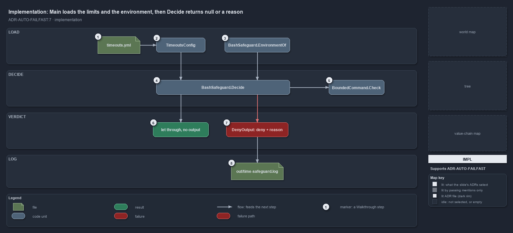

---
catzc:
  immutable:
    with_body_sha: "9302c72f3cc8"
    path: docs/explanation/automation/decide-returns-null-or-a-reason.md
    folder: docs/explanation/automation
    name: decide-returns-null-or-a-reason
    filetype: md
    kind: explanation
    language: markdown
    track: docs
    tracktype: documentation
  edges:
    cites:
      - ADR-AUTO-FAILFAST#7
    links:
      - docs/.assets/explanation/adr-auto-failfast--decide-returns-null-or-a-reason--implementation.drawio.md
      - docs/.assets/explanation/adr-auto-failfast--decide-returns-null-or-a-reason--implementation.drawio.png
      - docs/adr/automation/fail-fast-with-asserts.md
      - docs/explanation/automation/a-shell-call-carries-its-limit-or-is-denied.md
      - docs/explanation/automation/hook-compiles-module-verdict-and-limits.md
      - docs/explanation/automation/index.md
      - docs/explanation/automation/pass-the-limit-or-the-call-is-denied.md
      - docs/explanation/automation/three-tests-prove-the-hook.md
      - docs/explanation/index.md#how-to-read-the-diagrams
---

# Main loads the limits and the run environment, then Decide returns null or a reason

```text
Main loads the limits and the run environment, then Decide returns null to let the call through or a reason to deny it.

1  timeouts.yml                 loaded by the hook itself, three folders up from the published program
2  TimeoutsConfig               the typed limits; no limits: section today, so the defaults apply
3  BashSafeguard.EnvironmentOf  devbox or pipeline, from TF_BUILD and GITHUB_ACTIONS
4  BashSafeguard.Decide         the verdict on the payload: the background rule or the foreground rule
5  BoundedCommand.Check         the background rule: prefix, then duration, then one command
6  let through, no output       Decide returns null; Main prints nothing and exits 0
7  DenyOutput: deny + reason    Decide returns a reason; Main prints the PreToolUse denial
8  out/time-safeguard.log       one tab-separated line per denial, the list of blockers to tune

Supports ADR-AUTO-FAILFAST#7 (implementation lens).
```

The hook program is short on purpose: `Main` in `Program.cs` does the input and output, and every decision is made by the types it compiles
in from `Catzc.Base.Timeouts`. In code order, `Main` loads `timeouts.yml` into a `TimeoutsConfig`, reads the run environment, hands the
call's payload to `BashSafeguard.Decide`, and acts on what comes back: nothing, or a reason. The verdict for a background call is delegated
once more, to `BoundedCommand.Check`.



The diagram is described element by element in
[its asset description](../../.assets/explanation/adr-auto-failfast--decide-returns-null-or-a-reason--implementation.drawio.md).

## Walkthrough

1. **timeouts.yml.** `Main` finds the repository root three folders up from the published program and loads
   `automation/Catzc.Base.Timeouts/configs/timeouts.yml` with its own YAML loader, typing a plain integer as a number and a quoted scalar as
   a string, the way the module's loader does.
2. **TimeoutsConfig.** The loaded map becomes a `TimeoutsConfig`, which validates it and fills in the sensible defaults. The file has no
   `limits:` section today, so the bash limits are the defaults: 3 s foreground and 360 s background at a devbox, 600 s and 3600 s in a
   pipeline.
3. **BashSafeguard.EnvironmentOf.** The run environment is `Pipeline` when `TF_BUILD` or `GITHUB_ACTIONS` is set to anything, and `Devbox`
   otherwise, the same test the one pipeline-detection function makes.
4. **BashSafeguard.Decide.** The payload from standard input gives `tool_input.command`, `tool_input.timeout`,
   `tool_input.run_in_background`, `agent_id` and `agent_type`; the actor is `pipeline`, `subagent:<type>` (or the id) or `main`. A
   background call takes the background rule. A foreground call is let through when `0 < timeout <= limit x 1000` ms; a missing or
   non-number timeout counts as "no timeout".
5. **BoundedCommand.Check.** The background rule runs three checks in order and stops at the first that fails: the command starts with GNU
   `timeout [options] <duration>` (an `s`, `m`, `h` or `d` suffix is allowed); the duration is `0 < N <= limit` seconds; and what follows is
   one command, with no `&&`, `||`, `;`, `|`, background `&` or newline outside quotes, where the `&` of a redirection is fine.
6. **Let through, no output.** When the call carries its limit, `Decide` returns null. `Main` prints nothing and exits 0, which is how a
   PreToolUse hook lets a call continue into the normal permission flow.
7. **DenyOutput: deny + reason.** Otherwise `Decide` returns the reason: the problem, the file the limits live in, the fix, and the
   escalation for the actor. `Main` prints `BashSafeguard.DenyOutput`, a `hookSpecificOutput` with `hookEventName: PreToolUse`,
   `permissionDecision: deny` and the reason.
8. **out/time-safeguard.log.** On each denial `Main` also appends the log line `Decide` built: the UTC time, the environment, the actor,
   foreground or background, what was requested, the limit, and the command cut to 120 characters, tab-separated. Allowed calls are not
   logged, so the file is the list of blockers to tune.

## Why it holds

- Every wait is bounded, the bash limits bound every shell call an agent makes, and a hook denies a call outside them; a foreground call
  passes its timeout, and a background call starts with a GNU `timeout` around a single command because the Bash tool does not apply its
  timeout there (ADR-AUTO-FAILFAST#7).
- The hook denies and never rewrites, and each denial is appended to `out/time-safeguard.log`, the list of blockers to tune
  (ADR-AUTO-FAILFAST#7).

## Where the code and the ADR differ

- The ADR states that an agent cannot start a shell call that has no limit. A hook error, a payload that is not JSON for instance, exits 1
  as a non-blocking error and the call goes ahead; so does an unbuilt hook.
- The hook reads `timeouts.yml` with its own YAML loader, while the file's header says it is loaded by `Get-Config`.

## See also

- [Fail fast with inline assertions](../../adr/automation/fail-fast-with-asserts.md) — the decision this article explains.
- The other lenses on the same verdict: [meta](a-shell-call-carries-its-limit-or-is-denied.md),
  [architecture](hook-compiles-module-verdict-and-limits.md), [operations](pass-the-limit-or-the-call-is-denied.md) and
  [governance](three-tests-prove-the-hook.md).
- [The automation explanations](index.md) · [How to read the diagrams](../index.md#how-to-read-the-diagrams)
