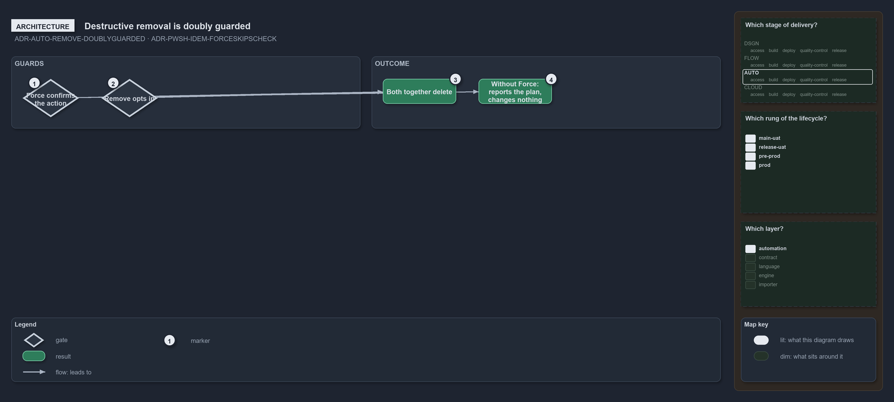

---
catzc:
  warning: "Experimental: this article merges two rules into one and holds nothing beyond what they say"
  edges:
    cites:
      - ADR-AUTO-REMOVE-DOUBLYGUARDED
      - ADR-PWSH-IDEM-FORCESKIPSCHECK
---

# Destructive removal is doubly guarded and force redoes the work

This article is one rule: [ADR-AUTO-REMOVE-DOUBLYGUARDED](../../drs/automation/tool-removal-lifecycle.md#rule-adr-auto-remove-doublyguarded)
and [ADR-PWSH-IDEM-FORCESKIPSCHECK](../../drs/automation/pwsh/idempotent-state-mechanics.md#rule-adr-pwsh-idem-forceskipscheck) merged into
one. It holds nothing beyond what those two rules say.

Destructive removal is doubly guarded: `-Force` confirms the action, and without it the function reports the plan and changes nothing, and
through the escalation a separate `-Remove` switch opts in, so neither switch alone deletes. On a state function `-Force` is the one switch
that skips the check before acting and redoes the work, replacing an install at the wrong version; without it, a re-run that finds the
desired state changes nothing.

