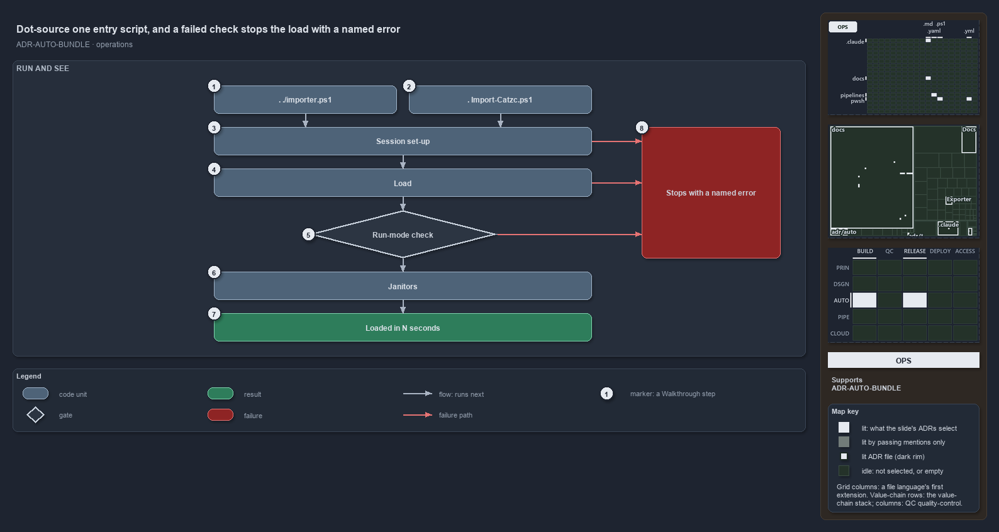

# Dot-source one entry script, and a failed check stops the load with a named error

```text
Dot-source one entry script; a failed check stops the load with a named error.

1  . ./importer.ps1           enters source mode
2  . Import-Catzc.ps1         enters build mode; Import-Module Catzc runs the same file
3  Session set-up             preferences and roots; an old PowerShell stops here
4  Load                       a name clash or an incomplete bundle stops here
5  Run-mode check             a module left over from the other mode stops here
6  Janitors                   rewrite generated files; skipped in build mode
7  Loaded in N seconds        the one line a console session ends on
8  Stops with a named error   each failed check says what to do

Supports ADR-AUTO-BUNDLE-ONELIVINGIMPORTER and ADR-AUTO-BUNDLE-BUNDLEISSESSION (operations lens).
```

A person starts cats by dot-sourcing one entry script, one per run mode, and sees the same load either way. Three checks along the way can
stop it: an old PowerShell, a function-name clash or an incomplete bundle, and a module left over from the other run mode. Each stop names
what is wrong. Otherwise a console session ends on one "Loaded in N seconds" line.



The diagram is described element by element in [its asset description](.assets/dot-source-one-entry-script/diagram.drawio.md).

## Walkthrough

1. **`. ./importer.ps1`.** This starts the load in source mode. Useful switches are `-SkipJanitors` for a lean load, `-ClearCompiledTypes`
   to rebuild the C# types from source, `-AllowWarnings`, `-DiagnoseLoadTime`, `-ExportPrivates` and `-CleanClone`. Dot-sourcing makes its
   `$global:` and `$env:` effects land in the caller's session.
2. **`. <build>/Import-Catzc.ps1`.** This enters build mode, with `-RepositoryRoot` and `-AllowWarnings`; `Import-Module Catzc` runs the
   same file. Build mode forces the janitors off and never compiles.
3. **Session set-up.** Warnings stop the load unless `-AllowWarnings` is given, and `-Verbose` shows the `Session:` and `Roots:` lines. An
   old PowerShell stops here. In source mode at a person's own console, a process that still holds C# types whose sources have changed says
   so and continues the import in a new PowerShell in the same window; `exit` there returns to the old session.
4. **Load.** `-DiagnoseLoadTime` prints per-stage timings and a summary. Two modules exporting one name, or a function that would shadow a
   vendored or built-in command, stops here; so does a bundle that is missing its prebuilt types DLL or a module manifest.
5. **Run-mode check.** A catzc module still loaded from the other mode's root stops the load here.
6. **Janitors.** The janitors may rewrite generated files, such as the ADR index, the READMEs and the managed root configs. On Windows they
   warn when `PSModulePath` holds a network share and print the fix script. They are skipped with `-SkipJanitors`, and always in build mode.
7. **Loaded in N seconds.** A console session prints "Loaded in N seconds (module import …s, session initializer/finalizer …s)". A script
   that dot-sources an entry script sees no such line.
8. **Stops with a named error.** Each failed check throws a message that says what to do:
   - an old PowerShell: "The Catzc toolset requires PowerShell 7.4 or later (found …).";
   - a name clash: "Function name collision(s) detected before import…";
   - an incomplete bundle: a missing types DLL or module manifest, with the advice to rebuild the bundle;
   - a mixed session: "Run-mode exclusivity violated: … Restart PowerShell, or re-run the entry script of the mode you want."

## Why it holds

- Every entry script ends in the one living importer, so both run modes run the same checks in the same order
  (ADR-AUTO-BUNDLE-ONELIVINGIMPORTER).
- A loaded bundle is a session, not a passive library: it sets the same fail-fast preferences, which is why a warning stops the load unless
  it is allowed (ADR-AUTO-BUNDLE-BUNDLEISSESSION).

## See also

- [Platform bundle](../../adr/automation/platform-bundle.md) — the decision this article explains.
- The other lenses on the same load sequence: [meta](every-entry-runs-one-load-sequence.md),
  [architecture](two-entries-feed-one-importer.md), [implementation](invoke-importer-in-code-order.md) and
  [governance](rule-and-gate-per-load-stage.md).
- [The automation explanations](index.md) · [How to read the diagrams](../index.md#how-to-read-the-diagrams)
