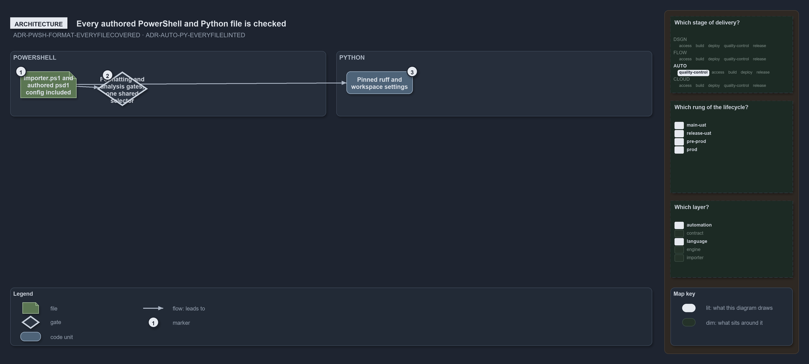

---
catzc:
  warning: "Experimental: this article merges two rules into one and holds nothing beyond what they say"
  edges:
    cites:
      - ADR-PWSH-FORMAT-EVERYFILECOVERED
      - ADR-AUTO-PY-EVERYFILELINTED
---

# Every authored powershell and python file takes the repositorys checks

This article is one rule:
[ADR-PWSH-FORMAT-EVERYFILECOVERED](../../drs/automation/pwsh/powershell-formatting.md#rule-adr-pwsh-format-everyfilecovered) and
[ADR-AUTO-PY-EVERYFILELINTED](../../drs/automation/python/python-test-artifacts.md#rule-adr-auto-py-everyfilelinted) merged into one. It
holds nothing beyond what those two rules say.

Every authored PowerShell file the repository ships or runs is covered by the formatting and analysis quality gates, including the root
`importer.ps1` and authored `.psd1` config, resolved through one shared selector so no file escapes. Every `.py` file takes the repository's
checks where a check reads Python, with the pinned ruff and the workspace's settings.

