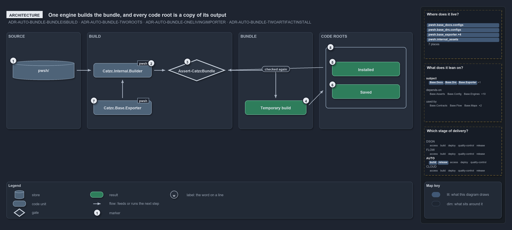

# One engine builds the bundle, and every code root is a copy of its output

```text
One engine builds the bundle, and every code root is a copy of its output.

1  pwsh/                    the source tree, the engine's only input
2  Catzc.Internal.Builder   the .internal engine, Invoke-ModuleBuild, that writes the build
3  Assert-CatzcBundle       the integrity guard, owned by the exporter
4  Temporary build          the verified build under out/pwsh/built/<bundle>/Catzc/<version>/
5  Installed                Install-Catzc -Scope CurrentUser, the user's module folder
6  Saved                    Install-Catzc -Root <dir>, the build under <dir>/.vendor/
7  Catzc.Base.Exporter      the exporter module that drives the engine and owns the lifecycle
8  Checked again            Install-Catzc runs the guard before it copies

Supports ADR-AUTO-BUNDLE-BUNDLEISBUILD, ADR-AUTO-BUNDLE-TWOROOTS, ADR-AUTO-BUNDLE-ONELIVINGIMPORTER and ADR-AUTO-BUNDLE-TWOARTIFACTINSTALL (architecture lens).
```

Cats runs from a code root: the folder its modules load from. In the repository that root is the source tree itself, but a bundle carries
the code anywhere else, so the platform has to be built and then copied. Seen as components, the bundle has a clear shape. One `.internal`
engine writes the build from the source tree, the exporter module drives the engine and owns the integrity guard, and every code root
outside the repository is a copy of the one verified build.

```yml drawio
description:
  One engine in the internal modules builds the bundle from the source tree, the exporter module drives it and owns the integrity guard, and
  every code root outside the repository is a copy of the one verified build.
about:
  adrs: [ADR-AUTO-BUNDLE-BUNDLEISBUILD, ADR-AUTO-BUNDLE-TWOROOTS, ADR-AUTO-BUNDLE-ONELIVINGIMPORTER, ADR-AUTO-BUNDLE-TWOARTIFACTINSTALL]
  lens: architecture
content:
  title: One engine builds the bundle, and every code root is a copy of its output
  kind: explanation
  flow: left-to-right
  relation: feeds or runs the next step
  theme: dark
  bands:
    - { id: band-source, label: SOURCE }
    - { id: band-build, label: BUILD }
    - { id: band-bundle, label: BUNDLE }
    - { id: band-roots, label: CODE ROOTS }
  groups:
    - { id: grp-roots, label: " ", in: band-roots }
  glyphs:
    - { id: s-source, kind: store, label: pwsh/, in: band-source }
    - { id: g-engine, kind: code, label: Catzc.Internal.Builder, in: band-build }
    - { id: g-exporter, kind: code, label: Catzc.Base.Exporter, in: band-build }
    - { id: g-assert, kind: gate, label: Assert-CatzcBundle, in: band-build }
    - { id: r-temporary, kind: result, label: Temporary build, in: band-bundle }
    - { id: r-installed, kind: result, label: Installed, in: grp-roots }
    - { id: r-saved, kind: result, label: Saved, in: grp-roots }
  edges:
    - { from: s-source, to: g-engine, kind: flow, label: "" }
    - { from: g-exporter, to: g-engine, kind: flow, label: "" }
    - { from: g-engine, to: g-assert, kind: flow, label: "" }
    - { from: g-assert, to: r-temporary, kind: flow, label: "" }
    - { from: r-temporary, to: grp-roots, kind: flow, label: "" }
    - { from: grp-roots, to: g-assert, kind: flow, label: checked again }
  markers:
    - { at: s-source, number: 1 }
    - { at: g-engine, number: 2 }
    - { at: g-assert, number: 3 }
    - { at: r-temporary, number: 4 }
    - { at: r-installed, number: 5 }
    - { at: r-saved, number: 6 }
    - { at: g-exporter, number: 7 }
    - { at: grp-roots, number: 8 }
  legend: auto
  minimaps: [code-locations, module-neighbourhood, axis]
layout:
  band-source: { x: 20, y: 84, w: 230, h: 300 }
  band-build: { x: 270, y: 84, w: 450, h: 300 }
  band-bundle: { x: 740, y: 84, w: 230, h: 300 }
  band-roots: { x: 990, y: 84, w: 290, h: 300 }
  s-source: { x: 40, y: 172, w: 190, h: 60 }
  g-engine: { x: 290, y: 180, w: 180, h: 44 }
  g-exporter: { x: 290, y: 296, w: 180, h: 44 }
  g-assert: { x: 520, y: 168, w: 180, h: 68 }
  r-temporary: { x: 760, y: 296, w: 190, h: 44 }
  grp-roots: { x: 1010, y: 130, w: 250, h: 190 }
  r-installed: { x: 1030, y: 176, w: 210, h: 44 }
  r-saved: { x: 1030, y: 246, w: 210, h: 44 }
```



## Walkthrough

1. **pwsh/.** The source tree under the working root is the only input. The engine asserts that it runs in the source tree and refuses to
   run anywhere else.
2. **Catzc.Internal.Builder.** The `.internal` engine, `Invoke-ModuleBuild`, does the writing: the closure over the declared dependencies,
   the merged function files, the manifests, the types DLL, the vendor and `.internal` copies, and `build.json`.
3. **Assert-CatzcBundle.** The integrity guard checks what the engine wrote and throws with every violation it finds. It belongs to the
   exporter, not to the engine.
4. **Temporary build.** The verified build lands under `out/pwsh/built/<bundle>/Catzc/<version>/`. It is the package every placement copies.
5. **Installed.** `Install-Catzc -Scope CurrentUser` copies the build into the user's own PowerShell module folder, so `Import-Module Catzc`
   loads it from any shell.
6. **Saved.** `Install-Catzc -Root <dir>`, which `Export-Catzc -Root` calls after building, copies the build into `<dir>/.vendor/Catzc/` and
   writes a root `importer.ps1` beside it. That folder becomes the working root, and the copy becomes the code root.
7. **Catzc.Base.Exporter.** The exporter module owns the lifecycle. `Build-Modules` loads the engine on demand and calls it by name, which
   keeps the engine off the static function-dependency graph; the same module verifies the build and places it.
8. **Checked again before placement.** `Install-Catzc` runs the integrity guard on the build it is about to copy, before it touches the
   destination, and skips the copy when the destination already holds the same content hash.

## Why it holds

- The bundle is the toolset's build, owned by `Catzc.Base.Exporter`, built through the `Invoke-ModuleBuild` engine, verified by
  `Assert-CatzcBundle`, and placed by `Install-Catzc` and `Export-Catzc` (ADR-AUTO-BUNDLE-BUNDLEISBUILD).
- The working root and the code root are two anchors. In the repository they coincide; an install makes them differ, which is what lets the
  code be carried out of the repository (ADR-AUTO-BUNDLE-TWOROOTS).
- Every copy loads through the one living importer in its bundle mode, never through a forked loader (ADR-AUTO-BUNDLE-ONELIVINGIMPORTER).
- An install is two artifacts in two places, verified before the destination is touched, and idempotent
  (ADR-AUTO-BUNDLE-TWOARTIFACTINSTALL).

A NuGet package, packed by `Export-Catzc -To nuget`, is a distribution file and not a code root until it is installed or saved, so it is not
drawn here.

## Where the code and the decision record differ

ADR-AUTO-BUNDLE-TWOARTIFACTINSTALL calls the `-Root` placement an install, where DDR-RUNMODE-THREEBUILDKINDS calls the same root saved.

## See also

- [Platform bundle](../../drs/automation/platform-bundle.md) — the decision this article explains.
- [Run modes](../../drs/design/run-modes.md) — the three kinds of build root.
- The other lenses on the same bundle: [meta](one-commit-one-immutable-package.md), [implementation](build-verify-then-copy-the-folder.md),
  [operations](build-then-place-with-one-command.md) and [governance](what-gates-each-bundle-stage.md).
- [The automation explanations](index.md) · [How to read the diagrams](../index.md#how-to-read-the-diagrams)
