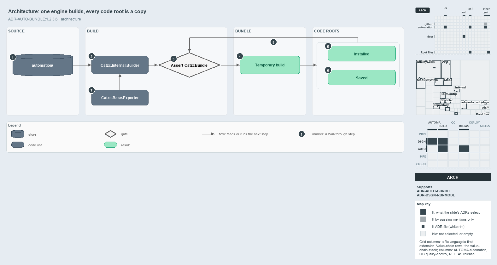

---
catzc:
  derived:
    path: docs/explanation/automation/every-code-root-is-a-copy.md
    kind: explanation
    language: markdown
    filekind: md
    track: docs
    body_sha: "746c77c76a50"
    adrs:
      - ADR-AUTO-BUNDLE#{1-3,6}
      - ADR-DSGN-RUNMODE#7
    links:
      - docs/.assets/explanation/adr-auto-bundle--every-code-root-is-a-copy--architecture.drawio.md
      - docs/.assets/explanation/adr-auto-bundle--every-code-root-is-a-copy--architecture.drawio.png
      - docs/adr/automation/platform-bundle.md
      - docs/adr/design/run-modes.md
      - docs/explanation/automation/build-then-place-with-one-command.md
      - docs/explanation/automation/build-verify-then-copy-the-folder.md
      - docs/explanation/automation/index.md
      - docs/explanation/automation/one-commit-one-immutable-package.md
      - docs/explanation/automation/what-gates-each-bundle-stage.md
      - docs/explanation/index.md#how-to-read-the-diagrams
---

# One engine builds the bundle, and every code root is a copy of its output

```text
One engine builds the bundle, and every code root is a copy of its output.

1  automation/              the source tree, the engine's only input
2  Catzc.Internal.Builder   the .internal engine, Invoke-ModuleBuild, that writes the build
3  Assert-CatzcBundle       the integrity guard, owned by the exporter
4  Temporary build          the verified build under out/automation/build/Catzc/<version>/
5  Installed                Install-Catzc -Scope CurrentUser, the user's module folder
6  Saved                    Install-Catzc -Root <dir>, the build under <dir>/.vendor/
7  Catzc.Base.Exporter      the exporter module that drives the engine and owns the lifecycle
8  Checked again            Install-Catzc runs the guard before it copies

Supports ADR-AUTO-BUNDLE#1, #2, #3 and #6, and ADR-DSGN-RUNMODE#7 (architecture lens).
```

Cats runs from a code root: the folder its modules load from. In the repository that root is the source tree itself, but a bundle carries
the code anywhere else, so the platform has to be built and then copied. Seen as components, the bundle has a clear shape. One `.internal`
engine writes the build from the source tree, the exporter module drives the engine and owns the integrity guard, and every code root
outside the repository is a copy of the one verified build.



The diagram is described element by element in
[its asset description](../../.assets/explanation/adr-auto-bundle--every-code-root-is-a-copy--architecture.drawio.md).

## Walkthrough

1. **automation/.** The source tree under the working root is the only input. The engine asserts that it runs in the source tree and refuses
   to run anywhere else.
2. **Catzc.Internal.Builder.** The `.internal` engine, `Invoke-ModuleBuild`, does the writing: the closure over the declared dependencies,
   the merged function files, the manifests, the types DLL, the vendor and `.internal` copies, and `build.json`.
3. **Assert-CatzcBundle.** The integrity guard checks what the engine wrote and throws with every violation it finds. It belongs to the
   exporter, not to the engine.
4. **Temporary build.** The verified build lands under `out/automation/build/Catzc/<version>/`. It is the package every placement copies.
5. **Installed.** `Install-Catzc -Scope CurrentUser` copies the build into the user's own PowerShell module folder, so `Import-Module Catzc`
   loads it from any shell.
6. **Saved.** `Install-Catzc -Root <dir>`, which `Export-Catzc -Root` calls after building, copies the build into `<dir>/.vendor/Catzc/` and
   writes a root `importer.ps1` beside it. That folder becomes the working root, and the copy becomes the code root.
7. **Catzc.Base.Exporter.** The exporter module owns the lifecycle. `Build-Modules` loads the engine on demand and calls it by name, which
   keeps the engine off the static function-dependency graph; the same module verifies the build and places it.
8. **Checked again before placement.** `Install-Catzc` runs the integrity guard on the build it is about to copy, before it touches the
   destination, and skips the copy when the destination already holds the same content hash.

## Why it holds

- The bundle is the toolset's build, owned by `Catzc.Base.Exporter`, built through the `Invoke-ModuleBuild` engine, verified by
  `Assert-CatzcBundle`, and placed by `Install-Catzc` and `Export-Catzc` (ADR-AUTO-BUNDLE#1).
- The working root and the code root are two anchors. In the repository they coincide; an install makes them differ, which is what lets the
  code be carried out of the repository (ADR-AUTO-BUNDLE#2).
- Every copy loads through the one living importer in its bundle mode, never through a forked loader (ADR-AUTO-BUNDLE#3).
- An install is two artifacts in two places, verified before the destination is touched, and idempotent (ADR-AUTO-BUNDLE#6).

A NuGet package, packed by `Export-Catzc -To nuget`, is a distribution file and not a code root until it is installed or saved, so it is not
drawn here.

## Where the code and the ADR differ

- ADR-DSGN-RUNMODE#7 names a fourth code root, a cached build kept outside the repository and reused per commit. No code makes one.
- ADR-AUTO-BUNDLE#6 calls the `-Root` placement an install, where ADR-DSGN-RUNMODE#7 calls the same root saved.

## See also

- [Platform bundle](../../adr/automation/platform-bundle.md) — the decision this article explains.
- [Run modes](../../adr/design/run-modes.md) — the four kinds of build root.
- The other lenses on the same bundle: [meta](one-commit-one-immutable-package.md), [implementation](build-verify-then-copy-the-folder.md),
  [operations](build-then-place-with-one-command.md) and [governance](what-gates-each-bundle-stage.md).
- [The automation explanations](index.md) · [How to read the diagrams](../index.md#how-to-read-the-diagrams)
