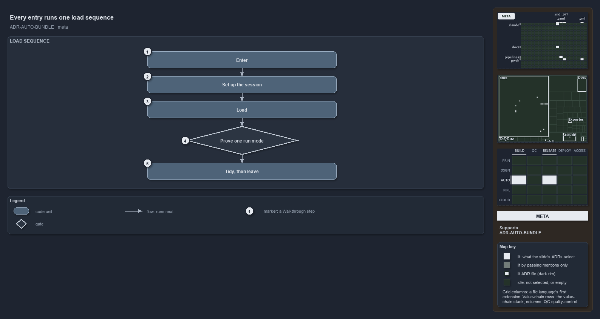

# Every entry runs one load sequence

```text
Whatever the entry point, cats loads through the same five stages in the same order.

1  Enter                 a dot-sourced entry script hands over to the one importer
2  Set up the session    version floor, fail-fast preferences, the working root and the code root
3  Load                  shared code, third-party modules, C# types, then every module
4  Prove one run mode    a check: no module from the other run mode survives the load
5  Tidy, then leave      the janitors run unless skipped, then the import-time helpers go

Supports ADR-AUTO-BUNDLE-ONELIVINGIMPORTER and ADR-AUTO-BUNDLE-BUNDLEISSESSION (meta lens).
```

Cats loads through the same five stages in the same order, whatever the entry point: enter, set up the session, load, prove one run mode,
then tidy up and leave. There is one living importer, never a forked copy, so a session loaded from the repository and a session loaded from
a build are set up the same way.



## Walkthrough

1. **Enter.** A dot-sourced entry script hands over to the one importer. There are two entry scripts, one per run mode, and both end in the
   same importer call.
2. **Set up the session.** The importer checks the PowerShell version, sets the fail-fast preferences, and sets the working root and the
   code root. A loaded session is a session, not a passive library: it sets the global error and warning preferences in both modes.
3. **Load.** Shared code loads first, then the third-party modules, then the C# types, then every module. The types and their accelerators
   register before any module loads.
4. **Prove one run mode.** This stage is a check. Every loaded module must come from the active run mode: the other mode is cleared during
   the load, and its absence is proved after it. A module left over from the other mode stops the load.
5. **Tidy, then leave.** The janitors run, unless they are skipped, and build mode always skips them. Then the import-time helpers remove
   themselves.

Whatever the entry point, the load runs the same steps in the same order, and the two run modes never coexist in one session.

## Why it holds

- A bundle loads by running the one living importer, never a forked bootstrap, which reproduces the exact tested load sequence
  (ADR-AUTO-BUNDLE-ONELIVINGIMPORTER).
- A bundle is a session, not a passive library: loading it sets the global error and warning preferences exactly as the source importer does
  (ADR-AUTO-BUNDLE-BUNDLEISSESSION).
- The two run modes never coexist in one session (DDR-RUNMODE-NEVERCOEXIST).

## See also

- [Platform bundle](../../drs/automation/platform-bundle.md) — the decision this article explains.
- The other lenses on the same load sequence: [architecture](two-entries-feed-one-importer.md),
  [implementation](invoke-importer-in-code-order.md), [operations](dot-source-one-entry-script.md) and
  [governance](rule-and-gate-per-load-stage.md).
- [The automation explanations](index.md) · [How to read the diagrams](../index.md#how-to-read-the-diagrams)
