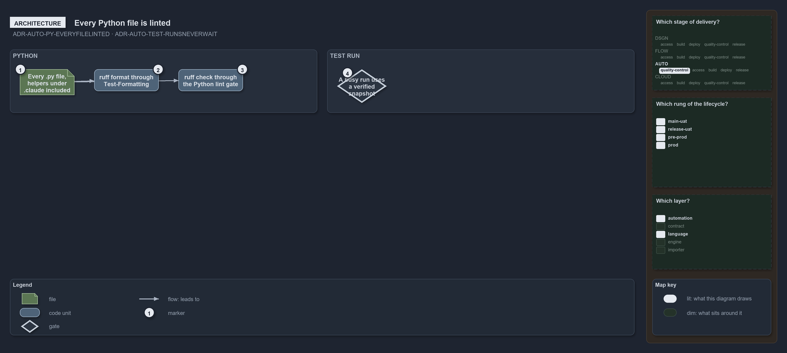

---
catzc:
  warning: "Experimental: this article merges two rules into one and holds nothing beyond what they say"
  edges:
    cites:
      - ADR-AUTO-PY-EVERYFILELINTED
      - ADR-AUTO-TEST-RUNSNEVERWAIT
---

# Every python file is linted and a busy test run uses a snapshot

This article is one rule:
[ADR-AUTO-PY-EVERYFILELINTED](../../drs/automation/python/python-test-artifacts.md#rule-adr-auto-py-everyfilelinted) and
[ADR-AUTO-TEST-RUNSNEVERWAIT](../../drs/automation/test-automation.md#rule-adr-auto-test-runsneverwait) merged into one. It holds nothing
beyond what those two rules say.

Every `.py` file the repository holds, the Python tests and the agent helpers under `.claude/` alike, takes the repository's checks where a
check reads Python, with the pinned ruff and the workspace's settings. A test run never waits for another: the first run owns the working
folder and a run that starts while another holds it runs in a verified snapshot.

