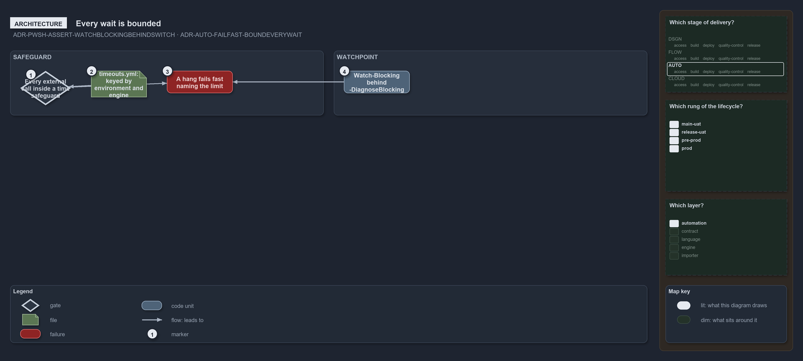

---
catzc:
  warning: "Experimental: this article merges two rules into one and holds nothing beyond what they say"
  edges:
    cites:
      - ADR-PWSH-ASSERT-WATCHBLOCKINGBEHINDSWITCH
      - ADR-AUTO-FAILFAST-BOUNDEVERYWAIT
---

# Every wait is bounded and a blocking watchpoint sits behind a switch

This article is one rule:
[ADR-PWSH-ASSERT-WATCHBLOCKINGBEHINDSWITCH](../../drs/automation/pwsh/assert-idioms.md#rule-adr-pwsh-assert-watchblockingbehindswitch) and
[ADR-AUTO-FAILFAST-BOUNDEVERYWAIT](../../drs/automation/fail-fast-with-asserts.md#rule-adr-auto-failfast-boundeverywait) merged into one. It
holds nothing beyond what those two rules say.

Bound every wait: every external call and every unbounded piece of work runs inside a time safeguard, so a hang fails fast with a message
naming the limit, the limits living in one config, `timeouts.yml`. In pwsh the watchpoint is a `Watch-Blocking` call behind the entry's
`-DiagnoseBlocking` switch, writing its ticks and one closing `Write-Message -Warning` line.

