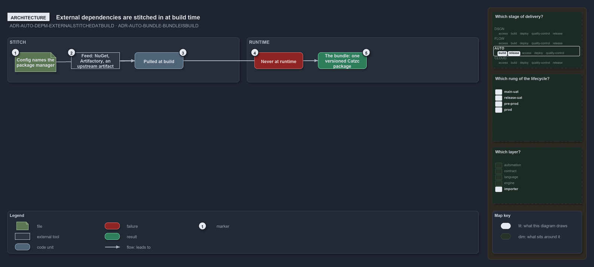

---
catzc:
  warning: "Experimental: this article merges two rules into one and holds nothing beyond what they say"
  edges:
    cites:
      - ADR-AUTO-DEPM-EXTERNALSTITCHEDATBUILD
      - ADR-AUTO-BUNDLE-BUNDLEISBUILD
---

# External dependencies are stitched in at build time and a bundle is the toolsets build

This article is one rule:
[ADR-AUTO-DEPM-EXTERNALSTITCHEDATBUILD](../../drs/automation/controlling-module-dependencies.md#rule-adr-auto-depm-externalstitchedatbuild)
and [ADR-AUTO-BUNDLE-BUNDLEISBUILD](../../drs/automation/platform-bundle.md#rule-adr-auto-bundle-bundleisbuild) merged into one. It holds
nothing beyond what those two rules say.

External module dependencies are stitched in at build time by the package manager named in config: a capability not worth reimplementing and
not appropriate to vendor is pulled, at build and never at runtime, from its feed. The result is the bundle, the toolset's build: one
installable, versioned `Catzc` package of one named bundle, built by `Build-Modules` from the bundle's profile.

