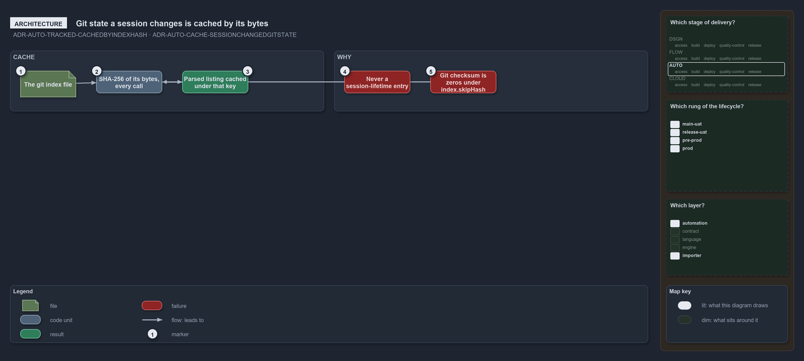

---
catzc:
  warning: "Experimental: this article merges two rules into one and holds nothing beyond what they say"
  edges:
    cites:
      - ADR-AUTO-TRACKED-CACHEDBYINDEXHASH
      - ADR-AUTO-CACHE-SESSIONCHANGEDGITSTATE
---

# Git state a session changes is cached only under a key computed from its bytes

This article is one rule:
[ADR-AUTO-TRACKED-CACHEDBYINDEXHASH](../../drs/automation/tracked-files-from-the-index.md#rule-adr-auto-tracked-cachedbyindexhash) and
[ADR-AUTO-CACHE-SESSIONCHANGEDGITSTATE](../../drs/automation/caching.md#rule-adr-auto-cache-sessionchangedgitstate) merged into one. It
holds nothing beyond what those two rules say.

Git state that a session itself changes, such as the tracked-file set a `git add` or a commit rewrites, is cached only under a key computed
from its bytes on disk on every call, never under a session-lifetime entry. `Get-GitTrackedPath` is the exemplar: it reads the index
in-process and keys the parsed listing on the SHA-256 of the index file's bytes, computed by the seam and not taken from git's own checksum,
which git writes as zeros under `index.skipHash`.

