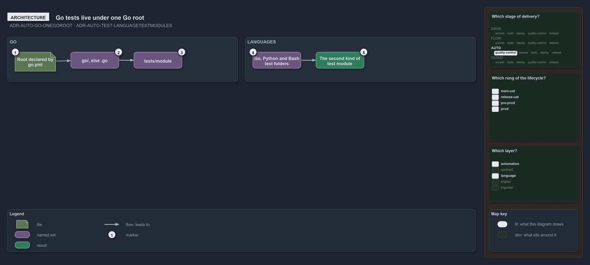

---
catzc:
  warning: "Experimental: this article merges two rules into one and holds nothing beyond what they say"
  edges:
    cites:
      - ADR-AUTO-GO-ONEGOROOT
      - ADR-AUTO-TEST-LANGUAGETESTMODULES
---

# Go tests live under one go root and each language has test modules

This article is one rule: [ADR-AUTO-GO-ONEGOROOT](../../drs/automation/go/go-test-artifacts.md#rule-adr-auto-go-onegoroot) and
[ADR-AUTO-TEST-LANGUAGETESTMODULES](../../drs/automation/test-automation.md#rule-adr-auto-test-languagetestmodules) merged into one. It
holds nothing beyond what those two rules say.

The Go tests live under one Go root, a repository-relative folder declared by `go.yml`'s `root`, `go` when the repository has a `go/`
folder, else the dot-prefixed `.go`; a Go test module is the folder `<root>/tests/<module>/`, one per catzc module. A Go test module, a
Python test folder and a Bash test folder are the second kind of test module, each kept under its language's root.

