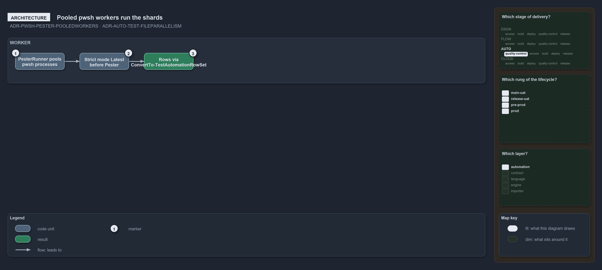

---
catzc:
  warning: "Experimental: this article merges two rules into one and holds nothing beyond what they say"
  edges:
    cites:
      - ADR-PWSH-PESTER-POOLEDWORKERS
      - ADR-AUTO-TEST-FILEPARALLELISM
---

# Harness workers are pooled pwsh processes and a run shards whole files

This article is one rule: [ADR-PWSH-PESTER-POOLEDWORKERS](../../drs/automation/pwsh/pester-testing.md#rule-adr-pwsh-pester-pooledworkers)
and [ADR-AUTO-TEST-FILEPARALLELISM](../../drs/automation/test-automation.md#rule-adr-auto-test-fileparallelism) merged into one. It holds
nothing beyond what those two rules say.

The harness workers are `pwsh` processes, pooled by the `PesterRunner` type: each dot-sources its entry script, sets
`Set-StrictMode -Version Latest` before it invokes Pester, runs its shard and reduces its live Pester result to rows with
`ConvertTo-TestAutomationRowSet`. `Test-Automation` parallelizes at whole-file granularity across them, the run's test files sharded across
workers with pooled live output.

