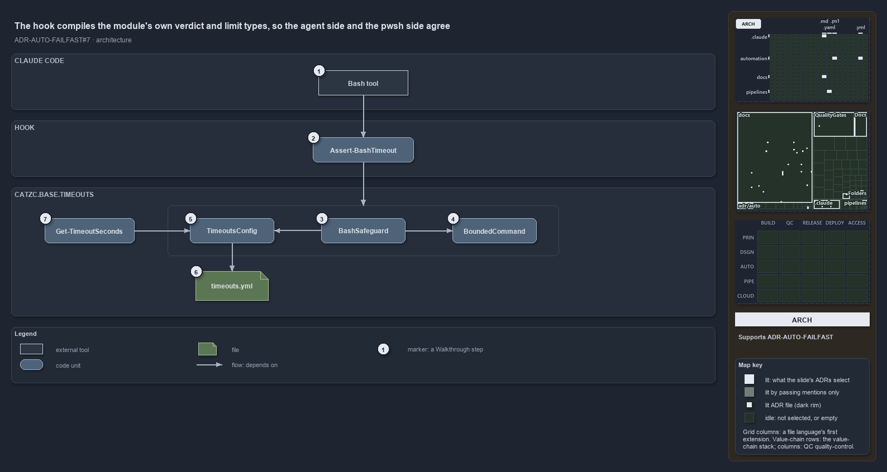

---
catzc:
  immutable:
    repo_status: clean
    path: docs/explanation/automation/hook-compiles-module-verdict-and-limits.md
    folder: docs/explanation/automation
    name: hook-compiles-module-verdict-and-limits
    filetype: md
    kind: explanation
    language: markdown
    track: docs
    tracktype: documentation
  edges:
    cites:
      - ADR-AUTO-FAILFAST#7
    links:
      - docs/adr/automation/fail-fast-with-asserts.md
      - docs/explanation/.assets/adr-auto-failfast--hook-compiles-module-verdict-and-limits--architecture.drawio.png
      - docs/explanation/automation/a-shell-call-carries-its-limit-or-is-denied.md
      - docs/explanation/automation/decide-returns-null-or-a-reason.md
      - docs/explanation/automation/hook-compiles-module-verdict-and-limits.drawio.md
      - docs/explanation/automation/index.md
      - docs/explanation/automation/pass-the-limit-or-the-call-is-denied.md
      - docs/explanation/automation/three-tests-prove-the-hook.md
      - docs/explanation/index.md#how-to-read-the-diagrams
---

# The hook compiles the module's own verdict and limit types, so the agent side and the pwsh side agree

```text
The hook compiles the module's own verdict and limit types, so the agent side and the pwsh side agree.

1  Bash tool           Claude Code's shell tool; a PreToolUse hook runs before each of its calls
2  Assert-BashTimeout  the hook: a small compiled program that only does the I/O around the verdict
3  BashSafeguard       the verdict type of Catzc.Base.Timeouts, compiled into the hook from its source file
4  BoundedCommand      the type behind the background rule: a timeout prefix around one command
5  TimeoutsConfig      the typed limits, with the sensible defaults declared once
6  timeouts.yml        the one config the limits live in, keyed by run environment and shell
7  Get-TimeoutSeconds  the pwsh side, resolving its limits from the same TimeoutsConfig

Supports ADR-AUTO-FAILFAST#7 (architecture lens).
```

The time safeguard of cats has two consumers that must never disagree: the pwsh code that bounds its own work, and the hook that bounds a
coding agent's shell calls. They cannot share a process, because the hook runs before Claude Code hands a call to the shell, outside any
PowerShell session. They share the source instead. The hook's project compiles the `Catzc.Base.Timeouts` module's own types straight from
their files, so the limits it reads and the verdict it gives are the ones `Get-TimeoutSeconds` resolves and the module's tests check.



The diagram is described element by element in [its asset description](hook-compiles-module-verdict-and-limits.drawio.md).

## Walkthrough

1. **Bash tool.** Claude Code runs shell commands through its Bash tool. The repository's `.claude/settings.json` registers a `PreToolUse`
   hook on it, matching `Bash`, that executes the published hook program before every call and passes the call's payload on standard input.
2. **Assert-BashTimeout.** The hook is a compiled program under `.claude/hooks/Assert-BashTimeout/`, published to `.claude/hooks/bin/` by
   `Build-BashTimeoutHook` whenever its sources change; the importer runs that publish on every import at a devbox. It is compiled rather
   than scripted because it runs before every call and starts in about a third of the time a pwsh script does. The program itself only does
   the I/O: it loads the limits, reads the run environment, asks for the verdict, prints a denial and appends the log line.
3. **BashSafeguard.** The verdict is `BashSafeguard.Decide`, a type that lives in the module and is compiled into the hook from its source
   file. Its one job is to turn a call's payload, the limits and the run environment into either nothing or a reason to deny.
4. **BoundedCommand.** The background rule, that a call starts with a GNU `timeout` of at most the background limit around exactly one
   command, is `BoundedCommand.Check`. The same type states the rule in each execution engine's grammar, which is why it is its own type and
   not a private part of the verdict.
5. **TimeoutsConfig.** The limits are a typed record. The sensible defaults are declared once on the type, 3 s and 360 s at a devbox, 600 s
   and 3600 s in a pipeline, so an empty file, a fresh checkout and the hook all resolve the same numbers. Bash is the one shell with both a
   foreground and a background limit, because the hook governs the Bash tool only.
6. **timeouts.yml.** The one config the limits live in, owned by `Catzc.Base.Timeouts` and keyed by run environment and shell. The file
   states only what has been tuned; today it tunes per-executable limits and leaves the shell limits at their defaults.
7. **Get-TimeoutSeconds.** The pwsh side resolves a limit through the same `TimeoutsConfig`, loaded by `Get-Config`. Because the hook and
   the function share one parser and one set of defaults, an integrity test can prove the hook allows exactly the limit the function
   resolves and denies one unit more.

## Why it holds

- The limits live in one config, `timeouts.yml`, owned by `Catzc.Base.Timeouts`, with sensible defaults declared on its config type, and the
  bash limits bound every shell call an agent makes (ADR-AUTO-FAILFAST#7).
- The hook compiles the module's own config and verdict types, so its limits and decisions are the ones `Get-TimeoutSeconds` resolves and
  the L0 tests check, and an integrity test runs the published hook against the shipped config to prove it (ADR-AUTO-FAILFAST#7).

## Where the code and the ADR differ

- The ADR says the run environment is read through `Get-RunEnvironment`. The hook has no PowerShell session, so it decides devbox or
  pipeline itself with `BashSafeguard.EnvironmentOf`, a second copy of the one pipeline-detection test; an L0 test checks the two agree.
- The hook carries pipeline limits and a pipeline escalation, but the importer never publishes the hook in a pipeline, so in a pipeline it
  is absent.
- The hook reads `timeouts.yml` with its own YAML loader, while the file's header says it is loaded by `Get-Config`.

## See also

- [Fail fast with inline assertions](../../adr/automation/fail-fast-with-asserts.md) — the decision this article explains.
- The other lenses on the same verdict: [meta](a-shell-call-carries-its-limit-or-is-denied.md),
  [implementation](decide-returns-null-or-a-reason.md), [operations](pass-the-limit-or-the-call-is-denied.md) and
  [governance](three-tests-prove-the-hook.md).
- [The automation explanations](index.md) · [How to read the diagrams](../index.md#how-to-read-the-diagrams)
