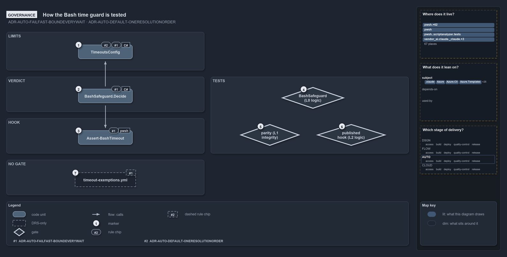

# How the Bash time guard is tested

```text
How the Bash time guard is tested.

1  TimeoutsConfig             the limits, validated at load, defaults declared once (ADR-AUTO-FAILFAST-BOUNDEVERYWAIT,
                              ADR-AUTO-DEFAULT-ONERESOLUTIONORDER)
2  BashSafeguard.Decide       the verdict that applies the bash limits to a call (ADR-AUTO-FAILFAST-BOUNDEVERYWAIT)
3  Assert-BashTimeout         the hook that denies a call outside them (ADR-AUTO-FAILFAST-BOUNDEVERYWAIT)
4  BashSafeguard (L0 logic)   the verdict against fixture limits: every rule, actor and wording
5  parity (L1 integrity)      the published hook against the shipped config, against Get-TimeoutSeconds
6  published hook (L2 logic)  the published program end to end: allow, deny, log, and deny on its own error
7  timeout-exemptions.yml     a budget exemption raises a limit; a Bash call carries no budget and takes none

Supports ADR-AUTO-FAILFAST-BOUNDEVERYWAIT and ADR-AUTO-DEFAULT-ONERESOLUTIONORDER (governance lens).
```

One rule governs the whole path of an agent's shell call through cats: every wait is bounded, the limits live in one config, and a hook
denies a call outside them. A second rule fixes where the defaults live. Three tests, one per tier, prove that the hook keeps to the rule as
published, not just as written. One route the rule offers, exempting slow work by its budget GUID, has no code behind it for a Bash call.

```yml drawio
description:
  "One rule bounds every agent call: the limits, the verdict and the hook follow it, three tests at three tiers prove the hook, and the
  exemption route has no gate because it exists only in the record."
about:
  rules: [ADR-AUTO-FAILFAST-BOUNDEVERYWAIT, ADR-AUTO-DEFAULT-ONERESOLUTIONORDER]
  lens: governance
content:
  title: How the Bash time guard is tested
  kind: explanation
  flow: left-to-right
  theme: dark
  bands:
    - { id: band-limits, label: LIMITS }
    - { id: band-verdict, label: VERDICT }
    - { id: band-hook, label: HOOK }
    - { id: band-no-gate, label: NO GATE }
    - { id: band-tests, label: TESTS }
  glyphs:
    - { id: g-config, kind: code, label: TimeoutsConfig, in: band-limits }
    - { id: g-decide, kind: code, label: BashSafeguard.Decide, in: band-verdict }
    - { id: g-hook, kind: code, label: Assert-BashTimeout, in: band-hook }
    - { id: a-exemptions, kind: drsonly, label: timeout-exemptions.yml, in: band-no-gate }
    - { id: g-logic, kind: gate, label: BashSafeguard (L0 logic), in: band-tests }
    - { id: g-parity, kind: gate, label: parity (L1 integrity), in: band-tests }
    - { id: g-published, kind: gate, label: published hook (L2 logic), in: band-tests }
  edges:
    - { from: g-decide, to: g-config, kind: flow, label: calls }
    - { from: g-decide, to: g-hook, kind: flow, label: calls }
  markers:
    - { at: g-config, number: 1 }
    - { at: g-decide, number: 2 }
    - { at: g-hook, number: 3 }
    - { at: g-logic, number: 4 }
    - { at: g-parity, number: 5 }
    - { at: g-published, number: 6 }
    - { at: a-exemptions, number: 7 }
  chips:
    - { at: g-config, kind: rule, rule: ADR-AUTO-FAILFAST-BOUNDEVERYWAIT }
    - { at: g-config, kind: rule, rule: ADR-AUTO-DEFAULT-ONERESOLUTIONORDER }
    - { at: g-decide, kind: rule, rule: ADR-AUTO-FAILFAST-BOUNDEVERYWAIT }
    - { at: g-hook, kind: rule, rule: ADR-AUTO-FAILFAST-BOUNDEVERYWAIT }
    - { at: a-exemptions, kind: rule, rule: ADR-AUTO-FAILFAST-BOUNDEVERYWAIT, gated: false }
  legend: auto
  minimaps: [code-locations, module-neighbourhood, axis]
layout:
  band-limits: { x: 20, y: 84, w: 620, h: 120 }
  band-verdict: { x: 20, y: 224, w: 620, h: 110 }
  band-hook: { x: 20, y: 354, w: 620, h: 110 }
  band-no-gate: { x: 20, y: 484, w: 620, h: 110 }
  band-tests: { x: 660, y: 224, w: 620, h: 240 }
  g-config: { x: 245, y: 124, w: 170, h: 44 }
  g-decide: { x: 245, y: 262, w: 170, h: 44 }
  g-hook: { x: 245, y: 392, w: 170, h: 44 }
  a-exemptions: { x: 235, y: 524, w: 190, h: 44 }
  g-logic: { x: 880, y: 256, w: 200, h: 68 }
  g-parity: { x: 750, y: 372, w: 190, h: 68 }
  g-published: { x: 990, y: 372, w: 220, h: 68 }
```



## Walkthrough

1. **TimeoutsConfig.** The limits are keyed by run environment and shell, every value is a positive whole number of seconds, and there is no
   "no limit" value; constructing the type validates all of that and throws once with every violation. The sensible defaults are declared on
   the type, once, so the file states only what has been tuned.
2. **BashSafeguard.Decide.** The verdict applies the bash limits to one call: a foreground timeout within the foreground limit, or a
   `timeout` prefix within the background limit around one command. It is the module's own type, so it is governed and tested where the
   limits are.
3. **Assert-BashTimeout.** The hook compiles that verdict and those limits in, and denies a call outside them with a reason. It never
   rewrites a call.
4. **BashSafeguard (L0 logic).** The verdict's own tests run `Decide` against fixture limits, 7 s and 70 s at a devbox, 60 s and 600 s in a
   pipeline, and cover the run environment, every foreground and background case, who is asked to act on a denial, the denial output and the
   log line.
5. **Parity (L1 integrity).** An integrity test publishes the hook and runs it against the shipped `timeouts.yml`: it must allow exactly the
   foreground limit `Get-TimeoutSeconds -Shell Bash` resolves and deny one millisecond more, and allow exactly the background limit and deny
   one second more.
6. **Published hook (L2 logic).** A test publishes the program against a fixture repository and drives it end to end: an allowed foreground
   and background call, a denied background call that is also logged, a denied foreground call naming the limit, and a payload the hook
   cannot read, which the hook denies, naming the failure.
7. **timeout-exemptions.yml.** The rule offers one route for work that must run longer while it is tuned: an immutable budget GUID, exempted
   in `timeout-exemptions.yml`, raises its limit to a ceiling. The pwsh side applies that in `Get-TimeoutSeconds`. A Bash call carries no
   budget, so the rule gives an agent's shell call no exemption; it goes to the background or gets a `timeouts.yml` entry.

## Why it holds

- Every wait runs inside a time safeguard; the limits live in one config, `timeouts.yml`, keyed by run environment and execution engine,
  with no "no limit" value; the bash limits bound every shell call an agent makes and a hook denies a call outside them; and the hook
  compiles the module's own config and verdict types, proven by an integrity test against the shipped config
  (ADR-AUTO-FAILFAST-BOUNDEVERYWAIT).
- A setting resolves in one fixed order, and its sensible default is declared once on the config type (ADR-AUTO-DEFAULT-ONERESOLUTIONORDER).

## Where the code and the decision record differ

The record says the run environment comes from `Get-RunEnvironment`. The hook decides it with `BashSafeguard.EnvironmentOf`; an L0 test
keeps the two in agreement.

## See also

- [Fail fast with inline assertions](../../drs/automation/fail-fast-with-asserts.md) — the decision this article explains.
- [Sensible defaults](../../drs/automation/sensible-defaults.md) — the resolution order of a setting, ADR-AUTO-DEFAULT-ONERESOLUTIONORDER.
- The other lenses on the same verdict: [meta](how-the-hook-treats-a-shell-calls-limit.md),
  [architecture](how-the-hook-and-pwsh-share-one-verdict.md), [implementation](how-the-bash-time-guard-decides.md) and
  [operations](when-the-hook-denies-a-call.md).
- [The automation explanations](index.md) · [How to read the diagrams](../index.md#how-to-read-the-diagrams)
