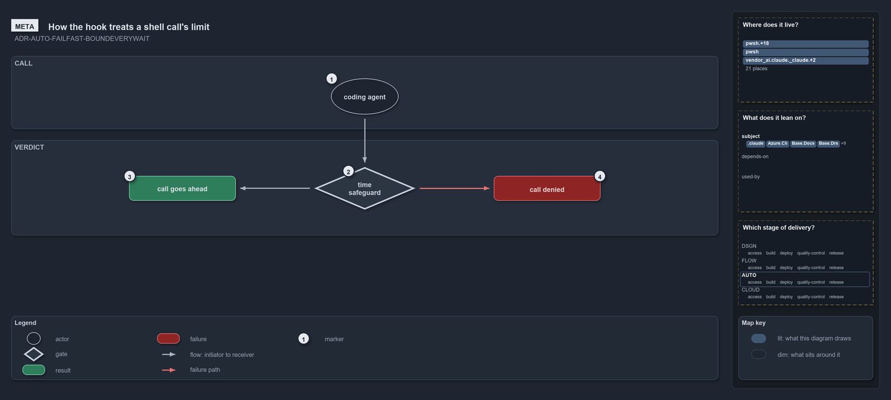

# How the hook treats a shell call's limit

```text
How the hook treats a shell call's limit.

1  coding agent     who makes the call: the main session, a subagent, or an agent in a pipeline
2  time safeguard   the check run before every call: does the call carry a limit inside the bounds?
3  call goes ahead  the call carries its limit; the hook says nothing and the normal permission flow runs
4  call denied      the call does not; the hook denies it and says how to re-issue it

Supports ADR-AUTO-FAILFAST-BOUNDEVERYWAIT (meta lens).
```

A coding agent working in cats runs shell commands all day, and each one is a wait like any other: a command that hangs holds the agent
until a person notices. The domain rules bound every wait, so an agent's shell call is bounded too. The idea is the smallest possible one: a
call either carries its own limit, within the limits cats configures, or it does not run. There is no third verdict. The hook never rewrites
a call into a bounded one, because a hook that rewrites must also approve, and an approval skips the permission prompt that every other
safeguard relies on.

```yml drawio
description:
  "A coding agent's shell call meets the time safeguard first: a call that carries its limit goes ahead untouched, and one that does not is
  denied with the reason, never rewritten."
about:
  rules: [ADR-AUTO-FAILFAST-BOUNDEVERYWAIT]
  lens: meta
content:
  title: How the hook treats a shell call's limit
  kind: explanation
  flow: top-to-bottom
  theme: dark
  bands:
    - { id: band-call, label: CALL }
    - { id: band-verdict, label: VERDICT }
  glyphs:
    - { id: g-agent, kind: actor, label: coding agent, in: band-call }
    - { id: g-safeguard, kind: gate, label: time safeguard, in: band-verdict }
    - { id: r-ahead, kind: result, label: call goes ahead, in: band-verdict }
    - { id: f-denied, kind: failure, label: call denied, in: band-verdict }
  edges:
    - { from: g-agent, to: g-safeguard, kind: flow, label: "" }
    - { from: g-safeguard, to: r-ahead, kind: flow, label: "" }
    - { from: g-safeguard, to: f-denied, kind: fail, label: "" }
  markers:
    - { at: g-agent, number: 1 }
    - { at: g-safeguard, number: 2 }
    - { at: r-ahead, number: 3 }
    - { at: f-denied, number: 4 }
  legend: auto
  minimaps: [code-locations, module-neighbourhood, axis]
layout:
  band-call: { x: 20, y: 84, w: 1260, h: 130 }
  band-verdict: { x: 20, y: 234, w: 1260, h: 170 }
  g-agent: { x: 590, y: 124, w: 120, h: 64 }
  g-safeguard: { x: 560, y: 282, w: 180, h: 76 }
  r-ahead: { x: 230, y: 298, w: 190, h: 44 }
  f-denied: { x: 880, y: 298, w: 190, h: 44 }
```



## Walkthrough

1. **Coding agent.** The caller is an AI coding agent: the main session at a devbox, a subagent it launched, or an agent running inside a
   pipeline. Every shell call it makes goes through the same check, whoever asks.
2. **Time safeguard.** Before the call runs, the safeguard asks one question: does this call carry a limit inside the configured bounds? A
   foreground call carries it as its own timeout; a background call carries it as a `timeout` prefix around one command, because the tool
   that runs background work does not apply its timeout there.
3. **Call goes ahead.** When the answer is yes, the safeguard says nothing. The call then meets the ordinary permission flow exactly as if
   the safeguard did not exist; an allowed call is never pre-approved.
4. **Call denied.** When the answer is no, the call is denied with a reason that names the limit it broke and the form to re-issue it in,
   and the denial is recorded as a blocker to tune. Who asked changes only what the reason says: the main session raises the blocker with
   the user, a subagent reports it to its coordinator, and a pipeline fixes the call or its limit.

## Why it holds

- Every wait is bounded, and an agent's shell call is a wait: the bash limits bound every shell call an agent makes, in the foreground and
  the background, and a hook denies a call outside them (ADR-AUTO-FAILFAST-BOUNDEVERYWAIT).
- The limits live in one config with no "no limit" value, so a call that needs longer is a blocker to tune, never a limit raised quietly in
  a call (ADR-AUTO-FAILFAST-BOUNDEVERYWAIT).
- The hook denies and never rewrites, so a denial leaves every other safeguard in force (ADR-AUTO-FAILFAST-BOUNDEVERYWAIT).

## See also

- [Fail fast with inline assertions](../../drs/automation/fail-fast-with-asserts.md) — the decision this article explains.
- The other lenses on the same verdict: [architecture](how-the-hook-and-pwsh-share-one-verdict.md),
  [implementation](how-the-bash-time-guard-decides.md), [operations](when-the-hook-denies-a-call.md) and
  [governance](how-the-bash-time-guard-is-tested.md).
- [The automation explanations](index.md) · [How to read the diagrams](../index.md#how-to-read-the-diagrams)
