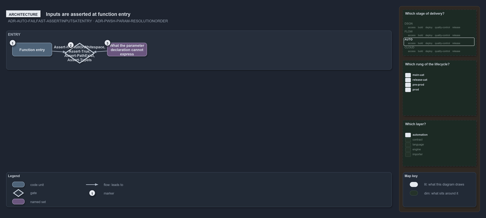

---
catzc:
  warning: "Experimental: this article merges two rules into one and holds nothing beyond what they say"
  edges:
    cites:
      - ADR-AUTO-FAILFAST-ASSERTINPUTSATENTRY
      - ADR-PWSH-PARAM-RESOLUTIONORDER
---

# Inputs are asserted at entry and a parameter default reads the configured value

This article is one rule:
[ADR-AUTO-FAILFAST-ASSERTINPUTSATENTRY](../../drs/automation/fail-fast-with-asserts.md#rule-adr-auto-failfast-assertinputsatentry) and
[ADR-PWSH-PARAM-RESOLUTIONORDER](../../drs/automation/pwsh/parameter-design.md#rule-adr-pwsh-param-resolutionorder) merged into one. It
holds nothing beyond what those two rules say.

Assert inputs at function entry: before a function uses a value it receives, it validates that value through the toolset's assertion
library, `Assert-NotNullOrWhitespace`, `Assert-True`, `Assert-PathExist`, `Assert-TypeIs` and the other `Assert-*` functions, for everything
its parameter declaration cannot express. The resolution order of a setting is, in PowerShell, one parameter declaration whose default
expression reads the configured value.

