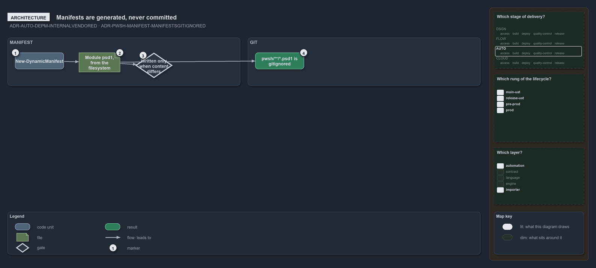

---
catzc:
  warning: "Experimental: this article merges two rules into one and holds nothing beyond what they say"
  edges:
    cites:
      - ADR-AUTO-DEPM-INTERNALVENDORED
      - ADR-PWSH-MANIFEST-MANIFESTSGITIGNORED
---

# Internal dependencies are vendored and generated manifests are gitignored

This article is one rule:
[ADR-AUTO-DEPM-INTERNALVENDORED](../../drs/automation/controlling-module-dependencies.md#rule-adr-auto-depm-internalvendored) and
[ADR-PWSH-MANIFEST-MANIFESTSGITIGNORED](../../drs/automation/pwsh/dynamic-module-manifests.md#rule-adr-pwsh-manifest-manifestsgitignored)
merged into one. It holds nothing beyond what those two rules say.

Internal module dependencies are vendored and named: the code is in-tree, the toolset's own modules and third-party modules vendored under
`pwsh/.vendor/`, with every edge declared by name in `dependencies.yml`, so the repository alone is the internal dependency set. Generated
manifests are the counterpart that never gets committed: `New-DynamicManifest` recomputes each module's `<Module>.psd1` on every import,
writing only when the content differs, so `pwsh/**/*.psd1` is gitignored.

