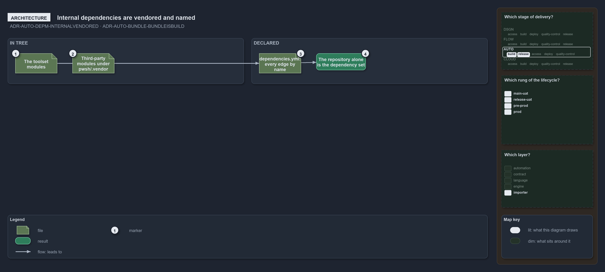

---
catzc:
  warning: "Experimental: this article merges two rules into one and holds nothing beyond what they say"
  edges:
    cites:
      - ADR-AUTO-DEPM-INTERNALVENDORED
      - ADR-AUTO-BUNDLE-BUNDLEISBUILD
---

# Internal dependencies are vendored and named and a bundle is the toolsets build

This article is one rule:
[ADR-AUTO-DEPM-INTERNALVENDORED](../../drs/automation/controlling-module-dependencies.md#rule-adr-auto-depm-internalvendored) and
[ADR-AUTO-BUNDLE-BUNDLEISBUILD](../../drs/automation/platform-bundle.md#rule-adr-auto-bundle-bundleisbuild) merged into one. It holds
nothing beyond what those two rules say.

Internal module dependencies are vendored and named: the code is in-tree, the toolset's own modules and third-party modules vendored under
`pwsh/.vendor/`, and every edge is declared by name in `dependencies.yml`, so the repository alone is the internal dependency set and there
is nothing to fetch. A bundle is the toolset's build: one installable, versioned `Catzc` package of one named bundle, built by
`Build-Modules` from the bundle's profile.

