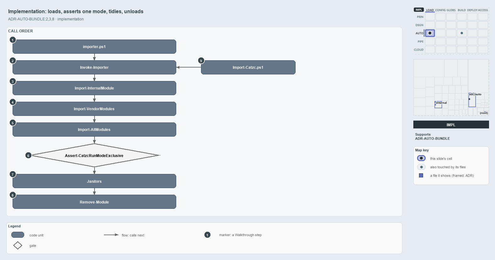

---
catzc:
  derived:
    path: docs/explanation/automation/invoke-importer-in-code-order.md
    kind: explanation
    body_sha: "3580a530afb4"
    adrs:
      - ADR-AUTO-BUNDLE#2
      - ADR-AUTO-BUNDLE#3
      - ADR-AUTO-BUNDLE#8
    links:
      - docs/.assets/explanation/adr-auto-bundle--invoke-importer-in-code-order--implementation.drawio.md
      - docs/.assets/explanation/adr-auto-bundle--invoke-importer-in-code-order--implementation.drawio.png
      - docs/adr/automation/platform-bundle.md
      - docs/explanation/automation/dot-source-one-entry-script.md
      - docs/explanation/automation/every-entry-runs-one-load-sequence.md
      - docs/explanation/automation/index.md
      - docs/explanation/automation/rule-and-gate-per-load-stage.md
      - docs/explanation/automation/two-entries-feed-one-importer.md
      - docs/explanation/index.md#how-to-read-the-diagrams
---

# Invoke-Importer loads, asserts one run mode, tidies up and unloads, in one call chain

```text
Invoke-Importer loads, asserts one run mode, tidies up and unloads, in one call chain.

1  importer.ps1                    the source-mode shim, which delegates to Invoke-Importer
2  Invoke-Importer                 version floor, preferences, the code root
3  Import-InternalModule           Bootstrap, Types and Vendor, then the error view
4  Import-VendorModules            the vendored modules, two of them lazy
5  Import-AllModules               name check, eviction, C# types, then every module
6  Assert-CatzcRunModeExclusive    throws when a module from another root is loaded
7  Janitors                        eleven calls, each skipped under -SkipJanitors
8  Remove-Module                   removes the Bootstrap; the entry removes the importer
9  Import-Catzc.ps1                the build-mode entry, which calls Invoke-Importer -Bundle

Supports ADR-AUTO-BUNDLE#2, #3 and #8 (implementation lens).
```

The whole cats load is one call chain inside `Invoke-Importer`, in `automation/.internal/Catzc.Internal.Importer.psm1`. It loads the
internal modules, the vendored modules and every catzc module, proves that only one run mode is loaded, runs the janitors, and removes its
own Bootstrap. Both entry scripts end in this one function, so this order is the load order in both run modes.



The diagram is described element by element in
[its asset description](../../.assets/explanation/adr-auto-bundle--invoke-importer-in-code-order--implementation.drawio.md).

## Walkthrough

1. **importer.ps1.** The source-mode shim turns on `Set-StrictMode -Version Latest`, sets `$env:RepositoryRoot` to its own folder, imports
   `Catzc.Internal.Loader.psm1` by path and the importer through `Import-InternalModule Importer -Force`, and calls
   `Invoke-Importer @PSBoundParameters`. Its `param()` block holds seven switches, `-ExportPrivates`, `-AllowWarnings`, `-DiagnoseLoadTime`,
   `-ClearCompiledTypes`, `-SkipJanitors`, `-CleanClone` and `-Bundle`, the same set as `Invoke-Importer`.
2. **Invoke-Importer.** It throws below PowerShell 7.4, sets `$global:ErrorActionPreference` to `Stop` and `$global:WarningPreference` to
   `Stop` unless `-AllowWarnings`, makes a redirected session write UTF-8, and sets `$env:CatzcModulesRoot`. Under `-Bundle` it sets
   `$SkipJanitors`.
3. **Import-InternalModule.** It imports `Bootstrap`, `Types` and `Vendor`, each with `-Force`. In source mode, when the process already
   holds C# types whose sources have changed and a person is importing at their own console, `Invoke-StaleTypesRestart` continues the import
   in a new `pwsh` in the same window, and this call returns. Otherwise the custom error view is prepended with `Update-FormatData`, and the
   importer writes its Session and Roots lines.
4. **Import-VendorModules.** It loads the vendored modules from `<CatzcModulesRoot>/.vendor`, with Pester and PSScriptAnalyzer lazy. Under
   `-ClearCompiledTypes`, `Clear-CompiledType` deletes the compiled DLLs next.
5. **Import-AllModules.** This Bootstrap function checks every function name with `Assert-UniqueModuleFunctionName`, removes stale modules,
   evicts the other run mode's modules, and calls `Import-CSharpTypes -PrebuiltOnly:$Bundle`. Then, per module, it calls
   `New-DynamicManifest -ReadOnly:$Bundle` and `Import-Module -Scope Global -Force`.
6. **Assert-CatzcRunModeExclusive.** It asks `Get-ForeignCatzcModule -IncludeInternal` for any catzc module loaded from another root, and
   throws naming every one it finds.
7. **Janitors.** Eleven calls run in this order, each guarded by `-not $SkipJanitors`: `Reset-GitCleanFxd` (only with `-CleanClone`),
   `Invoke-TypeCacheJanitor`, `Build-AdrIndex` and `Build-Glossary`, `Build-Readme`, `Build-GitKeep`, `Build-TerminologyDictionary`,
   `Build-RootConfig`, `Sync-SessionTools`, `Invoke-AgentHookJanitor`, and `Sync-GeneratedFile` (not for a `Pipeline` actor). Then, on
   Windows only, the importer warns when `PSModulePath` holds a network share.
8. **Remove-Module.** It removes `Catzc.Internal.Bootstrap`, and a console session then prints its load line. The entry script's `finally`
   block removes `Catzc.Internal.Importer`.
9. **Import-Catzc.ps1.** The build-mode entry sets `$env:CatzcModulesRoot = $PSScriptRoot`, loads its own Loader and importer, and calls
   `Invoke-Importer -Bundle -AllowWarnings:$AllowWarnings`. Under `-Bundle`, `New-DynamicManifest -ReadOnly` reads the prebuilt manifests
   and throws when one is missing.

## Why it holds

- The working root and the code root are set separately, and the code root drives discovery (ADR-AUTO-BUNDLE#2).
- A bundle runs the same `Invoke-Importer`, so the types load before any module in both modes (ADR-AUTO-BUNDLE#3).
- Loading sets the global error and warning preferences, because a bundle is a session, not a library (ADR-AUTO-BUNDLE#8).

## Where the code and the ADR differ

The code and the ADR agree on this sequence; two comments in `Catzc.Internal.Importer.psm1` lag behind the code. The comment on
`-SkipJanitors` names four janitors, while the switch skips all eleven calls and the network-share check. The help block written for
`Write-LoadTimeSummary` sits above `Invoke-TypeCacheJanitor`, which therefore carries two help blocks while `Write-LoadTimeSummary` has
none.

## See also

- [Platform bundle](../../adr/automation/platform-bundle.md) — the decision this article explains.
- The other lenses on the same load sequence: [meta](every-entry-runs-one-load-sequence.md),
  [architecture](two-entries-feed-one-importer.md), [operations](dot-source-one-entry-script.md) and
  [governance](rule-and-gate-per-load-stage.md).
- [The automation explanations](index.md) · [How to read the diagrams](../index.md#how-to-read-the-diagrams)
