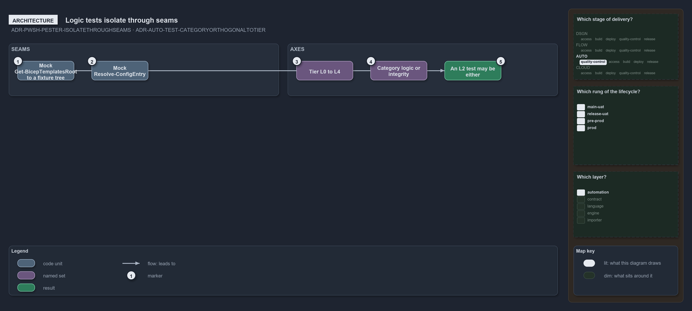

---
catzc:
  warning: "Experimental: this article merges two rules into one and holds nothing beyond what they say"
  edges:
    cites:
      - ADR-PWSH-PESTER-ISOLATETHROUGHSEAMS
      - ADR-AUTO-TEST-CATEGORYORTHOGONALTOTIER
---

# Logic tests isolate through seams and category is orthogonal to tier

This article is one rule:
[ADR-PWSH-PESTER-ISOLATETHROUGHSEAMS](../../drs/automation/pwsh/pester-testing.md#rule-adr-pwsh-pester-isolatethroughseams) and
[ADR-AUTO-TEST-CATEGORYORTHOGONALTOTIER](../../drs/automation/test-automation.md#rule-adr-auto-test-categoryorthogonaltotier) merged into
one. It holds nothing beyond what those two rules say.

Logic tests are isolated through the seams: in `BeforeEach`, mock `Get-BicepTemplatesRoot` to a fixture template tree, and isolate config by
mocking the discovery seam `Resolve-ConfigEntry`. The category, logic or integrity, is orthogonal to the L0 to L4 tier, so an L2 test may be
either; pure-logic tests use fixtures via the seams, and tests that deliberately read the shipped assets to verify real templates are
legitimate.

