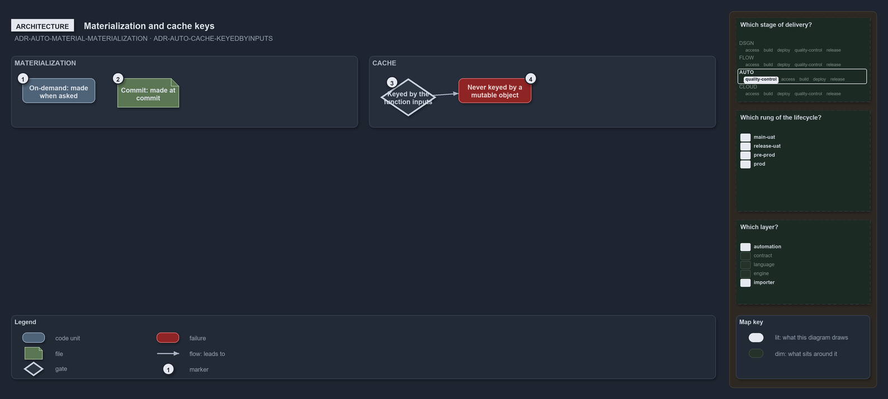

---
catzc:
  warning: "Experimental: this article merges two rules into one and holds nothing beyond what they say"
  edges:
    cites:
      - ADR-AUTO-MATERIAL-MATERIALIZATION
      - ADR-AUTO-CACHE-KEYEDBYINPUTS
---

# Materialization names when a resource exists and a cache is keyed by inputs

This article is one rule:
[ADR-AUTO-MATERIAL-MATERIALIZATION](../../drs/automation/materialization.md#rule-adr-auto-material-materialization) and
[ADR-AUTO-CACHE-KEYEDBYINPUTS](../../drs/automation/caching.md#rule-adr-auto-cache-keyedbyinputs) merged into one. It holds nothing beyond
what those two rules say.

Materialization names when a knowledge resource comes into being and how long it holds, and it takes one of two values. An on-demand
resource is made when asked, a scan, a computation or a resolved config, and holds until the call ends or the session cache entry that holds
it is gone. A cache is keyed by the function's inputs: no parameters, a single cache entry; parameters, a cache keyed on them; and keys must
be session-stable values, never mutable objects.

