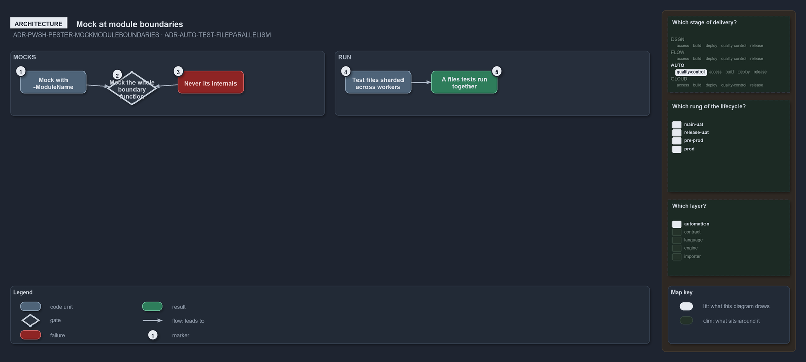

---
catzc:
  warning: "Experimental: this article merges two rules into one and holds nothing beyond what they say"
  edges:
    cites:
      - ADR-PWSH-PESTER-MOCKMODULEBOUNDARIES
      - ADR-AUTO-TEST-FILEPARALLELISM
---

# Mocks sit at module boundaries and a run parallelizes at whole file granularity

This article is one rule:
[ADR-PWSH-PESTER-MOCKMODULEBOUNDARIES](../../drs/automation/pwsh/pester-testing.md#rule-adr-pwsh-pester-mockmoduleboundaries) and
[ADR-AUTO-TEST-FILEPARALLELISM](../../drs/automation/test-automation.md#rule-adr-auto-test-fileparallelism) merged into one. It holds
nothing beyond what those two rules say.

Mock at module boundaries with `-ModuleName`, and mock the whole boundary function, never its internals: a cached function is varied by
mocking the function itself, because a warm cache ignores mocked dependencies. `Test-Automation` parallelizes at whole-file granularity
across worker processes, the run's test files sharded across workers, so a file's tests run together and never split.

