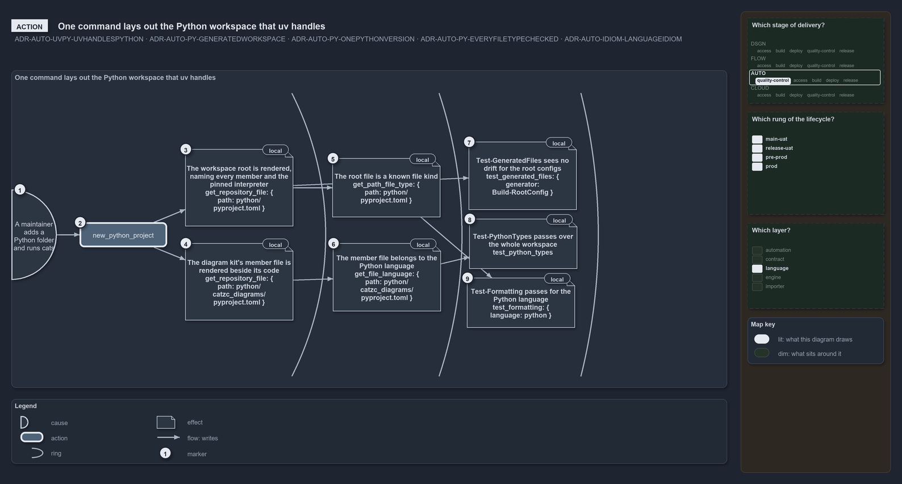

---
catzc:
  warning: "Header is generated by Format-FileMeta via Format-Code; do not change it"
  edges:
    cites:
      - ADR-AUTO-ACCOSTED-ARTICLERENDERING
      - ADR-AUTO-IDIOM-LANGUAGEIDIOM
      - ADR-AUTO-PY-GENERATEDWORKSPACE
      - ADR-AUTO-PY-ONEPYTHONVERSION
      - ADR-AUTO-PY-EVERYFILETYPECHECKED
      - ADR-AUTO-UVPY-UVHANDLESPYTHON
      - DDR-VISUAL-ACTIONISALENS
      - DDR-VISUAL-PROOFISTHEACCOSTEDFILE
    drs_total: 8
---

# One command lays out the Python workspace that uv handles

```text
A maintainer adds a Python folder and runs cats; one command renders the uv workspace, the tree classifies its files, and the gates hold.

1  A maintainer adds a Python folder and runs cats   the cause: a new Python folder needs its place in the workspace
2  new_python_project                                the action: one command, in the contract form
3  The workspace root                                zone 1, local: get_repository_file shows python/pyproject.toml
4  The kit's member file                             zone 1, local: get_repository_file shows python/catzc_diagrams/pyproject.toml
5  A known file kind                                 zone 2, local, after 3: get_path_file_type names the root file's kind
6  The Python language                               zone 2, local, after 4: get_file_language puts the member's file in Python
7  The root-config drift check                        zone 3, local, after 3: test_generated_files sees no drift for Build-RootConfig
8  The Test-PythonTypes                                    zone 3, local, after 6: test_python_types passes over the workspace
9  The Test-Formatting                               zone 3, local, after 5: test_formatting passes for the Python language

Supports ADR-AUTO-UVPY-UVHANDLESPYTHON, ADR-AUTO-PY-GENERATEDWORKSPACE, ADR-AUTO-PY-ONEPYTHONVERSION, ADR-AUTO-PY-EVERYFILETYPECHECKED and ADR-AUTO-IDIOM-LANGUAGEIDIOM (action lens).
```

uv is the single handler for Python in this repository: it provisions the interpreter, pins it, and runs every Python tool. What uv needs
from the tree is a workspace, and nobody writes that by hand: the workspace is generated and gitignored, rendered from the languages
configuration by one command and written on every import, so the only Python the repository commits is the code itself. This diagram is that
command and the three zones its effects reach: the two files it renders, how the tree then classifies them and holds them to their source,
and the two Python quality gates that pass over the workspace they define.



## Walkthrough

1. **A maintainer adds a Python folder and runs cats.** The cause is a new Python folder under the one Python root, named in Python's own
   idiom ([ADR-AUTO-IDIOM-LANGUAGEIDIOM](../../drs/automation/idiomatic-names.md#rule-adr-auto-idiom-languageidiom)). It needs a member
   file, and the workspace root must name it.
2. **new_python_project.** The action is one command in the contract form; its one parameter, the target, defaults to every member. It
   renders the workspace files from the languages configuration, pure text and byte-stable, never from a file someone edits by hand
   ([ADR-AUTO-PY-GENERATEDWORKSPACE](../../drs/automation/python/python-test-artifacts.md#rule-adr-auto-py-generatedworkspace)).
3. **The workspace root.** The first zone holds what the command renders directly. `python/pyproject.toml` is the uv workspace: a virtual
   root naming every member explicitly, carrying the one Python version the tools pin
   ([ADR-AUTO-PY-ONEPYTHONVERSION](../../drs/automation/python/python-test-artifacts.md#rule-adr-auto-py-onepythonversion),
   [ADR-AUTO-UVPY-UVHANDLESPYTHON](../../drs/automation/uv-python-handler.md#rule-adr-auto-uvpy-uvhandlespython)).
4. **The kit's member file.** In the same zone, the same run renders a member file per Python folder; the diagram kit's own,
   `python/catzc_diagrams/pyproject.toml`, is the one shown. The two files are parallel effects of one run.
5. **A known file kind.** The second zone holds what the rendered files cause. A file in the tree is classified by the repository's file
   kinds, and `get_path_file_type` on the root file names its kind; this follows the root, so the edge comes from it.
6. **The Python language.** The member file belongs to the Python language, which is how every Python quality gate finds it:
   `get_file_language` on the path puts it there. It follows the member file.
7. **Test-GeneratedFiles for the root configs.** The rendered files are gitignored and written on every import by the root-config writer,
   and `test_generated_files` for that writer finds them in step with their source: a changed configuration without a re-render fails here.
   It follows the root and stands in zone 3 with the other gates, since a gate is what the classified files cause last.
8. **Test-PythonTypes.** The zone 3 holds what the classification causes: the gates run over what the Python language owns.
   `test_python_types` passes over the whole workspace
   ([ADR-AUTO-PY-EVERYFILETYPECHECKED](../../drs/automation/python/python-test-artifacts.md#rule-adr-auto-py-everyfiletypechecked)).
9. **Test-Formatting.** `test_formatting` for the Python language passes as well; it follows the kind the root file was given, since the
   formatter is chosen by language.

## The proof

The drawing never says what the proof does not run. The seven runs below are copied from the accosted file the diagram names, and each
observation on the drawing occurs in them verbatim
([DDR-VISUAL-PROOFISTHEACCOSTEDFILE](../../drs/design/visual-design.md#rule-ddr-visual-proofistheaccostedfile)).

```yml accosted
runs:
  - - get_repository_file: { path: python/pyproject.toml }
  - - get_repository_file: { path: python/catzc_diagrams/pyproject.toml }
  - - get_path_file_type: { path: python/pyproject.toml }
  - - get_file_language: { path: python/catzc_diagrams/pyproject.toml }
  - - test_generated_files: { generator: Build-RootConfig }
  - - test_python_types:
  - - test_formatting: { language: python }
```

The same runs in PowerShell, rendered from that file by `Get-AccostedFragment`, never written by hand
([ADR-AUTO-ACCOSTED-ARTICLERENDERING](../../drs/automation/accosted-language.md#rule-adr-auto-accosted-articlerendering)):

```powershell
Get-RepositoryFile -Path 'python/pyproject.toml'

Get-RepositoryFile -Path 'python/catzc_diagrams/pyproject.toml'

Get-PathFileType -Path 'python/pyproject.toml'

Get-FileLanguage -Path 'python/catzc_diagrams/pyproject.toml'

Test-GeneratedFiles -Generator 'Build-RootConfig'

Test-PythonTypes

Test-Formatting -Language 'python'
```

## Why it holds

- uv is the single handler for Python, so the workspace root is the one place the interpreter pin and the members are declared
  (ADR-AUTO-UVPY-UVHANDLESPYTHON, ADR-AUTO-PY-ONEPYTHONVERSION).
- The workspace is generated and gitignored, rendered from the languages configuration and drift-checked, so nothing Python-specific is
  committed but the code (ADR-AUTO-PY-GENERATEDWORKSPACE).
- Every Python file takes the repository's checks where it lands, so a file is under the gates the moment the tree classifies it
  (ADR-AUTO-PY-EVERYFILETYPECHECKED).
- A Python folder is named in Python's idiom, which is what makes it a member uv can import (ADR-AUTO-IDIOM-LANGUAGEIDIOM).
- Zone by zone the story goes forward: the files, then what the tree makes of them, then the gates over the classified set; no effect points
  back (DDR-VISUAL-ACTIONISALENS).

The gates prove the workspace is well-typed and well-formatted today; whether a member's code is right is its own tests' promise.

## See also

- [uv handles Python](../../drs/automation/uv-python-handler.md),
  [Python test artifacts](../../drs/automation/python/python-test-artifacts.md) and
  [idiomatic names](../../drs/automation/idiomatic-names.md) — the decisions this article explains.
- [Visual design](../../drs/design/visual-design.md) — how an action diagram is drawn.
- [The automation explanations](index.md) · [How to read the diagrams](../index.md#how-to-read-the-diagrams)
