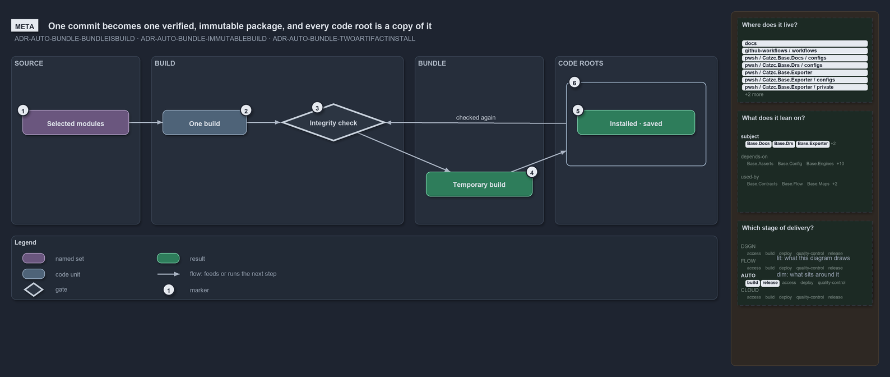

# How a commit becomes a package

```text
How a commit becomes a package.

1  Selected modules         the input: modules named or profiled, closure-expanded
2  One build                writes the runtime payload in merged form
3  Integrity check          recomputes the recorded content hash, collects every violation
4  Temporary build          one versioned package under out/, the same bytes per commit
5  Installed, saved         every other code root, a copy of the same package
6  Checked again            the integrity check runs on the package before a copy is placed

Supports ADR-AUTO-BUNDLE-ISBUILD, ADR-AUTO-BUNDLE-IMMUTABLEBUILD and ADR-AUTO-BUNDLE-TWOARTIFACTINSTALL (meta lens).
```

A bundle is how cats leaves the repository it is developed in: the selected modules are built once into one versioned package that loads
anywhere. The idea fits in one line. One build of one commit produces one package with one content hash, an integrity check proves the
package is what the build wrote, and every place the package is installed holds a copy of those same bytes.

```yml drawio
description:
  Selected modules are built once into one versioned package, an integrity check proves it, and every other code root is a copy of that
  package that is checked again before the copy is placed.
about:
  rules: [ADR-AUTO-BUNDLE-ISBUILD, ADR-AUTO-BUNDLE-IMMUTABLEBUILD, ADR-AUTO-BUNDLE-TWOARTIFACTINSTALL]
  lens: meta
content:
  title: How a commit becomes a package
  kind: explanation
  flow: left-to-right
  theme: dark
  bands:
    - { id: band-source, label: SOURCE }
    - { id: band-build, label: BUILD }
    - { id: band-bundle, label: BUNDLE }
    - { id: band-roots, label: CODE ROOTS }
  groups:
    - { id: grp-copies, label: " ", in: band-roots }
  glyphs:
    - { id: s-modules, kind: set, label: Selected modules, in: band-source }
    - { id: g-build, kind: code, label: One build, in: band-build }
    - { id: g-integrity, kind: gate, label: Integrity check, in: band-build }
    - { id: r-temporary, kind: result, label: Temporary build, in: band-bundle }
    - { id: r-installed, kind: result, label: Installed · saved, in: grp-copies }
  edges:
    - { from: g-build, to: s-modules, kind: flow, label: reads }
    - { from: g-build, to: g-integrity, kind: flow, label: "" }
    - { from: g-integrity, to: r-temporary, kind: flow, label: "" }
    - { from: r-temporary, to: grp-copies, kind: flow, label: "" }
    - { from: grp-copies, to: g-integrity, kind: flow, label: checked again }
  markers:
    - { at: s-modules, number: 1 }
    - { at: g-build, number: 2 }
    - { at: g-integrity, number: 3 }
    - { at: r-temporary, number: 4 }
    - { at: r-installed, number: 5 }
    - { at: grp-copies, number: 6 }
  legend: auto
  minimaps: [code-locations, module-neighbourhood, axis]
layout:
  band-source: { x: 20, y: 84, w: 230, h: 300 }
  band-build: { x: 270, y: 84, w: 450, h: 300 }
  band-bundle: { x: 740, y: 84, w: 230, h: 300 }
  band-roots: { x: 990, y: 84, w: 290, h: 300 }
  s-modules: { x: 40, y: 180, w: 190, h: 44 }
  g-build: { x: 290, y: 180, w: 150, h: 44 }
  g-integrity: { x: 500, y: 168, w: 190, h: 68 }
  r-temporary: { x: 760, y: 290, w: 190, h: 44 }
  grp-copies: { x: 1010, y: 130, w: 250, h: 150 }
  r-installed: { x: 1030, y: 180, w: 210, h: 44 }
```



## Walkthrough

1. **Selected modules.** The input is a set of modules, named explicitly, by a profile, or both. The set is closure-expanded, so every
   module a selected module depends on comes along.
2. **One build.** The build writes the runtime payload in merged form: one manifest and one merged function file per module, beside the
   loader, the vendored dependencies and the full types DLL. Tests never ship.
3. **Integrity check.** The check recomputes the content hash the build recorded and collects every violation before it fails. The build
   runs it on its own output, so a package that leaves the build has passed it.
4. **Temporary build.** The result is one versioned package under `out/`, the code root of build mode on a devbox. The same commit yields
   the same build and one content hash, so the package is immutable.
5. **Installed, saved.** Every other code root is a copy of the same package: installed into a module path, or saved into another root's
   `.vendor/`. The copy carries the same bytes and the same content hash.
6. **Checked again before placement.** Before a copy is placed, the integrity check runs once more on the package being copied, so a package
   that changed after its build is never installed or saved.

## Why it holds

- A bundle is one installable, versioned module built from a selected set of modules, closure-expanded over the declared dependencies, that
  loads outside the repository (ADR-AUTO-BUNDLE-ISBUILD).
- A build is immutable and content-addressed: the same commit yields a byte-identical build and an identical content hash, and the integrity
  guard re-verifies that hash (ADR-AUTO-BUNDLE-IMMUTABLEBUILD).
- An install verifies the source build before it touches the destination, and a re-install with a matching content hash does not copy again
  (ADR-AUTO-BUNDLE-TWOARTIFACTINSTALL).
- The build kinds say only where the code root lives, and every kind loads through the same importer (DDR-RUNMODE-THREEBUILDKINDS).

## See also

- [Platform bundle](../../drs/automation/platform-bundle.md) — the decision this article explains.
- [Run modes](../../drs/design/run-modes.md) — the build kinds.
- The other lenses on the same bundle: [architecture](every-code-root-is-a-copy.md), [implementation](build-verify-then-copy-the-folder.md),
  [operations](build-then-place-with-one-command.md) and [governance](what-gates-each-bundle-stage.md).
- [The automation explanations](index.md) · [How to read the diagrams](../index.md#how-to-read-the-diagrams)
