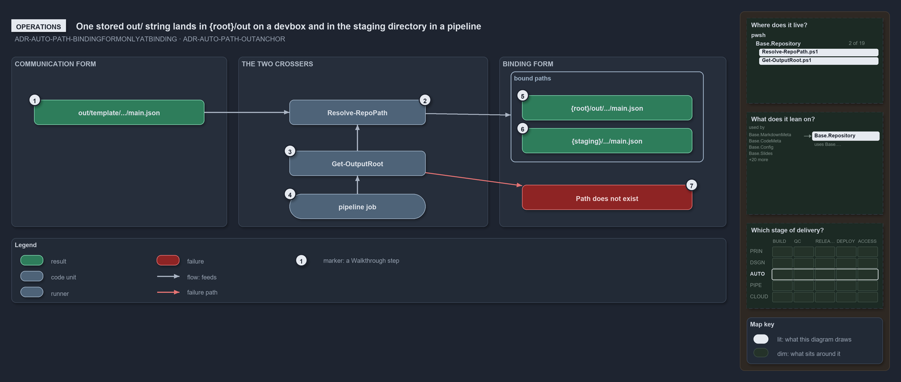

# One stored out/ string lands in {root}/out on a devbox and in the staging directory in a pipeline

```text
One stored out/ string resolves to {root}/out on a devbox and to the staging directory in a pipeline.

1  out/template/sample/main.json  the one stored string, the same on every machine
2  Resolve-RepoPath               the command that binds it: out/ is joined onto the output root
3  Get-OutputRoot                 the output root for this context
4  pipeline job                   sets TF_BUILD and BUILD_ARTIFACTSTAGINGDIRECTORY
5  {root}/out/.../main.json       what a devbox sees
6  {staging}/.../main.json        what a pipeline job sees
7  Path does not exist            the throw when the staging directory the variable names is missing

Supports ADR-AUTO-PATH-BINDINGFORMONLYATBINDING and ADR-AUTO-PATH-OUTANCHOR (operations lens).
```

An output artifact of cats is stored as one string, `out/template/sample/main.json`, wherever it is recorded. Whoever runs
`Resolve-RepoPath` on that string gets the right absolute path for the machine they are on: under `{root}/out` on a devbox, under the
staging directory in a pipeline job. Nobody edits the string, and nobody writes an absolute path into a record.



## Walkthrough

1. **out/template/sample/main.json.** The stored form of an output artifact. `ConvertTo-RepoRelativePath` wrote it, and it is identical on a
   workstation and on a build agent, so it can sit in a record, a config or a log line.
2. **Resolve-RepoPath.** The command to run immediately before the read, write or tool call:
   `Resolve-RepoPath 'out/template/sample/main.json'`. It sees the `out/` anchor, asks `Get-OutputRoot`, joins the remainder onto it and
   normalizes the result.
3. **Get-OutputRoot.** The output root for the current context: `BUILD_ARTIFACTSTAGINGDIRECTORY` when `Test-IsRunningInPipeline` is true and
   the variable is set, otherwise `{root}/out`. With `-EnsureExists` it creates the folder when it is missing.
4. **pipeline job.** An Azure DevOps agent sets `TF_BUILD` and a GitHub Actions runner sets `GITHUB_ACTIONS`, and either makes
   `Test-IsRunningInPipeline` true. Azure DevOps also sets `BUILD_ARTIFACTSTAGINGDIRECTORY`; a job without it falls back to `{root}/out`
   like a devbox.
5. **{root}/out/.../main.json.** On a devbox the command prints `{root}/out/template/sample/main.json`.
6. **{staging}/.../main.json.** In a pipeline job the same command prints `{staging}/template/sample/main.json`, inside the folder the agent
   will publish.
7. **Path does not exist.** When the variable names a folder that does not exist, `Get-OutputRoot` stops with `Path does not exist: <path>`
   before any remainder is joined onto it, so a wrong staging directory fails at once rather than producing a path to nowhere.

## Why it holds

- A path is in binding form only at the point of binding, resolved with `Resolve-RepoPath` immediately before the side effect
  (ADR-AUTO-PATH-BINDINGFORMONLYATBINDING).
- `out/` is a reserved anchor re-anchored against `Get-OutputRoot`, so the same stored string resolves to the right place on a devbox and in
  a pipeline (ADR-AUTO-PATH-OUTANCHOR).

A file that crosses from a build stage to a deploy stage is anchored differently, on its artifact root through `ArtifactRef`; nobody
operates that type today, because no production code calls it.

## See also

- [Path representation](../../adr/automation/path-representation.md) — the decision this article explains.
- The other views of the same boundary: [meta](two-forms-never-a-third.md), [architecture](two-crossers-and-three-anchors.md),
  [implementation](output-root-first-then-repo-root.md) and [governance](types-check-forms-review-checks-crossers.md).
- [The automation explanations](index.md) · [How to read the diagrams](../index.md#how-to-read-the-diagrams)
